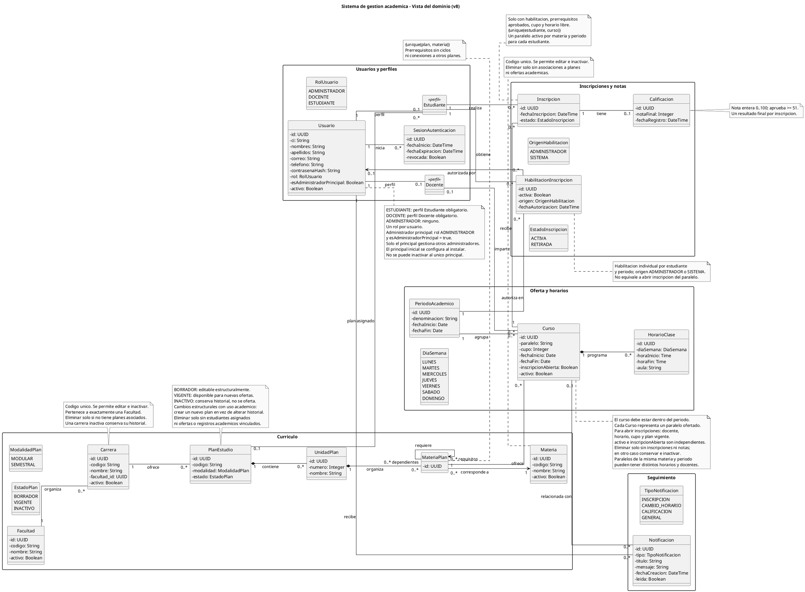
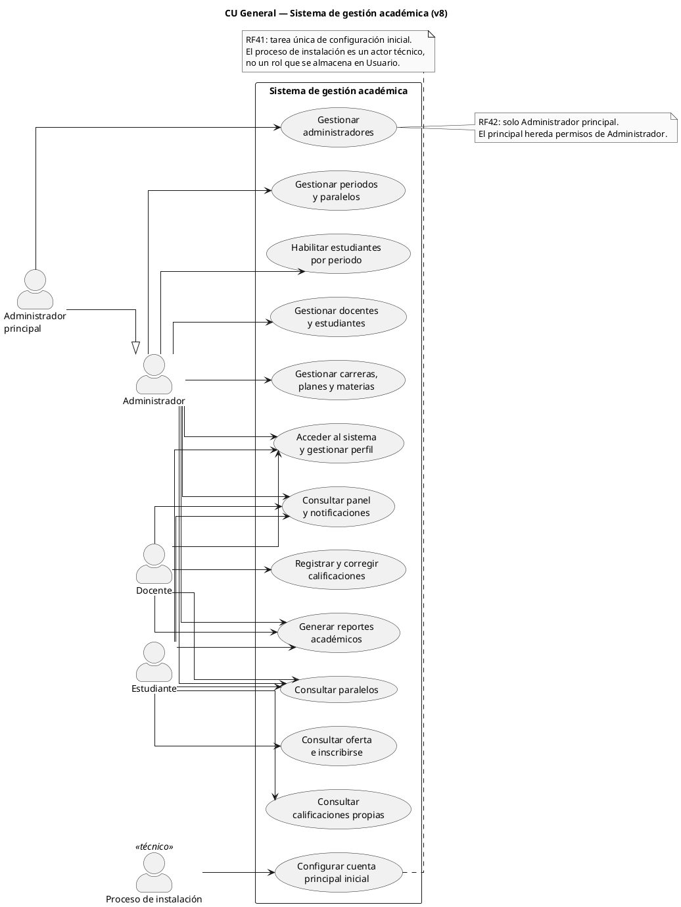
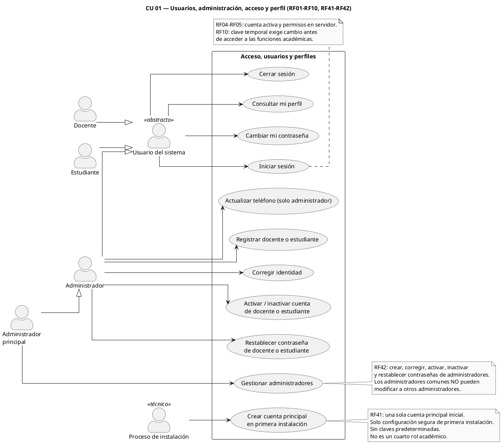
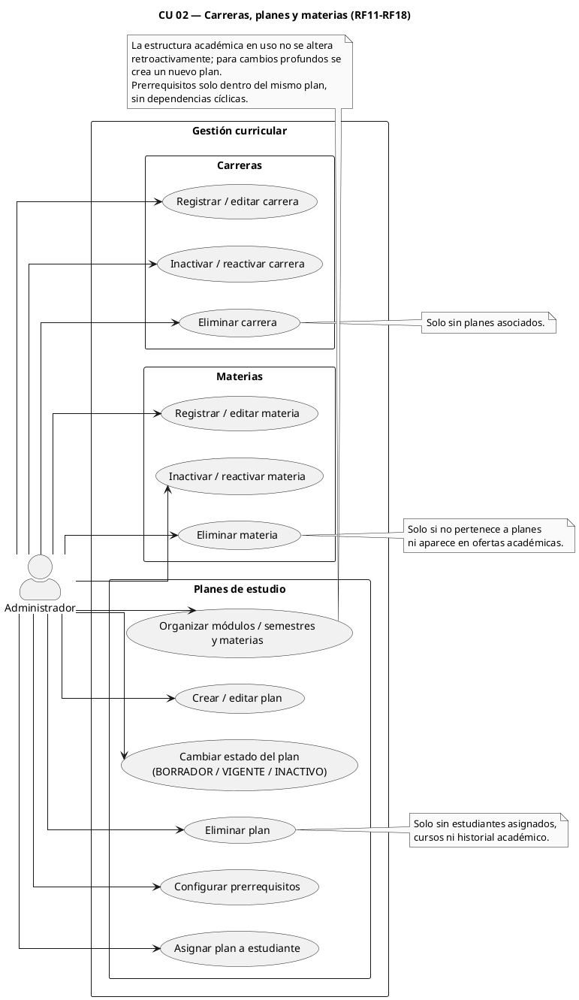
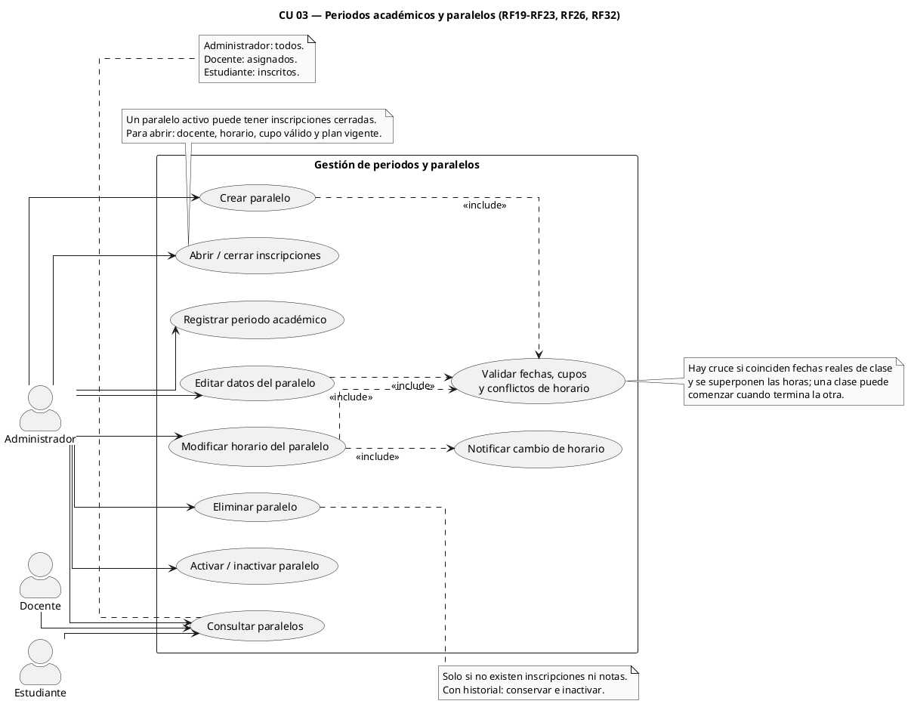
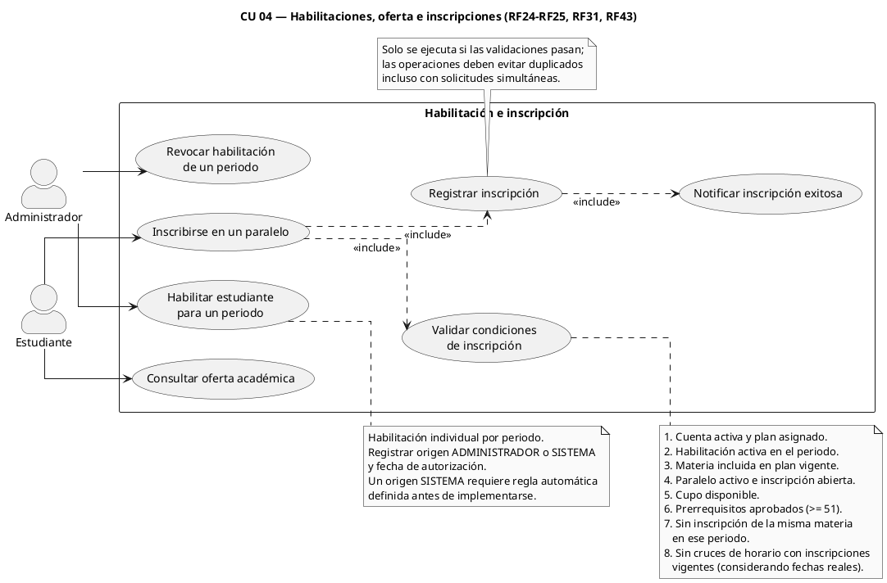
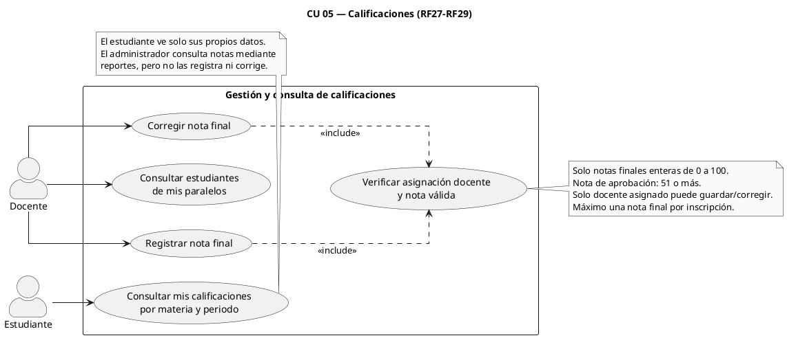
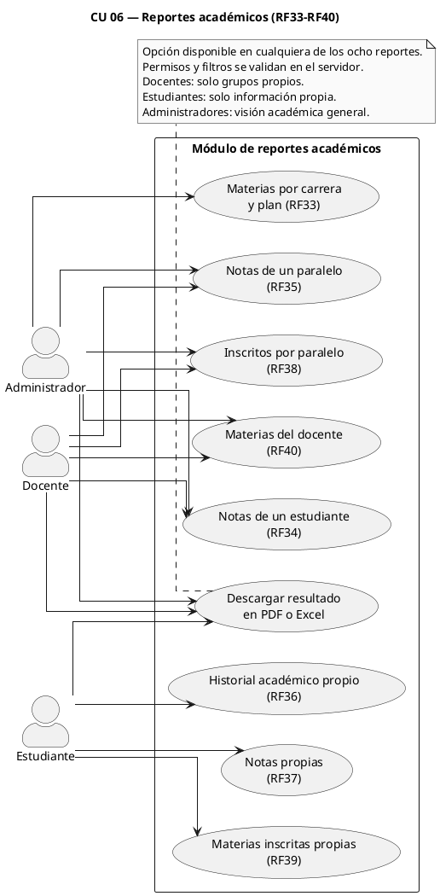
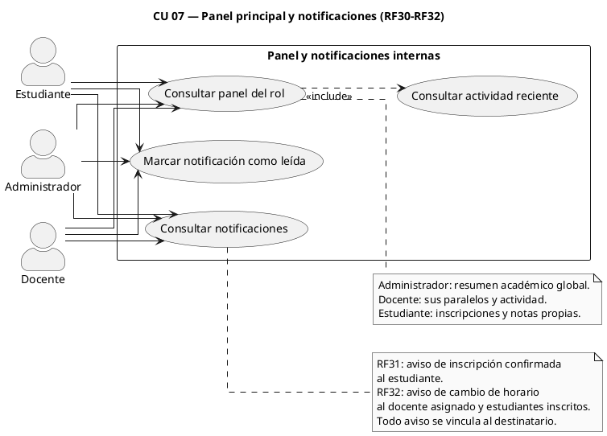

# Contexto completo del Sistema Web de Gestión Académica

**Proyecto:** Programación IV · Ingeniería de Sistemas · UPDS, Sub-sede La Paz.  
**Responsable identificado:** Oscar Brayan Pari Hidalgo. Equipo de tres integrantes; los otros nombres y la asignación definitiva siguen pendientes.  
**Versión documental:** Documento Maestro v1.0, línea funcional y dominio v8.  
**Fecha de esta instantánea:** 17 de noviembre de 2026.  
**Estado:** documento maestro de requisitos, diseño y planificación; el estado real de implementación se mantiene en `CAMBIOS_PARA_INFORME.md`.

**Estado de desarrollo del repositorio (17-11-2026):** las Fases 1–6 están
implementadas y la Fase 7 está en curso. Las pruebas T01–T43 siguen siendo
criterios previstos; los resultados reales se registran en
`CAMBIOS_PARA_INFORME.md`.

**Documento maestro editable:** [Google Docs](https://docs.google.com/document/d/1rquaIlAKKYSZd2U0IWFCM-4AZXUzwC5e8u9ZYA70QaA/edit).

## Cómo utilizar este contexto

Este archivo conserva el contenido del documento maestro y las fuentes editables de los diagramas. Sus requisitos describen el sistema esperado; el estado de implementación se anota en `CAMBIOS_PARA_INFORME.md`. Las pruebas T01–T43 son previstas, las puntuaciones de calidad están sin evaluar y las rutas de pantallas son propuestas.

Antes de actuar:

1. Identificar la tarea concreta solicitada por el usuario y, si existe un repositorio, inspeccionar sus instrucciones y su estado real. No afirmar que existen archivos, endpoints, migraciones o pruebas que no se hayan comprobado.
2. Mantener los códigos RF01–RF43, RNF01–RNF08, HU01–HU29 y P01–P14. Conservar las funciones aprobadas y registrar explícitamente cualquier modificación propuesta.
3. Respetar la distinción entre decisiones funcionales vigentes, propuestas técnicas y asuntos pendientes. No resolver por cuenta propia los pendientes que cambien comportamiento académico, permisos o alcance.
4. Usar **Paralelo** en la interfaz. Conservar **Curso** como denominación del modelo de dominio; representa un paralelo ofertado de una materia en un periodo.
5. Mantener Administrador, Docente y Estudiante como únicos roles académicos. El principal es un Administrador con privilegios especiales; Instalación inicial y SISTEMA no son roles académicos adicionales.
6. Mantener el alcance exclusivamente académico: no agregar cobros, pagos ni facturación.
7. Conservar el modelo v8 como línea base; las ampliaciones confirmadas se registran en 14.7 antes de reflejarlas en el diseño. No rediseñar silenciosamente ni inventar actividades, secuencias, prototipos aprobados o resultados.
8. Contrastar la documentación con futuras modificaciones del proyecto. Esta es una instantánea y debe actualizarse cuando el usuario confirme cambios.

## Prioridad y estado de las fuentes

- **Rúbrica oficial:** determina los 14 apartados y el formato de la entrega académica.
- **Decisiones funcionales recientes y consolidación v8:** determinan el comportamiento y alcance de desarrollo.
- **modelo_dominio_academico_v8.puml:** referencia vigente del dominio; su código completo está incluido más abajo.
- **Casos_de_Uso_Academico_Estilo_Referencia.drawio:** referencia definitiva de los ocho diagramas de casos de uso; se incluyen el catálogo de nodos/relaciones y el XML completo.
- **casos_uso_academico_v8/*.puml:** fuentes complementarias. Si difieren del Draw.io definitivo, prevalece este último.
- **Documento maestro:** se exportó su contenido actual de Google Docs para esta instantánea. El índice automático y la paginación pertenecen al documento académico; en Markdown se utiliza la jerarquía de encabezados.

## Mapa de lectura para el agente

- Alcance, actores y reglas: apartado 3 del documento maestro.
- Tecnologías confirmadas y propuestas: apartado 4.
- Interfaz y permisos: apartado 5 y anexo 14.4.
- Arquitectura, patrones candidatos y dominio: apartado 6.
- Fases 0–7 y distribución propuesta del equipo: apartado 7.
- Calidad y pruebas previstas: apartados 8–9 y anexo 14.5.
- RF completos: anexo 14.1; RNF con verificación: 14.2; HU completas con aceptación: 14.3.
- Trazabilidad RF → HU → CU → clase/módulo → pantalla → prueba: 14.5.
- Diferencias entre versiones y decisiones pendientes: 14.7–14.8.
- Fuentes editables autocontenidas: secciones finales de este Markdown.

## Criterios que deben preservarse durante el desarrollo

- Confirmado: React con TypeScript, Python/FastAPI y PostgreSQL.
- Propuesto: monolito modular con frontend y backend separados; SQLAlchemy, Alembic y Pytest; Repository y Strategy como patrones candidatos.
- Cada inscripción depende de habilitación activa individual en el periodo y de la apertura del paralelo; son condiciones distintas.
- Nota final entera de 0 a 100, aprobación desde 51 y una sola nota final por inscripción.
- Cruces de horario basados en fechas reales de clase y superposición de horas. Clases consecutivas no se superponen.
- Control de permisos en backend y protección de datos por relación con el usuario; el administrador consulta notas y el docente asignado las escribe.
- La inactivación conserva historial; las eliminaciones físicas están condicionadas por dependencias.
- Los ocho reportes deben exportarse en PDF y Excel con los mismos límites de autorización.
- Siguen pendientes la automatización de habilitaciones, recuperación del principal, cierre de notas, diseño físico completo, contratos de API para fases posteriores y decisiones de entrega, según el anexo 14.8. La sesión técnica de acceso y las decisiones de currículo se encuentran definidas más abajo.

---

# Documento maestro completo

UNIVERSIDAD PRIVADA DOMINGO SAVIO

SUB-SEDE LA PAZ

*Referencia visual: consultar la figura correspondiente en Google Docs y las fuentes editables incluidas al final de este archivo.*

SISTEMA WEB DE GESTIÓN ACADÉMICA

DOCUMENTO MAESTRO DE ANÁLISIS, DISEÑO Y PLANIFICACIÓN DEL DESARROLLO

Versión 1.0 — 17 de noviembre de 2026

CARRERA: Ingeniería de Sistemas

MATERIA: Programación IV

TIPO DE INSTRUMENTO: Proyecto formativo

DOCENTE: Ph. D. Luigi Antequera Tamari

INTEGRANTES:

Oscar Brayan Pari Hidalgo

[Completar los demás integrantes]

LA PAZ – BOLIVIA

2026

Índice general

Documento Maestro v1.0 • 17 de noviembre de 2026. Estado: análisis, diseño y planificación; implementación no iniciada.

## 1 Introducción

### 1.1 Descripción general

El Sistema Web de Gestión Académica centraliza la planificación de una plataforma educativa para administrar usuarios, carreras, planes modulares y semestrales, materias, prerrequisitos, periodos, paralelos, habilitaciones, inscripciones y calificaciones. Contempla paneles por rol, notificaciones internas y ocho reportes exportables en PDF y Excel. Excluye cobros, pagos y facturación.

Este documento reúne la línea funcional v8, el modelo de dominio vigente y los casos de uso definitivos como referencia del equipo durante el desarrollo. La implementación todavía no ha comenzado: las estructuras de repositorio, rutas, patrones, etapas y pruebas se presentan como planificación. No se declaran resultados de pruebas, puntajes de calidad ni componentes implementados.

### 1.2 Contexto del problema

La consigna académica plantea una institución de educación superior que desea modernizar sus procesos y presenta interfaces poco intuitivas, errores frecuentes y dificultades para escalar la solución. El proyecto aborda ese escenario mediante información académica relacionada, validaciones en el servidor y permisos diferenciados. No se afirma haber realizado una auditoría o un levantamiento de campo en una institución concreta.

El flujo de referencia comienza con la preparación de carreras y planes, continúa con la oferta de paralelos y habilitación de estudiantes por periodo, y concluye con la inscripción, las calificaciones y la consulta de reportes. Las restricciones deben evitar duplicados, cupos excedidos, prerrequisitos incumplidos y cruces reales de horario.

### 1.3 Importancia y control documental

La documentación permite contrastar cada requisito con su historia, caso de uso, elemento de dominio, pantalla y prueba prevista. El control de estados y dependencias protege el historial académico y evita que cambios administrativos alteren información ya utilizada.

La rúbrica oficial determina los 14 apartados y el formato. Las decisiones funcionales v8 determinan el comportamiento; modelo_dominio_academico_v8.puml define el dominio y el Draw.io definitivo define los casos de uso. Los PlantUML de casos de uso son complementarios. Ante diferencias relevantes se conserva la fuente vigente y se registra la observación en el apartado 10 y en el anexo 14.7.

## 2 Objetivos del Proyecto

### 2.1 Objetivo general

Diseñar y desarrollar un sistema web de gestión académica con React, TypeScript, FastAPI y PostgreSQL que administre procesos modulares y semestrales, aplicando reglas académicas, permisos por rol, principios de interfaz, patrones de diseño y criterios de calidad para ofrecer una solución usable, segura y mantenible.

### 2.2 Objetivos específicos

Consolidar los 43 requisitos funcionales, 8 no funcionales y 29 historias de usuario con criterios de aceptación y trazabilidad.

Documentar el modelo de dominio v8 y los ocho diagramas de casos de uso, conservando sus fuentes editables.

Especificar las 14 pantallas principales, sus rutas propuestas, permisos, campos y validaciones.

Definir una arquitectura modular e implementar sus módulos de forma incremental, con dependencias y entregables verificables.

Preparar la aplicación de al menos dos patrones de diseño y las pruebas unitarias, funcionales y de integración.

Establecer una evaluación de calidad basada en ISO/IEC 25010 y registrar las decisiones pendientes antes de implementarlas.

## 3 Descripción del Sistema

### 3.1 Tipo alcance y terminología

La solución será una aplicación web cliente-servidor. React con TypeScript atenderá la interfaz, FastAPI expondrá la API y PostgreSQL almacenará los datos. El backend comprobará permisos y reglas de negocio en cada operación protegida; los controles visuales no sustituirán estas comprobaciones.

Materia es el elemento del catálogo. MateriaPlan es su incorporación a un plan y unidad. Curso es la denominación conservada del UML para una oferta concreta de MateriaPlan dentro de PeriodoAcademico, identificada por el atributo paralelo. En las pantallas y explicaciones operativas se utiliza Paralelo. Pueden coexistir varios paralelos de una materia en un periodo.

### 3.2 Usuarios y responsabilidades

Tabla 1. 3.2 Usuarios y responsabilidades

| Usuario | Responsabilidad y límites |
| --- | --- |
| Administrador | Gestiona docentes y estudiantes, estructura académica, periodos, paralelos y habilitaciones. Consulta información y reportes autorizados. No registra ni corrige notas y no gestiona cuentas de otros administradores. |
| Administrador principal | Es un Administrador con esAdministradorPrincipal = true, no un cuarto rol académico. Hereda permisos administrativos y gestiona otras cuentas administrativas. Se configura de forma única en la instalación y no se inactiva mediante la administración ordinaria. |
| Docente | Consulta paralelos asignados, registra y corrige sus notas y genera reportes restringidos a sus asignaciones. |
| Estudiante | Consulta oferta de su plan, solicita inscripción, revisa sus paralelos y calificaciones y exporta información propia. |
| Proceso de instalación | Participante técnico de RF41, no rol académico ni usuario adicional. Configura la cuenta principal inicial sin credenciales predeterminadas. |

### 3.3 Módulos y cobertura

Usuarios y acceso: RF01–RF10. La especificación completa se encuentra en 14.1 y las historias de usuario en 14.3.

Carreras planes y materias: RF11–RF18. La especificación completa se encuentra en 14.1 y las historias de usuario en 14.3.

Periodos y paralelos: RF19–RF23. La especificación completa se encuentra en 14.1 y las historias de usuario en 14.3.

Oferta e inscripciones: RF24–RF26. La especificación completa se encuentra en 14.1 y las historias de usuario en 14.3.

Calificaciones: RF27–RF29. La especificación completa se encuentra en 14.1 y las historias de usuario en 14.3.

Panel y notificaciones: RF30–RF32. La especificación completa se encuentra en 14.1 y las historias de usuario en 14.3.

Reportes académicos: RF33–RF40. La especificación completa se encuentra en 14.1 y las historias de usuario en 14.3.

Administración principal y habilitaciones: RF41–RF43. La especificación completa se encuentra en 14.1 y las historias de usuario en 14.3.

### 3.4 Reglas de negocio confirmadas

#### RN01 Usuarios y privilegios

Cada usuario tiene un solo rol académico. ESTUDIANTE exige perfil Estudiante y DOCENTE exige perfil Docente; ADMINISTRADOR no utiliza esos perfiles. El principal pertenece al rol ADMINISTRADOR y es el único que gestiona otras cuentas administrativas. Los administradores comunes no pueden autopromoverse. La instalación configura una única cuenta principal sin claves predefinidas y su cuenta no se deshabilita en la operación ordinaria.

#### RN02 Identidad y acceso

CI y correo son únicos y los campos obligatorios deben validarse. La autenticación requiere credenciales válidas y cuenta activa. Los permisos dependen del rol y de la relación con cada registro y se verifican en el servidor. El cierre debe revocar la sesión. Inactivar cuentas conserva inscripciones y notas e impide acceso según las restricciones de seguridad.

#### RN03 Perfil y contraseñas

Todos los roles pueden consultar su perfil. Docentes y estudiantes no pueden editar datos personales propios: solicitan correcciones a Administración Académica. El administrador puede actualizar su propio teléfono y corregir nombres, apellidos, CI y teléfono de docentes y estudiantes desde la gestión de usuarios; el correo no se edita. Las contraseñas nuevas tienen un mínimo de 8 y un máximo de 128 caracteres. Todos los roles deben cambiarlas en el primer ingreso; restablecer acceso establece una contraseña temporal y también obliga a cambiarla. El servidor limita las operaciones hasta completar el cambio; al guardar la contraseña nueva revoca las sesiones y exige autenticarse nuevamente. El cambio verifica la contraseña actual. El administrador común opera sobre docentes y estudiantes; el principal también sobre otros administradores.

#### RN04 Carreras

Se registran con código único y nombre. Pueden consultarse, editarse, inactivarse y reactivarse; la inactivación conserva historial. La eliminación física procede exclusivamente cuando no tienen planes asociados.

#### RN05 Materias

Se registran activas, con código único y nombre. Se permite editar, inactivar y reactivar sin destruir historial. Solo se eliminan si no pertenecen a planes ni tienen ofertas o cursos vinculados.

#### RN06 Planes y semestres

Cada plan pertenece a una carrera, tiene un código único en todo el sistema y utiliza modalidad MODULAR o SEMESTRAL. Todos los planes se organizan por semestres. La modalidad SEMESTRAL cursa en conjunto las materias del semestre; la modalidad MODULAR las distribuye en bloques mensuales, pero conserva su pertenencia al semestre del plan. La ubicación semestral organiza el currículo, pero no bloquea por sí sola la inscripción: el estudiante puede retomar materias pendientes o adelantar materias de semestres posteriores si hay una oferta habilitada y cumple sus prerrequisitos y demás condiciones. Los estados son BORRADOR, VIGENTE e INACTIVO. Solo BORRADOR admite edición estructural; al pasar a VIGENTE la estructura queda bloqueada y cualquier cambio requiere crear otro plan. VIGENTE se utiliza para nuevas ofertas e INACTIVO conserva historial y no se oferta.

#### RN07 Materias del plan y prerrequisitos

Una materia no se duplica dentro del mismo plan. Cada materia se asigna a un semestre del plan, cualquiera sea la modalidad. Los prerrequisitos relacionan MateriaPlan del mismo plan; no admiten autorreferencias, ciclos directos o indirectos ni conexiones a otros planes. Para cursar una materia con prerrequisitos, se deben aprobar todos con nota final de 51 o más en un periodo académico anterior al de la nueva inscripción. Aprobar el prerrequisito en un bloque modular no habilita la materia dependiente en otro bloque del mismo periodo. La posición semestral no reemplaza este control ni agrega un bloqueo automático. Solo se elimina un plan sin estudiantes asignados y sin ofertas o registros vinculados.

#### RN08 Asignación del plan

El administrador asigna al estudiante un plan de la carrera que cursará. Ese plan determina su oferta y las condiciones académicas de inscripción. El modelo permite que el estudiante aún no tenga plan; esa situación impide inscribirse. La asignación puede corregirse mientras el estudiante no tenga inscripciones ni notas; una vez que existe historial académico, el plan no puede cambiarse.

#### RN09 Periodos y paralelos

El periodo académico representa el ciclo semestral real de oferta e inscripción, común a planes MODULARES y SEMESTRALES. No es el semestre curricular que ubica materias dentro del plan: un estudiante puede cursar durante el mismo periodo materias ubicadas en distintos semestres curriculares. En planes MODULARES, las fechas del paralelo delimitan el bloque mensual de impartición dentro del periodo semestral; no se crea un periodo académico por cada módulo mensual. La fecha final del periodo no puede preceder a su inicio. Cada paralelo corresponde a una materia del plan y a un periodo, con cupo, fechas, docente, días y horas. Sus fechas deben quedar dentro del periodo y sus intervalos deben ser válidos. La oferta de paralelos de una misma materia y periodo puede utilizar distintos docentes y horarios. Los días configurados se repiten en cada fecha coincidente del intervalo inclusivo del paralelo, excepto feriados del periodo y sesiones canceladas o reprogramadas.

#### RN10 Estado y apertura del paralelo

activo e inscripcionAbierta son condiciones distintas. Un paralelo activo puede mantener inscripciones cerradas. Para abrir se requiere docente, horario, cupo válido y plan vigente. El modelo permite docente opcional durante la preparación; no autoriza abrir sin docente. Al inactivar se cierran las inscripciones; al reactivar permanecen cerradas hasta una apertura explícita. El cupo no puede reducirse por debajo de las inscripciones activas. Solo se elimina físicamente sin inscripciones ni calificaciones; con historial se conserva e inactiva.

#### RN11 Cambios y cruces de horario

La creación y modificación comprueban cruces del docente y del aula; las modificaciones también consideran estudiantes inscritos. Hay cruce únicamente si existe una fecha real de impartición común, coincidencia de día semanal y superposición de horas. Compartir día semanal con intervalos de fechas disjuntos no es cruce. Una clase puede comenzar exactamente cuando termina otra. No basta comprobar solo que los intervalos globales de fechas se intersecten: debe existir una fecha de clase común. Los feriados se registran por periodo y afectan a todos sus paralelos. La excepción por paralelo permite cancelar una sesión o reprogramarla dentro del periodo, con fecha y horario sustitutos. El servidor valida los recursos al guardar; la interfaz no reemplaza esta comprobación.

#### RN12 Habilitación individual

La habilitación pertenece a un estudiante y periodo y puede autorizarse o revocarse. Se registra origen y fecha. No equivale a abrir la inscripción del paralelo ni constituye un proceso de pago. ADMINISTRADOR es el origen manual; SISTEMA se reserva para una automatización cuya regla no está definida y no debe implementarse arbitrariamente.

#### RN13 Admisión de una inscripción

Se exige cuenta activa, plan asignado y vigente, materia del plan, habilitación activa del estudiante en el periodo, paralelo activo con inscripción abierta, cupo disponible, todos los prerrequisitos aprobados con nota final de 51 o más en un periodo académico anterior, ausencia de otra inscripción activa a la misma materia en el mismo periodo y ausencia de cruces efectivos con inscripciones vigentes. Una materia reprobada no se repite dentro del mismo periodo; puede repetirse en uno posterior si se oferta y se cumplen las demás condiciones. No se bloquea una materia por pertenecer a un semestre anterior o posterior al nivel que el estudiante cursó previamente; la disponibilidad depende de su oferta y de estas condiciones. Si falla alguna condición se rechaza la operación y se indica el motivo.

#### RN14 Duplicidad cupos e historial

El UML declara unique(estudiante, curso) y un solo paralelo activo por materia y periodo para cada estudiante. Las validaciones y la escritura deben evitar duplicados y cupos excedidos incluso con solicitudes simultáneas. El tratamiento de un intento de reinscripción tras estado RETIRADA requiere definir si se reactiva el registro o se sigue otra política; no se agrega un flujo de retiro no aprobado.

#### RN15 Calificaciones

La nota final es un entero entre 0 y 100. Se aprueba desde 51 y existe como máximo una calificación final por inscripción. Solo el docente asignado registra o corrige las notas de sus paralelos; el estudiante consulta sus propias notas por materia y periodo. El administrador consulta mediante reportes y no escribe notas. El cierre académico y la política de correcciones posterior al cierre siguen pendientes.

#### RN16 Panel y notificaciones

El panel y la actividad reciente se limitan al alcance de cada rol. La inscripción exitosa genera aviso al estudiante y los cambios confirmados de horario al docente asignado y estudiantes inscritos. Las notificaciones son internas, pertenecen al destinatario y el Draw.io contempla consultarlas y marcarlas como leídas. Los valores CALIFICACION y GENERAL del enum no establecen eventos automáticos adicionales.

#### RN17 Reportes

Los ocho reportes RF33–RF40 pueden consultarse primero en una vista previa en pantalla, imprimirse desde la tabla mostrada y generarse en PDF y Excel. Impresión y exportaciones usan el mismo conjunto de datos y filtros. Además de los filtros originales por carrera/plan, estudiante, paralelo o docente, se confirman filtros opcionales de periodo académico, estado académico, rango de fechas y carrera/plan en más reportes. El estado académico aplica según el reporte: estado del plan en RF33, estado de inscripción en RF34–RF39 y estado del paralelo en RF40. Carrera/plan filtran el plan asignado del estudiante en RF34–RF39 y el plan de la materia en RF40. El rango de fechas usa solapamiento con el periodo académico en RF34–RF39 y con las fechas del paralelo en RF40. El administrador consulta el ámbito académico general permitido; el docente solo sus paralelos, estudiantes y notas relacionados; el estudiante solo información propia. El backend aplica los mismos filtros de autorización a la vista previa, la impresión y la exportación.

#### RN18 Conservación histórica

Inactivar carreras, materias, planes, paralelos y cuentas no destruye inscripciones, notas ni relaciones académicas históricas. Las eliminaciones físicas respetan las dependencias indicadas. No se incorporan cobros, pagos, facturación ni reglas nuevas derivadas de esas funciones.

## 4 Tecnologías y Frameworks Utilizados

### 4.1 Tecnologías confirmadas

Tabla 2. 4.1 Tecnologías confirmadas

| Tecnología | Responsabilidad |
| --- | --- |
| React con TypeScript | Interfaz web mediante componentes, formularios, navegación y tipos de datos utilizados por la presentación. React se utiliza como biblioteca de interfaces, sin confundirla con el framework backend. |
| Python con FastAPI | API REST, validación de entradas, autenticación, autorización y coordinación de reglas académicas. |
| PostgreSQL | Persistencia relacional con relaciones, restricciones y transacciones coherentes con el diseño físico que se aprobará. |

### 4.2 Herramientas adicionales propuestas

Tabla 3. 4.2 Herramientas adicionales propuestas

| Propuesta | Utilidad prevista y condición |
| --- | --- |
| SQLAlchemy | Acceso a datos y mapeo de persistencia; no está confirmado como dependencia implementada. |
| Alembic | Migraciones versionadas para construir y actualizar la estructura de datos; sujeto al diseño físico. |
| Pytest | Pruebas unitarias y de integración del backend; configuración y cobertura pendientes. |
| Git y repositorio compartido | Control de cambios y revisión del trabajo. La ubicación, ramas y flujo definitivo están por acordar. |
| Herramientas de frontend exportación y despliegue | La herramienta de construcción, biblioteca de pruebas frontend, generación PDF/Excel y entorno de publicación aún deben seleccionarse. |

Las versiones exactas se fijarán al preparar el proyecto. La elección de un ORM no sustituye las restricciones de base de datos ni la autorización del servidor. Las fuentes editables del diseño se conservan en PlantUML y Draw.io.

## 5 Diseño de Interfaz de Usuario UI UX

### 5.1 Principios y navegación

La interfaz deberá mantener vocabulario, formularios y mensajes consistentes. Los campos obligatorios tendrán identificación y etiquetas; los errores explicarán la condición incumplida y las operaciones exitosas se confirmarán. Se prevé teclado, foco visible y controles utilizables a 1366 y 360 píxeles, con desplazamiento en tablas extensas. Estos son criterios de diseño y evaluación, no resultados ya comprobados.

Tras iniciar sesión se accede al panel del rol. Desde allí, el administrador abre las pantallas de gestión, el docente sus paralelos y calificaciones, y el estudiante su oferta, paralelos y notas. Reportes y perfil se comparten según permisos. Las rutas son propuestas de navegación y no endpoints definitivos de la API.

### 5.2 Matriz general de permisos

Tabla 4. 5.2 Matriz general de permisos

| Función | Principal | Admin. | Docente | Estudiante |
| --- | --- | --- | --- | --- |
| Inicio panel y perfil | Propio | Propio | Propio | Propio |
| Docentes y estudiantes | Gestiona | Gestiona | No | No |
| Otras cuentas administrativas | Gestiona | No | No | No |
| Cuenta principal inicial | Instalación | No | No | No |
| Carreras planes materias periodos | Gestiona | Gestiona | No | No |
| Paralelos y apertura | Gestiona todos | Gestiona todos | Consulta asignados | Consulta inscritos |
| Habilitación por periodo | Autoriza/revoca | Autoriza/revoca | No | No |
| Oferta e inscripción propia | No | No | No | Consulta/solicita |
| Registro y corrección de notas | No | No | Solo asignados | No |
| Consulta de notas | Reportes generales | Reportes generales | Reportes propios | Propias |
| Reportes RF33–RF40 | RF33–35,38,40 | RF33–35,38,40 | RF34,35,38,40 propios | RF36,37,39 propios |
| Avisos y marcar leído | Propios | Propios | Propios | Propios |

### 5.3 Catálogo de pantallas principales

Tabla 5. 5.3 Catálogo de pantallas principales

| ID | Pantalla | Usuarios | Ruta propuesta |
| --- | --- | --- | --- |
| P01 | Inicio de sesión | Administrador, Docente y Estudiante | /login |
| P02 | Panel principal | Administrador, Docente y Estudiante | /dashboard |
| P03 | Usuarios y habilitaciones | Administrador (incluye principal) | /admin/usuarios |
| P04 | Carreras | Administrador (incluye principal) | /admin/carreras |
| P05 | Planes de estudio | Administrador (incluye principal) | /admin/planes |
| P06 | Materias | Administrador (incluye principal) | /admin/materias |
| P07 | Planificación del semestre académico | Administrador (incluye principal) | /admin/periodos |
| P08 | Paralelos | Administrador (incluye principal) | /admin/paralelos |
| P09 | Oferta académica e inscripciones | Estudiante | /estudiante/oferta |
| P10 | Mis paralelos | Docente / Estudiante | /mis-paralelos |
| P11 | Registro de calificaciones | Docente | /docente/calificaciones |
| P12 | Mis calificaciones | Estudiante | /estudiante/calificaciones |
| P13 | Reportes académicos | Administrador, Docente y Estudiante según permisos | /reportes |
| P14 | Mi perfil | Administrador, Docente y Estudiante | /perfil |

La especificación detallada de cada pantalla se encuentra en 14.4. Los botones y campos son propuestas de diseño derivadas de requisitos confirmados: no añaden permisos ni operaciones nuevas.

### 5.4 Funciones compartidas y evidencias pendientes

Notificaciones y marcación de lectura se integrarán como componente accesible desde la navegación. Cerrar sesión será una acción compartida y el cambio obligatorio de contraseña en el primer ingreso o después de restablecerla será un formulario de acceso. Las altas, ediciones, horarios, prerrequisitos y restablecimiento pueden utilizar formularios o paneles dentro de su pantalla principal; no incrementan el catálogo de 14 pantallas.

Los wireframes, prototipos visuales y capturas del sistema siguen pendientes. El catálogo de pantallas especifica comportamiento y navegación; no se presenta como un prototipo gráfico ya aprobado. Las capturas se incorporarán cuando exista una aplicación implementada.

## 6 Arquitectura y Patrones de Diseño

### 6.1 Arquitectura propuesta

Se propone un monolito modular en el backend con frontend y backend separados. El navegador React consume la API REST de FastAPI; los módulos de aplicación ejecutan reglas académicas y acceden a PostgreSQL. No se proponen microservicios ni infraestructura adicional para este alcance universitario.

Tabla 6. 6.1 Arquitectura propuesta

| Capa | Responsabilidad propuesta |
| --- | --- |
| Frontend | Presentación, formularios tipados, navegación y estados de carga, error y éxito. Oculta acciones no autorizadas como ayuda de uso, sin decidir por sí solo la seguridad. |
| Rutas y esquemas de API | Recibir y validar solicitudes, resolver la identidad autenticada y devolver respuestas; no concentrar las reglas complejas en los controladores. |
| Servicios de aplicación | Coordinar operaciones como inscribir, abrir paralelo, modificar horario, habilitar y registrar nota. Comprobar reglas y permisos. |
| Persistencia | Encapsular consultas, escritura y transacciones. Traducir restricciones del dominio a las del diseño físico aprobado. |
| Base de datos | Aplicar claves, integridad referencial, unicidad y mecanismos de concurrencia acordes con las operaciones críticas. |

### 6.2 Autenticación autorización y API

La cuenta, rol, privilegio principal, estado activo y relación con los registros se comprobarán en el backend. Se utiliza cookie HttpOnly de sesión opaca revocable en servidor, de 8 horas y SameSite=Lax; se almacena el hash Argon2 de las contraseñas. Los restablecimientos utilizan credenciales temporales y todas las cuentas cambian su contraseña en el primer ingreso. No se adopta JWT/localStorage.

Se propone intercambiar JSON por API REST y documentar contratos con OpenAPI. Los recursos se agruparán por módulos y se aplicará el mismo permiso a consultas, escrituras y exportaciones. El diseño final de endpoints, contratos de error, paginación y estrategia de sesión queda pendiente. Ninguna ruta de pantalla se considera un endpoint aprobado.

### 6.3 Persistencia y migraciones

Se proponen SQLAlchemy y Alembic. El modelo de dominio orienta el diseño físico, pero aún deben definirse tablas, claves foráneas, índices, restricciones y estrategia para cupos concurrentes y conflictos de horario. Las migraciones deberán reproducir una base vacía y versionar cambios. No se da por implementada una restricción solo porque exista una nota UML.

### 6.4 Patrones candidatos

Tabla 7. 6.4 Patrones candidatos

| Patrón propuesto | Aplicación y evidencia requerida |
| --- | --- |
| Repository | Encapsular consultas y persistencia de entidades académicas. Debe justificarse la separación respecto al ORM y mostrar interfaces o contratos, implementaciones y su uso por servicios. Evitar duplicación sin beneficio. |
| Strategy | Permitir seleccionar exportación PDF o Excel mediante un contrato común de exportador. Requiere estrategias concretas, selección y pruebas del resultado y permisos. |
| Criterio de aceptación de la rúbrica | Deben existir al menos dos patrones implementados y explicados con participantes y código real. Repository y Strategy son candidatos técnicos, no decisiones cerradas ni clases ya incorporadas al dominio v8. |

### 6.5 Modelo de dominio vigente

La fuente canónica es modelo_dominio_academico_v8.puml y se conserva sin rediseño. Contiene cinco paquetes, 16 clases y 7 enumeraciones. Curso mantiene su nombre técnico y representa un paralelo en la interfaz. Las figuras completas se acompañan de ampliaciones y de la transcripción estructurada de asociaciones para poder revisar la información sin depender del tamaño de impresión.

*Referencia visual: consultar la figura correspondiente en Google Docs y las fuentes editables incluidas al final de este archivo.*

Figura 1. Modelo de dominio completo v8

#### 6.5.1 Paquetes y clases

Tabla 8. 6.5.1 Paquetes y clases

| Paquete | Clases | Propósito |
| --- | --- | --- |
| Currículo | Facultad, Carrera, PlanEstudio, UnidadPlan, Materia, MateriaPlan | Estructura institucional y de carrera; ubicación de materias y dependencias dentro del plan. |
| Usuarios y perfiles | Usuario, Estudiante, Docente, SesionAutenticacion | Identidad y rol, privilegio principal, perfiles y sesión revocable. |
| Oferta y horarios | PeriodoAcademico, Curso, HorarioClase | Oferta de paralelos en un periodo, cupo y planificación temporal. |
| Inscripciones y notas | HabilitacionInscripcion, Inscripcion, Calificacion | Autorización individual por periodo, matrícula y resultado final. |
| Seguimiento | Notificacion | Avisos internos por destinatario y relación opcional con Curso. |

Tabla 9. 6.5.1 Paquetes y clases

| Clase | Atributos declarados en v8 |
| --- | --- |
| Facultad | id: UUID; codigo: String; nombre: String; activo: Boolean |
| Carrera | id: UUID; codigo: String; nombre: String; facultad_id: UUID; activo: Boolean |
| PlanEstudio | id: UUID; codigo: String; modalidad: ModalidadPlan; estado: EstadoPlan |
| UnidadPlan | id: UUID; numero: Integer; nombre: String |
| Materia | id: UUID; codigo: String; nombre: String; activo: Boolean |
| MateriaPlan | id: UUID |
| Usuario | id: UUID; ci: String; nombres: String; apellidos: String; correo: String; telefono: String; contrasenaHash: String; rol: RolUsuario; esAdministradorPrincipal: Boolean; activo: Boolean |
| Estudiante | Perfil sin atributos propios definidos en esta vista. |
| Docente | Perfil sin atributos propios definidos en esta vista. |
| SesionAutenticacion | id: UUID; fechaInicio: DateTime; fechaExpiracion: DateTime; revocada: Boolean |
| PeriodoAcademico | id: UUID; denominacion: String; fechaInicio: Date; fechaFin: Date |
| Curso | id: UUID; paralelo: String; cupo: Integer; fechaInicio: Date; fechaFin: Date; inscripcionAbierta: Boolean; activo: Boolean |
| HorarioClase | id: UUID; diaSemana: DiaSemana; horaInicio: Time; horaFin: Time; aula: String |
| Aula | codigo: String; activa: Boolean |
| BloqueHorario | id: UUID; turno: String; nombre: String; horaInicio: Time; horaFin: Time; activo: Boolean |
| HabilitacionInscripcion | id: UUID; activa: Boolean; origen: OrigenHabilitacion; fechaAutorizacion: DateTime |
| Inscripcion | id: UUID; fechaInscripcion: DateTime; estado: EstadoInscripcion |
| Calificacion | id: UUID; notaFinal: Integer; fechaRegistro: DateTime |
| Notificacion | id: UUID; tipo: TipoNotificacion; titulo: String; mensaje: String; fechaCreacion: DateTime; leida: Boolean |

#### 6.5.2 Enumeraciones

Tabla 10. 6.5.2 Enumeraciones

| Enumeración | Valores |
| --- | --- |
| ModalidadPlan | MODULAR, SEMESTRAL |
| EstadoPlan | BORRADOR, VIGENTE, INACTIVO |
| RolUsuario | ADMINISTRADOR, DOCENTE, ESTUDIANTE |
| DiaSemana | LUNES, MARTES, MIERCOLES, JUEVES, VIERNES, SABADO, DOMINGO |
| OrigenHabilitacion | ADMINISTRADOR, SISTEMA |
| EstadoInscripcion | ACTIVA, RETIRADA |
| TipoNotificacion | INSCRIPCION, CAMBIO_HORARIO, CALIFICACION, GENERAL |

#### 6.5.3 Asociaciones y multiplicidades

Tabla 11. 6.5.3 Asociaciones y multiplicidades

| Relación exacta del modelo | Nombre |
| --- | --- |
| Facultad "1" -- "0..*" Carrera | organiza |
| Carrera "1" -- "0..*" PlanEstudio | ofrece |
| PlanEstudio "1" *-- "0..*" UnidadPlan | contiene |
| UnidadPlan "1" *-- "0..*" MateriaPlan | organiza |
| MateriaPlan "0..*" --> "1" Materia | corresponde a |
| MateriaPlan "0..* dependientes" --> "0..* requisitos" MateriaPlan | requiere |
| PlanEstudio "0..1" -- "0..*" Estudiante | plan asignado |
| Usuario "1" -- "0..1" Estudiante | perfil |
| Usuario "1" -- "0..1" Docente | perfil |
| Usuario "1" -- "0..*" SesionAutenticacion | inicia |
| MateriaPlan "1" -- "0..*" Curso | ofrece |
| PeriodoAcademico "1" -- "0..*" Curso | agrupa |
| Docente "0..1" -- "0..*" Curso | imparte |
| Curso "1" *-- "0..*" HorarioClase | programa |
| Estudiante "1" -- "0..*" Inscripcion | realiza |
| Curso "1" -- "0..*" Inscripcion | recibe |
| Inscripcion "1" -- "0..1" Calificacion | tiene |
| Estudiante "1" -- "0..*" HabilitacionInscripcion | obtiene |
| PeriodoAcademico "1" -- "0..*" HabilitacionInscripcion | autoriza en |
| HabilitacionInscripcion "0..*" --> "0..1" Usuario | autorizada por |
| Usuario "1" -- "0..*" Notificacion | recibe |
| Curso "0..1" -- "0..*" Notificacion | relacionada con |

La multiplicidad 1 exige una instancia relacionada; 0..1 indica una asociación opcional y 0..* admite varias. Las composiciones representan que PlanEstudio contiene UnidadPlan, UnidadPlan organiza MateriaPlan y Curso programa HorarioClase. Las restricciones operativas complementan las multiplicidades: un docente puede faltar en preparación, pero es obligatorio para abrir inscripciones; un estudiante puede carecer de plan, pero no inscribirse sin uno.

#### 6.5.4 Restricciones e interpretación

Se conservan las notas UML de unicidad por plan y materia, ausencia de ciclos, coherencia de perfiles y rol, protección del principal, conservación histórica, estados de plan, eliminación condicionada, habilitación individual, cupos, paralelos y nota final. Las reglas completas están desarrolladas en 3.4. El diseño físico todavía debe concretar la implementación de estas restricciones.

### 6.6 Casos de uso definitivos

Se utilizan las ocho páginas del Draw.io definitivo. Los identificadores CU00–CU07 son referencias documentales a esas páginas; las claves de los nodos se conservan para la trazabilidad. Los casos comunes de Administrador también alcanzan al principal por especialización. Usuario del sistema es una abstracción de participación, no un nuevo rol almacenado.

#### 6.6.1 CU00 Diagrama general

Actores: Administrador, principal, Docente y Estudiante. Presenta acceso, administración académica, habilitación, inscripción, notas, panel, reportes y salida. La configuración inicial se desarrolla en CU01.

*Referencia visual: consultar la figura correspondiente en Google Docs y las fuentes editables incluidas al final de este archivo.*

Figura 2. CU00 Diagrama general

#### 6.6.2 CU01 Usuarios y acceso

Actores: Usuario del sistema, Administrador, principal e Instalación inicial. Desarrolla validación de credenciales y cuenta activa, perfil propio, gestión de docentes y estudiantes y gestión exclusiva de administradores por el principal.

*Referencia visual: consultar la figura correspondiente en Google Docs y las fuentes editables incluidas al final de este archivo.*

Figura 3. CU01 Usuarios y acceso

#### 6.6.3 CU02 Carreras materias y planes

Actores: Administrador, incluido principal. Organiza altas, edición, estados y eliminaciones condicionadas de carreras, materias y planes, unidades, prerrequisitos y asignación de plan.

*Referencia visual: consultar la figura correspondiente en Google Docs y las fuentes editables incluidas al final de este archivo.*

Figura 4. CU02 Carreras materias y planes

#### 6.6.4 CU03 Periodos y paralelos

Actores: Administrador, Docente y Estudiante. Detalla periodos, paralelos, cambios de horario, apertura, estados, eliminación y consulta según asignación o inscripción.

*Referencia visual: consultar la figura correspondiente en Google Docs y las fuentes editables incluidas al final de este archivo.*

Figura 5. CU03 Periodos y paralelos

#### 6.6.5 CU04 Habilitaciones e inscripciones

Actores: Administrador y Estudiante. Separa habilitación individual por periodo de apertura del paralelo, valida inscripción, registra y avisa al estudiante.

*Referencia visual: consultar la figura correspondiente en Google Docs y las fuentes editables incluidas al final de este archivo.*

Figura 6. CU04 Habilitaciones e inscripciones

#### 6.6.6 CU05 Calificaciones

Actores: Docente y Estudiante. Permite registro y corrección por docente asignado y consulta de notas propias con validación entera 0–100.

*Referencia visual: consultar la figura correspondiente en Google Docs y las fuentes editables incluidas al final de este archivo.*

Figura 7. CU05 Calificaciones

#### 6.6.7 CU06 Reportes académicos

Actores: Administrador, Docente y Estudiante. Reúne los ocho reportes y la descarga PDF o Excel, con filtros de autorización en servidor.

*Referencia visual: consultar la figura correspondiente en Google Docs y las fuentes editables incluidas al final de este archivo.*

Figura 8. CU06 Reportes académicos

#### 6.6.8 CU07 Panel y notificaciones

Actores: Administrador, Docente y Estudiante. Presenta resúmenes según rol, actividad reciente, consulta de avisos y marcación de lectura por destinatario.

*Referencia visual: consultar la figura correspondiente en Google Docs y las fuentes editables incluidas al final de este archivo.*

Figura 9. CU07 Panel y notificaciones

Las ampliaciones del anexo 14.6 complementan estas vistas completas. No se incorporan diagramas de secuencia ni actividades no aprobados; su preparación sigue pendiente para completar el modelado exigido por la rúbrica.

## 7 Implementación del Sistema

### 7.1 Estado y organización propuesta

Implementación no iniciada. La estructura siguiente es una propuesta de repositorio; los nombres de carpetas no representan archivos ya existentes ni una selección definitiva de herramientas de construcción.

Tabla 12. 7.1 Estado y organización propuesta

| Carpeta propuesta | Responsabilidad |
| --- | --- |
| frontend/src/app | Arranque y navegación de la interfaz. |
| frontend/src/features | Funciones por módulo: usuarios, currículo, periodos, paralelos, inscripciones, calificaciones, reportes y panel. |
| frontend/src/shared | Componentes, tipos y utilidades compartidas. |
| frontend/src/api | Cliente de comunicación y contratos tipados. |
| frontend/tests | Pruebas de componentes y flujos según herramienta por seleccionar. |
| backend/app/api | Rutas, esquemas de entrada y salida y dependencias de acceso. |
| backend/app/modules | Servicios y reglas por módulo académico. |
| backend/app/core | Configuración y seguridad compartidas. |
| backend/app/db | Persistencia, sesiones de base de datos y modelos físicos. |
| backend/migrations | Migraciones versionadas si se aprueba Alembic. |
| backend/tests | Pruebas unitarias, funcionales e integración. |
| docs/fuentes y docs/diagramas | Rúbrica, especificaciones y fuentes editables de diseño. |

### 7.2 Plan de desarrollo por fases

#### Fase 0 Preparación documentación y base de datos

Objetivo y funcionalidades: Consolidar requisitos, resolver bloqueos y preparar diseño físico.

Dependencias: Ninguna fase técnica previa; utiliza fuentes v8.

Entregables: Documento maestro, acuerdos pendientes, diseño físico revisado y repositorio preparado.

Aceptación: 43 RF trazados; modelo y permisos revisados; decisiones necesarias para Fase 1 aprobadas.

Pruebas necesarias: Revisión de consistencia y futura reproducción de migraciones vacías.

#### Fase 1 Autenticación usuarios y principal

Objetivo y funcionalidades: Implementar RF01–RF10, RF41 y RF42.

Dependencias: Fase 0; mecanismo de sesión y recuperación del principal definidos en el alcance acordado.

Entregables: Acceso, perfiles, administración protegida y configuración inicial.

Aceptación: Cuenta principal única; administrador común no gestiona administradores; cierre revocable y cambio temporal obligatorio.

Pruebas necesarias: T01–T10, T41–T42 y RNF01–RNF02.

#### Fase 2 Currículo

Objetivo y funcionalidades: Implementar RF11–RF18: carreras, materias, planes, unidades y prerrequisitos.

Dependencias: Fase 1; reglas de estados y edición de planes aclaradas.

Entregables: Catálogo curricular y asignación de plan con integridad.

Aceptación: Sin códigos ni materias de plan duplicados; sin ciclos; bajas según dependencias.

Pruebas necesarias: T11–T18 y RNF03.

#### Fase 3 Periodos y paralelos

Objetivo y funcionalidades: Implementar RF19–RF23 y consultas RF26.

Dependencias: Fases 1–2; modelo de fechas y horarios.

Entregables: Oferta académica con cupos y validación temporal.

Aceptación: Fechas dentro del periodo y sin cruces; apertura distinta del estado activo.

Pruebas necesarias: T19–T23, T26 y casos frontera de calendario.

#### Fase 4 Habilitaciones e inscripciones

Objetivo y funcionalidades: Implementar RF24, RF25 y RF43; evento de inscripción RF31.

Dependencias: Fases 1–3; transacción de cupo y duplicidad definida.

Entregables: Oferta personal, habilitación manual y matrícula consistente.

Aceptación: Rechazo de cada condición inválida; un solo resultado válido bajo concurrencia y aviso tras éxito.

Pruebas necesarias: T24, T25, T31, T43 y RNF03.

#### Fase 5 Calificaciones

Objetivo y funcionalidades: Implementar RF27–RF29.

Dependencias: Fases 1, 3 y 4; inscripciones y asignación docente disponibles.

Entregables: Registro y consulta de nota final.

Aceptación: Solo enteros 0–100, una nota por inscripción y permiso del docente asignado.

Pruebas necesarias: T27–T29; límites 0, 50, 51, 100 y valores inválidos.

#### Fase 6 Reportes académicos

Objetivo y funcionalidades: Implementar RF33–RF40 y selección de formato.

Dependencias: Fases 2–5 con datos de prueba representativos.

Entregables: Ocho reportes PDF y Excel con autorización.

Aceptación: Cada reporte conserva filtros y datos autorizados en ambos formatos.

Pruebas necesarias: T33–T40; exportación y consultas ajenas.

#### Fase 7 Paneles avisos pruebas mejoras y despliegue

Objetivo y funcionalidades: Completar RF30–RF32, integración, evaluación y entrega.

Dependencias: Fases 1–6; eventos de inscripción y horario disponibles.

Entregables: Paneles, avisos, evidencias, rúbrica de calidad y prototipo para defensa.

Aceptación: Trazabilidad revisada; errores registrados; resultados reales documentados; despliegue reproducible según entorno por definir.

Pruebas necesarias: T30–T32, RNF01–RNF08 y regresión de flujos críticos.

Las notificaciones de Fase 4 constituyen una integración mínima asociada a la inscripción y se completan en Fase 7. Las fechas, duración de iteraciones, entorno de despliegue y compromisos individuales aún no se han fijado.

### 7.3 Distribución propuesta para tres integrantes

La distribución siguiente busca equilibrar módulos y complejidad y es una propuesta, no una asignación definitiva. A, B y C identifican integrantes por acordar; no se inventan nombres ni compromisos.

Tabla 13. 7.3 Distribución propuesta para tres integrantes

| Integrante | Responsabilidad propuesta | Colaboración y revisión |
| --- | --- | --- |
| A | Acceso, usuarios, principal y calificaciones; interfaz y API de esos módulos. | Revisa autorización en todos los módulos y cruza revisión con C. |
| B | Carreras, materias, planes, periodos, paralelos y horarios; interfaz y API correspondientes. | Revisa diseño físico y migraciones con A y prueba cruces con C. |
| C | Habilitaciones, inscripciones, reportes, panel y avisos; interfaz y API correspondientes. | Acompañamiento de A y B en concurrencia y exportación para equilibrar la complejidad. |
| Equipo | Fase 0, acuerdos de contratos, integración, pruebas cruzadas, calidad, documentación y defensa. | Cada cambio requiere revisión de otro integrante; la carga se ajusta tras estimar tareas. |

### 7.4 Reutilización prevista

Se podrán reutilizar componentes y plantillas compatibles, documentando origen, licencia y adaptaciones. No hay una plantilla concreta identificada en el paquete v8; su elección y las modificaciones deberán registrarse cuando se confirmen. No se declara reutilización implementada.

## 8 Evaluación de Calidad ISO 25010

### 8.1 Plan de evaluación

Se mantiene la referencia de trabajo ISO/IEC 25010:2023. La evaluación se ejecutará sobre una versión identificada del prototipo con datos y entorno documentados. La escala propuesta por el equipo es 1, incumplimiento demostrado; 2, cumplimiento parcial con fallos relevantes; 3, cumplimiento mayoritario con limitaciones; 4, cumplimiento de los criterios previstos con evidencia. NE significa no evaluado y NA requiere justificación. La escala no se atribuye a la norma.

Tabla 14. 8.1 Plan de evaluación

| Característica | Evidencia prevista | Estado |
| --- | --- | --- |
| Adecuación funcional | Cobertura de RF y HU, sin omisiones. | NE |
| Eficiencia de desempeño | Medir operaciones representativas con volumen, concurrencia y umbrales definidos antes de evaluar. | NE |
| Compatibilidad | Intercambio entre frontend, API y archivos exportados. | NE |
| Capacidad de interacción | Campos, mensajes, teclado, foco, consistencia y adaptación. | NE |
| Fiabilidad | Errores controlados y operaciones sin persistencia parcial. | NE |
| Seguridad de la información | Hash, sesión revocable, permisos, principal y separación de registros. | NE |
| Mantenibilidad | Módulos claros, pruebas y migraciones reproducibles. | NE |
| Flexibilidad | Configuración y adaptación al entorno de ejecución previsto. | NE |
| Seguridad operacional | Determinar aplicabilidad al contexto académico y justificar la valoración o NA. | NE |

### 8.2 Puntuaciones justificación y problemas

Pendiente de implementación y evaluación. Para cada característica se registrarán criterio, prueba o inspección utilizada, evidencia, resultado, puntuación y justificación. No se asignan notas ni se declaran problemas de ejecución sin observación real.

## 9 Pruebas del Sistema

### 9.1 Estrategia prevista

Las pruebas unitarias se concentrarán en prerrequisitos, estados, permisos, rangos de nota y cálculo de cruces reales. Las pruebas de integración comprobarán relaciones, transacciones, migraciones y concurrencia. Las funcionales recorrerán cada pantalla y rol y contrastarán los criterios de aceptación de las HU. Se propone automatizar el backend con Pytest y definir la herramienta de frontend durante Fase 0.

El anexo 14.5 contiene un caso previsto T01–T43 por RF para facilitar trazabilidad. Son escenarios de referencia que deberán desglosarse en datos concretos y casos positivos y negativos. No sustituyen una ejecución ni representan una cobertura medida.

### 9.2 Casos críticos y condiciones frontera

Inscripción simultánea al último cupo y dos solicitudes de la misma materia en el mismo periodo: ninguna operación debe exceder el cupo ni duplicar una inscripción válida.

Prerrequisito con nota 50 y 51; nota final 0 y 100; rechazo de −1, 101 y valores no enteros.

Mismo día semanal en fechas disjuntas; clases consecutivas; intervalos de fechas que se intersectan sin una fecha real común de ese día; modificación que afecte a inscritos.

Administrador común intenta promoverse o modificar otro administrador; docente intenta corregir notas ajenas; estudiante solicita datos de otra cuenta.

Plan inactivo, paralelo inactivo, inscripción cerrada, habilitación revocada y eliminaciones con dependencias.

Comparación de datos y permisos de los ocho reportes en PDF y Excel; navegación por teclado y anchos 1366 y 360.

### 9.3 Registro de resultados

Pendiente de implementación. Cada ejecución deberá registrar caso, versión del sistema, fecha, entorno, datos, resultado esperado y observado, estado, evidencia e incidencia. Los errores deberán incluir severidad, reproducción, causa cuando se compruebe y verificación posterior de la corrección. No existen resultados ejecutados en esta versión del documento.

## 10 Problemas Encontrados

### 10.1 Diferencias documentales identificadas

La base anterior usaba 40 RF, 26 HU y el término Grupo. La línea v8 agrega RF41–RF43 y HU27–HU29, emplea Paralelo en la interfaz y amplía estados, cupos y habilitaciones. Los códigos anteriores se conservan y sus textos se actualizan a las decisiones v8, según 14.7.

La rúbrica menciona eliminación de usuarios, mientras que la línea funcional conserva la inactivación para proteger historial. Debe validarse con el docente la equivalencia; no se añade una eliminación física de cuentas. La edición de rol de cuentas existentes tampoco queda como una función general independiente: se respeta el límite de no autopromoción y se debe precisar el detalle de permisos.

El UML no representa un indicador de contraseña temporal ni una política de cierre de notas. No se modifica el diagrama; esos detalles deben resolverse al diseñar persistencia y seguridad. La existencia de un atributo o enum no se convierte automáticamente en una funcionalidad aprobada.

### 10.2 Dificultades de implementación y equipo

No hay implementación iniciada ni incidencias técnicas de ejecución o del equipo acreditadas en estas fuentes. Este apartado se completará con problemas reales, impacto, causas contrastadas, solución y reflexión crítica. Las cuestiones de diseño abiertas se enumeran en 14.8.

## 11 Propuestas de Mejora

Como propuestas técnicas iniciales se consideran validaciones centralizadas en servicios, transacciones para cupos e inscripciones, componentes reutilizables de interfaz y revisión cruzada de permisos. No se incorporan funciones nuevas al alcance. Las mejoras posteriores deberán relacionarse con un problema o resultado real y documentar prioridad, beneficio, esfuerzo y aceptación del equipo.

Antes de codificar se propone resolver la recuperación del principal, los límites de edición de planes, la representación de credenciales temporales y el diseño de concurrencia. No se fija una solución definitiva para esos puntos sin acuerdo.

## 12 Conclusiones

### 12.1 Resultado de la etapa de planificación

La versión 1.0 centraliza la línea funcional v8 y los diseños aportados para orientar el desarrollo. La separación entre habilitación individual y apertura del paralelo, la especialización del administrador principal y la conservación del historial son condiciones transversales que deben mantenerse en interfaz, API y base de datos.

La trazabilidad permite preparar la comprobación de cobertura, pero todavía no demuestra que existan requisitos implementados ni pruebas aprobadas. La viabilidad de las propuestas técnicas y los resultados de calidad deberán contrastarse con la implementación y sus evidencias.

### 12.2 Conclusiones y retrospectiva futuras

Pendiente de desarrollo y evaluación. Al finalizar se documentarán objetivos alcanzados, funcionalidades demostradas, limitaciones, aprendizajes, valor del sistema, reflexión final y valoración del trabajo del equipo. No se anticipan resultados ni lecciones todavía no obtenidas.

## 13 Bibliografía

Antequera Tamari, L. (2026). Proyecto formativo del módulo Programación IV [Guía académica]. Universidad Privada Domingo Savio. Archivo Proyecto_P4_1126-3.pdf.

Equipo del proyecto. (2026, 17 de noviembre). Consolidación funcional para documento maestro del Sistema de Gestión Académica v8 [Documento de trabajo]. 01_REQUISITOS_HU_Y_PANTALLAS_V8.md.

Equipo del proyecto. (2026). Modelo de dominio académico v8 [Diagrama UML]. modelo_dominio_academico_v8.puml.

Equipo del proyecto. (2026). Casos de uso académico estilo de referencia [Diagramas UML editables]. Casos_de_Uso_Academico_Estilo_Referencia.drawio.

FastAPI. (s. f.). Features. https://fastapi.tiangolo.com/features/

International Organization for Standardization e International Electrotechnical Commission. (2023). ISO/IEC 25010:2023 Systems and software engineering — Systems and software Quality Requirements and Evaluation (SQuaRE) — Product quality model. https://www.iso.org/standard/78176.html

PostgreSQL Global Development Group. (s. f.). About. https://www.postgresql.org/about/

React. (s. f.). Describing the UI. https://react.dev/learn/describing-the-ui

## 14 Anexos

### 14.1 Requisitos funcionales completos

Los actores Administrador y principal se presentan como Administrador (incluye principal) cuando comparten permisos; las restricciones exclusivas se mantienen en la descripción. En RF41 participa el proceso de instalación. En RF43, SISTEMA identifica un origen reservado y condicionado, no un rol académico ni automatización ya aprobada.

#### Usuarios y acceso RF01 a RF10

Tabla 15. Usuarios y acceso RF01 a RF10

| Código | Nombre y actores | Descripción funcional completa |
| --- | --- | --- |
| RF01 | Registrar usuarios<br>Actor: Administrador (incluye principal) | Registrar usuarios con nombres, apellidos, CI, correo, teléfono y rol. Validar obligatorios, CI y correo únicos. Administrador común solo crea docentes y estudiantes; el principal también puede crear administradores. |
| RF02 | Deshabilitar cuentas<br>Actor: Administrador (incluye principal) | Inactivar cuentas impidiendo iniciar sesión sin borrar inscripciones y notas. Solo el principal puede inactivar cuentas de administradores. La cuenta principal no se inactiva por la administración ordinaria. |
| RF03 | Corregir datos de identidad<br>Actor: Administrador (incluye principal) | Corregir nombres, apellidos y CI sin duplicados. Los datos de las cuentas de administradores solo los gestiona el principal. |
| RF04 | Iniciar sesión<br>Actor: Administrador, Docente y Estudiante | Autenticar credenciales válidas y cuenta activa; gestionar la sesión y mostrar acceso autorizado. |
| RF05 | Aplicar permisos<br>Actor: Administrador, Docente y Estudiante | Restringir funciones y registros por rol y relación con los datos; comprobar autorización en backend. |
| RF06 | Cerrar sesión<br>Actor: Administrador, Docente y Estudiante | Cerrar y revocar la sesión para que no continúe autorizando operaciones. |
| RF07 | Consultar perfil<br>Actor: Administrador, Docente y Estudiante | Consultar la información personal de la cuenta propia. |
| RF08 | Actualizar teléfono<br>Actor: Administrador | Permitir actualizar el teléfono propio y corregir el teléfono de docentes y estudiantes desde administración. Docentes y estudiantes no editan sus datos desde el perfil. |
| RF09 | Cambiar contraseña<br>Actor: Administrador, Docente y Estudiante | Cambiar la contraseña propia tras verificar la actual. |
| RF10 | Restablecer contraseña<br>Actor: Administrador (incluye principal) | Establecer contraseña temporal para otro usuario y forzar cambio antes de funciones académicas. El administrador común solo puede restablecer la de docentes y estudiantes; el principal también la de otros administradores. |

#### Carreras planes y materias RF11 a RF18

Tabla 16. Carreras planes y materias RF11 a RF18

| Código | Nombre y actores | Descripción funcional completa |
| --- | --- | --- |
| RF11 | Gestionar facultades y carreras<br>Actor: Administrador (incluye principal) | Gestionar facultades con código único, nombre, consulta, edición, inactivación, reactivación y eliminación solo si no tienen carreras asociadas. Registrar cada carrera con código único, nombre y una facultad; consultar, editar, inactivar, reactivar y eliminar solo si no tienen planes asociados. Conservar historial de registros inactivados. |
| RF12 | Gestionar planes de estudio<br>Actor: Administrador (incluye principal) | Crear y consultar planes de carrera, modalidad MODULAR o SEMESTRAL y unidades; editar y gestionar estados BORRADOR, VIGENTE e INACTIVO. Restringir cambios estructurales tras uso académico; eliminar solo sin estudiantes asignados ni registros/ofertas vinculados. |
| RF13 | Registrar materias<br>Actor: Administrador (incluye principal) | Registrar materias con código único y nombre, inicialmente activas. |
| RF14 | Editar e inactivar materias<br>Actor: Administrador (incluye principal) | Editar código y nombre sin códigos duplicados; inactivar y reactivar preservando historial. |
| RF15 | Eliminar materias<br>Actor: Administrador (incluye principal) | Eliminar materias únicamente si no están incorporadas a ningún plan ni tienen ofertas o cursos vinculados. |
| RF16 | Organizar materias del plan<br>Actor: Administrador (incluye principal) | Asignar materias a semestres del plan, tanto en modalidad MODULAR como SEMESTRAL, y validar ausencia de duplicados en un mismo plan. |
| RF17 | Configurar prerrequisitos<br>Actor: Administrador (incluye principal) | Crear y retirar prerrequisitos entre materias del mismo plan; impedir autorreferencia, dependencias circulares y referencias a otros planes. |
| RF18 | Asignar planes a estudiantes<br>Actor: Administrador (incluye principal) | Asignar al estudiante un plan de estudios de la carrera para determinar oferta y requisitos de inscripción. |

#### Periodos y paralelos RF19 a RF23

Tabla 17. Periodos y paralelos RF19 a RF23

| Código | Nombre y actores | Descripción funcional completa |
| --- | --- | --- |
| RF19 | Registrar periodos<br>Actor: Administrador (incluye principal) | Registrar periodos con denominación, fecha de inicio y fin; rechazar fecha final anterior a inicio. |
| RF20 | Crear paralelos<br>Actor: Administrador (incluye principal) | Crear Curso como oferta de una materia del plan en un periodo, identificada por paralelo, cupo, fechas, docente, días y horas. Validar fechas dentro del periodo, rangos correctos y ausencia de cruces del docente. |
| RF21 | Modificar paralelos<br>Actor: Administrador (incluye principal) | Modificar datos, horarios y estado activo de paralelos; validar periodos y ausencia de cruces para docente y estudiantes inscritos; conservar historial. |
| RF22 | Eliminar paralelos<br>Actor: Administrador (incluye principal) | Eliminar físicamente solo paralelos sin inscripciones ni calificaciones asociadas; en otro caso conservar e inactivar. |
| RF23 | Abrir/cerrar inscripciones<br>Actor: Administrador (incluye principal) | Abrir o cerrar la inscripción de un paralelo de forma independiente de su estado activo, con docente, horario, cupo y plan vigente antes de abrir. |

#### Oferta e inscripciones RF24 a RF26

Tabla 18. Oferta e inscripciones RF24 a RF26

| Código | Nombre y actores | Descripción funcional completa |
| --- | --- | --- |
| RF24 | Consultar oferta<br>Actor: Estudiante | Mostrar paralelos de materias de cualquier semestre del plan asignado con docente, fechas, horario, cupos y estado de inscripción. Informar si faltan prerrequisitos aprobados en un periodo anterior y no habilitar la acción de inscripción hasta cumplirlos. |
| RF25 | Inscribirse en paralelo<br>Actor: Estudiante | Inscribir solo con cuenta activa, plan y materia correspondientes, habilitación del estudiante en periodo, plan vigente, paralelo activo con inscripción abierta y cupo, prerrequisitos con nota >=51 en un periodo académico anterior, sin otra inscripción activa a misma materia y periodo ni cruces efectivos de clases. Una materia reprobada solo se repite en un periodo posterior. |
| RF26 | Consultar paralelos<br>Actor: Administrador (incluye principal), Docente, Estudiante | Administrador consulta todos; docente solo los asignados; estudiante solo los inscritos, con materia, docente, fechas y horario. |

#### Calificaciones RF27 a RF29

Tabla 19. Calificaciones RF27 a RF29

| Código | Nombre y actores | Descripción funcional completa |
| --- | --- | --- |
| RF27 | Registrar calificaciones<br>Actor: Docente | Registrar nota final entera entre 0 y 100 para inscripciones en paralelos asignados al docente autenticado. |
| RF28 | Corregir calificaciones<br>Actor: Docente | Corregir notas de inscripciones en paralelos propios; impedir notas fuera de rango y cambios por docentes ajenos. |
| RF29 | Consultar calificaciones propias<br>Actor: Estudiante | Consultar notas propias por materia y periodo; impedir acceso a notas ajenas. |

#### Panel y notificaciones RF30 a RF32

Tabla 20. Panel y notificaciones RF30 a RF32

| Código | Nombre y actores | Descripción funcional completa |
| --- | --- | --- |
| RF30 | Consultar panel<br>Actor: Administrador, Docente y Estudiante | Dashboard con resumen y actividad reciente por rol: administrador visión general, docente sus paralelos, estudiante sus inscripciones y notas. |
| RF31 | Notificar inscripción<br>Actor: Estudiante | Emitir aviso interno al estudiante al registrarse exitosamente su inscripción. |
| RF32 | Notificar cambio de horario<br>Actor: Docente, Estudiante | Notificar internamente a docente asignado y estudiantes inscritos al confirmarse un cambio de horario en su paralelo. |

#### Reportes académicos RF33 a RF40

Tabla 21. Reportes académicos RF33 a RF40

| Código | Nombre y actores | Descripción funcional completa |
| --- | --- | --- |
| RF33 | Reporte de materias por carrera<br>Actor: Administrador (incluye principal) | Generar listado de materias del plan seleccionado de una carrera, descargable en PDF y Excel. |
| RF34 | Reporte de notas por estudiante<br>Actor: Administrador (incluye principal), Docente | Generar notas del estudiante seleccionado; docente solo sus propios paralelos, administrador acceso autorizado general. PDF y Excel. |
| RF35 | Reporte de notas por paralelo<br>Actor: Administrador (incluye principal), Docente | Generar notas de todos los inscritos del paralelo; docente solo de paralelos asignados. PDF y Excel. |
| RF36 | Historial académico propio<br>Actor: Estudiante | Generar historial propio organizado por periodo. PDF y Excel. |
| RF37 | Reporte de notas propias<br>Actor: Estudiante | Generar notas de todas las materias propias. PDF y Excel. |
| RF38 | Reporte de inscritos por paralelo<br>Actor: Administrador (incluye principal), Docente | Listar estudiantes inscritos en paralelo; docente solo sus paralelos. PDF y Excel. |
| RF39 | Reporte de materias inscritas<br>Actor: Estudiante | Generar listado de materias en que está inscrito el solicitante. PDF y Excel. |
| RF40 | Reporte de materias del docente<br>Actor: Administrador (incluye principal), Docente | Listar materias de paralelos asignados al docente propio o, para administrador, al docente seleccionado. PDF y Excel. |

#### Administración principal y habilitaciones RF41 a RF43

Tabla 22. Administración principal y habilitaciones RF41 a RF43

| Código | Nombre y actores | Descripción funcional completa |
| --- | --- | --- |
| RF41 | Configurar administrador principal<br>Actor: Instalación inicial | Configurar una única cuenta de administrador principal durante la instalación, sin credenciales predefinidas; su cuenta no se puede desactivar desde gestión ordinaria. |
| RF42 | Gestionar otros administradores<br>Actor: Administrador principal | Registrar, consultar, editar, activar/inactivar y restablecer contraseñas de administradores; los comunes no se pueden autopromover ni gestionar otras cuentas administrativas. |
| RF43 | Habilitar estudiantes por periodo<br>Actor: Administrador (incluye principal); proceso automático condicionado a regla pendiente | Autorizar o revocar habilitación individual de inscripción por estudiante y periodo, registrando origen y fecha. Automatización solo si se define una regla implementada; no equivale a abrir inscripción del paralelo. |

### 14.2 Requisitos no funcionales y verificación

Tabla 23. 14.2 Requisitos no funcionales y verificación

| Código | Atributo y requisito | Criterio de verificación |
| --- | --- | --- |
| RNF01 | Protección de contraseñas. Hash específico de contraseñas; nunca almacenarlas en texto legible. | Inspeccionar cuenta de prueba almacenada y comprobar verificación de contraseña sin texto legible. |
| RNF02 | Control de acceso. Validar autenticación y permisos en backend en todas las operaciones protegidas. | Enviar solicitudes directas de datos ajenos y cambios de notas de un paralelo no asignado; verificar rechazo también sin interfaz. |
| RNF03 | Integridad de datos. Preservar relaciones; transacciones atómicas; evitar duplicados también con concurrencia. | Intentar duplicados y registros sin referencia; probar dos inscripciones simultáneas y comprobar atomicidad y cupos. |
| RNF04 | Usabilidad. Identificar campos obligatorios, explicar errores y confirmar éxitos. | Revisar formularios de usuario, inscripción y calificación con entradas válidas e inválidas. |
| RNF05 | Accesibilidad. Uso por teclado, foco visible y etiquetas de campos. | Completar inicio de sesión e inscripción con teclado, comprobando etiquetas y foco visible. |
| RNF06 | Manejo de errores. Errores comprensibles; detalles técnicos al servidor sin filtrar credenciales. | Provocar un fallo controlado; revisar mensaje y registro técnico sin secretos ni credenciales. |
| RNF07 | Adaptación responsive. Operativo a 1366 px y 360 px; permitir scroll en tablas extensas. | Comprobar paneles y formularios a 1366 y 360 píxeles, con desplazamiento utilizable en tablas extensas. |
| RNF08 | Mantenibilidad. Módulos de responsabilidad definida y migraciones versionadas de base de datos. | Revisar módulos y construir una base vacía desde migraciones versionadas. |

### 14.3 Historias de usuario y aceptación

Las HU se redactan en formato completo a partir de los criterios originales disponibles y la consolidación v8. Cuando v8 amplía o restringe un comportamiento prevalece su regla; no se añaden funciones nuevas. Las historias compartidas mencionan los roles académicos correspondientes.

#### Usuarios y acceso

Tabla 24. Usuarios y acceso

| Historia y RF | Historia de usuario | Criterios de aceptación |
| --- | --- | --- |
| HU01<br>RF01 | Como administrador autorizado, quiero registrar usuarios y asignarles un rol permitido, para habilitar su participación en el sistema. | Una cuenta con datos válidos queda registrada con el rol permitido. Se rechazan obligatorios incompletos, CI y correos duplicados. El administrador común solo crea docentes y estudiantes; únicamente el principal crea administradores. |
| HU02<br>RF02 | Como administrador autorizado, quiero inactivar cuentas según mis privilegios, para retirar acceso conservando el historial académico. | La cuenta inactiva no accede y conserva inscripciones y notas. Solo el principal inactiva administradores; la cuenta principal no se inactiva mediante la gestión ordinaria. |
| HU03<br>RF03 | Como administrador autorizado, quiero corregir los datos oficiales de identidad, para mantener registros personales consistentes. | Se corrigen nombres, apellidos y CI sin duplicados. Docentes y estudiantes no modifican esos datos oficiales; las cuentas administrativas solo las gestiona el principal. |
| HU04<br>RF04<br>RF05<br>RF06 | Como administrador, docente o estudiante, quiero iniciar y cerrar sesión con acceso limitado a mis permisos, para utilizar de forma controlada las funciones de mi rol. | Solo se ingresa con credenciales válidas y cuenta activa. Se rechazan operaciones y registros no autorizados. Tras cerrar sesión su autorización deja de ser utilizable. |
| HU05<br>RF07<br>RF08 | Como usuario, quiero consultar mi perfil y, si soy administrador, actualizar teléfonos propios o de cuentas que gestiono, para mantener la información de contacto vigente. | Todos los roles consultan su perfil. Docentes y estudiantes no pueden modificar datos propios; la API rechaza la actualización. Administración corrige los datos permitidos desde gestión de usuarios. El administrador puede actualizar su teléfono propio. |
| HU06<br>RF09 | Como administrador, docente o estudiante, quiero cambiar mi contraseña verificando la actual, para mantener el control de mi cuenta. | La contraseña actual correcta permite establecer la nueva; una incorrecta impide el cambio. |
| HU07<br>RF10 | Como administrador autorizado, quiero restablecer contraseñas de las cuentas que puedo gestionar, para ayudar a sus titulares a recuperar el acceso. | Se establece contraseña temporal para una cuenta autorizada y se exige cambiarla antes de funciones académicas. El común opera sobre docentes y estudiantes; el principal también sobre otros administradores. |

#### Currículo

Tabla 25. Currículo

| Historia y RF | Historia de usuario | Criterios de aceptación |
| --- | --- | --- |
| HU08<br>RF11 | Como administrador, quiero gestionar facultades y carreras con sus estados, para mantener organizada la oferta institucional sin perder historial. | La facultad admite registro con código único y nombre, consulta, edición, inactivación y reactivación; solo se elimina sin carreras asociadas. Cada carrera pertenece a una facultad y admite registro con código único y nombre, consulta, edición, inactivación y reactivación. Eliminar se permite solo sin planes asociados; inactivar conserva historial. |
| HU09<br>RF12 | Como administrador, quiero gestionar planes modulares o semestrales y sus estados, para representar la estructura académica respetando su uso histórico. | El código de plan es único en todo el sistema. Pueden coexistir planes MODULAR y SEMESTRAL con sus unidades. Solo BORRADOR permite cambios estructurales; al pasar a VIGENTE, cualquier cambio estructural requiere otro plan. Se gestionan BORRADOR, VIGENTE e INACTIVO. Solo se elimina sin estudiantes y sin ofertas o registros vinculados. |
| HU10<br>RF13<br>RF14<br>RF15 | Como administrador, quiero mantener el catálogo de materias y sus estados, para conservar información académica coherente. | Código y nombre se registran y editan sin duplicados; la materia nace activa. Inactivar y reactivar conserva historial; eliminar solo procede sin pertenecer a planes ni tener ofertas o cursos. |
| HU11<br>RF16 | Como administrador, quiero organizar las materias en los semestres del plan, para representar correctamente la progresión académica en ambas modalidades. | La materia queda en el semestre seleccionado del plan. En modalidad MODULAR, las ofertas pueden distribuirse en bloques mensuales sin cambiar el semestre al que pertenece la materia. Una materia no se duplica dentro del mismo plan. |
| HU12<br>RF17 | Como administrador, quiero configurar prerrequisitos dentro del mismo plan, para respetar el orden académico sin dependencias inválidas. | Se añaden y retiran prerrequisitos del mismo plan. Se rechaza autorreferencia, ciclos entre varias materias y conexiones a otros planes. |
| HU13<br>RF18 | Como administrador, quiero asignar un plan compatible al estudiante, para determinar su oferta y condiciones de inscripción. | El plan seleccionado corresponde a la carrera y queda asociado al estudiante para oferta y validación de inscripciones. Se permite corregir la asignación mientras no tenga inscripciones ni notas; después se bloquea. |

#### Periodos paralelos e inscripciones

Tabla 26. Periodos paralelos e inscripciones

| Historia y RF | Historia de usuario | Criterios de aceptación |
| --- | --- | --- |
| HU14<br>RF19 | Como administrador, quiero registrar el semestre académico con fechas válidas, para delimitar la programación de los paralelos y habilitaciones. | Un periodo semestral con denominación y fechas válidas queda disponible para ambas modalidades. En modalidad modular, los paralelos delimitan bloques mensuales dentro del semestre. Se rechaza fecha final anterior a la inicial. |
| HU15<br>RF20<br>RF21<br>RF22 | Como administrador, quiero crear y mantener paralelos con cupo docente y horarios, para organizar la oferta sin conflictos y conservando el historial. | El paralelo conserva materia del plan, periodo, identificador, cupo, fechas, docente y horario. Las fechas quedan en el periodo. Se rechazan cruces del docente y cambios que generen cruces para inscritos. Se activa o inactiva conservando historial y solo se elimina sin inscripciones ni notas. |
| HU16<br>RF23 | Como administrador, quiero abrir y cerrar la inscripción del paralelo, para controlar cuándo admite estudiantes. | El estado de inscripción refleja la apertura seleccionada y es independiente de activo. Abrir requiere docente, horario, cupo válido y plan vigente. El servidor rechaza nuevas inscripciones estando cerrado. |
| HU17<br>RF24 | Como estudiante, quiero consultar la oferta de mi plan con sus cupos, horarios y requisitos, para elegir un paralelo que puedo cursar. | La oferta incluye materias de cualquier semestre del plan propio, docente, fechas, horarios, cupos y estado de inscripción. Si hay prerrequisitos pendientes o aprobados solo en el periodo actual, se muestran y la acción de inscripción no está habilitada. |
| HU18<br>RF25<br>RF31 | Como estudiante, quiero inscribirme en un paralelo cuando cumpla sus condiciones, para cursar una materia sin conflictos académicos ni de horario. | La inscripción se registra y avisa solo con cuenta activa, habilitación vigente del periodo, plan vigente, materia correspondiente, paralelo activo y abierto, cupo, prerrequisitos aprobados en un periodo anterior, sin duplicidad activa en materia y periodo ni cruces reales. Una materia reprobada solo puede repetirse en un periodo posterior. Se indica el motivo al rechazar; 51 aprueba y 50 no. La concurrencia no genera duplicados ni excede cupos. |
| HU19<br>RF26 | Como administrador, docente o estudiante, quiero consultar los paralelos que me corresponden, para conocer sus datos y horarios autorizados. | El administrador ve todos los paralelos; el docente solo asignados y el estudiante solo inscritos, con materia, docente, fechas y horario. Se bloquea consulta ajena. |

#### Notas panel y avisos

Tabla 27. Notas panel y avisos

| Historia y RF | Historia de usuario | Criterios de aceptación |
| --- | --- | --- |
| HU20<br>RF27<br>RF28 | Como docente, quiero registrar y corregir notas finales de mis paralelos, para mantener las calificaciones de sus estudiantes. | El docente registra y corrige exclusivamente notas de estudiantes inscritos en sus paralelos. Se admiten solo enteros 0–100 y una nota final por inscripción. Se rechazan operaciones de docentes ajenos. |
| HU21<br>RF29 | Como estudiante, quiero consultar mis calificaciones por materia y periodo, para revisar mi rendimiento académico. | Se muestran notas propias por materia y periodo; se impide acceder a calificaciones ajenas. |
| HU22<br>RF30 | Como administrador, docente o estudiante, quiero consultar el resumen y actividad de mi rol, para identificar información académica relevante. | El panel muestra resumen y actividad reciente según rol, con visión general para administrador, paralelos propios para docente e inscripciones y notas propias para estudiante. |
| HU23<br>RF32 | Como docente o estudiante, quiero recibir avisos de cambios confirmados de horario de mis paralelos, para ajustar mi asistencia a clases. | Al confirmarse el cambio de horario, el aviso interno corresponde al docente asignado y estudiantes inscritos. La consulta se restringe al destinatario. |

#### Reportes

Tabla 28. Reportes

| Historia y RF | Historia de usuario | Criterios de aceptación |
| --- | --- | --- |
| HU24<br>RF33<br>RF34<br>RF35<br>RF38<br>RF40 | Como administrador, quiero consultar y exportar reportes académicos autorizados, para supervisar la información institucional. | El administrador selecciona filtros de carrera/plan, estudiante, paralelo o docente según RF33, RF34, RF35, RF38 y RF40. Cada reporte incluye la información autorizada y se descarga tanto en PDF como Excel. |
| HU25<br>RF34<br>RF35<br>RF38<br>RF40 | Como docente, quiero exportar reportes de mis paralelos y estudiantes, para revisar mis asignaciones y calificaciones. | El docente exporta RF34, RF35, RF38 y RF40 en PDF y Excel, limitados a notas, inscritos y materias de sus propios paralelos; se rechazan filtros o registros ajenos. |
| HU26<br>RF36<br>RF37<br>RF39 | Como estudiante, quiero exportar mi historial mis notas y mis materias, para conservar mi información académica personal. | El estudiante descarga por separado historial, notas y materias inscritas en PDF y Excel. Todos contienen únicamente información propia. |

#### Principal y habilitaciones

Tabla 29. Principal y habilitaciones

| Historia y RF | Historia de usuario | Criterios de aceptación |
| --- | --- | --- |
| HU27<br>RF41 | Como responsable de la instalación inicial, quiero configurar una cuenta única de administrador principal sin claves predeterminadas, para habilitar la administración inicial segura. | La instalación configura una única cuenta principal sin credenciales predefinidas. Es ADMINISTRADOR con privilegio principal y no puede deshabilitarse desde administración ordinaria. La recuperación de esta cuenta sigue pendiente. |
| HU28<br>RF42 | Como administrador principal, quiero gestionar las cuentas de otros administradores, para controlar los privilegios administrativos. | Solo el principal registra, consulta, edita, activa/inactiva y restablece contraseñas de otros administradores. El administrador común no gestiona esas cuentas ni se autopromueve. |
| HU29<br>RF43 | Como administrador, quiero habilitar o revocar la inscripción individual por periodo, para controlar la autorización académica del estudiante. | Se autoriza o revoca la habilitación del estudiante para el periodo, con origen y fecha. Sin habilitación activa se impide la inscripción. El origen SISTEMA solo se utilizará tras definir una regla automática; habilitar no abre el paralelo. |

### 14.4 Especificación de las 14 pantallas

#### Pantallas Compartida

#### P01 Inicio de sesión

Usuarios: Administrador, Docente y Estudiante

Ruta propuesta: /login

Objetivo: Acceder al sistema y completar el cambio obligatorio de contraseña cuando corresponda.

Funcionalidades: Iniciar sesión; mostrar errores de credenciales y estado; conducir al panel autorizado.

Acciones y botones previstos: Ingresar; confirmar cambio temporal cuando corresponda.

Campos principales: Identificador de acceso y contraseña; contraseña nueva en formulario temporal. El uso de correo o CI como identificador final debe confirmarse.

Validaciones: Cuenta activa, credenciales correctas; impedir funciones académicas antes del cambio temporal.

RF relacionados: RF04, RF05, RF09, RF10

#### P02 Panel principal

Usuarios: Administrador, Docente y Estudiante

Ruta propuesta: /dashboard

Objetivo: Presentar resumen y actividad según el rol autenticado.

Funcionalidades: Visión académica general para administrador; paralelos propios para docente; inscripciones y notas propias para estudiante. Acceso a avisos.

Acciones y botones previstos: Abrir opciones del menú autorizado; consultar avisos; marcar leído; cerrar sesión como acción compartida.

Campos principales: Indicadores y actividad reciente; avisos del destinatario. La composición exacta del panel es diseño pendiente.

Validaciones: No exponer datos de otros usuarios o asignaciones; acciones según permisos.

RF relacionados: RF05, RF06, RF30, RF31, RF32

#### P13 Reportes académicos

Usuarios: Administrador, Docente y Estudiante según permisos

Ruta propuesta: /reportes

Objetivo: Consultar, revisar, imprimir y descargar reportes autorizados.

Funcionalidades: Selección de uno de ocho reportes, filtros según tipo y rol, vista previa en tabla, impresión de esa tabla y exportación PDF/Excel.

Acciones y botones previstos: Seleccionar reporte; aplicar filtros; consultar vista previa; imprimir; descargar PDF; descargar Excel. La impresión y las descargas permanecen deshabilitadas hasta consultar la vista previa con los filtros vigentes.

Campos principales: Tipo, carrera/plan, estudiante, paralelo o docente cuando corresponda; periodo académico, estado académico, rango de fechas y carrera/plan adicionales; resultados. La selección concreta depende del reporte.

Validaciones: Administrador: RF33–35,38,40; docente: RF34,35,38,40 propios; estudiante: RF36,37,39 propios. Validar filtros, vista previa, impresión y descarga en backend con la misma autorización.

RF relacionados: RF33, RF34, RF35, RF36, RF37, RF38, RF39, RF40

#### P14 Mi perfil

Usuarios: Administrador, Docente y Estudiante

Ruta propuesta: /perfil

Objetivo: Consultar perfil propio; cambiar la contraseña propia y permitir edición de teléfono solo a Administración.

Funcionalidades: Mostrar datos personales a todos los roles; permitir al administrador actualizar su teléfono; mostrar el perfil de Docentes y Estudiantes en solo lectura; cambiar contraseña mediante verificación de la actual.

Acciones y botones previstos: Administrador: guardar teléfono. Docente/Estudiante: consultar datos. Todos los roles: cambiar contraseña.

Campos principales: Datos de cuenta en lectura; teléfono editable solo para Administrador; contraseña actual y nueva en el formulario correspondiente.

Validaciones: Rechazar desde API la edición de perfil por Docentes y Estudiantes; la gestión administrativa valida los campos corregibles. Rechazar cambios de CI, correo y rol desde perfil; comprobar contraseña actual.

RF relacionados: RF07, RF08, RF09

#### Pantallas Administración

#### P03 Usuarios y habilitaciones

Usuarios: Administrador (incluye principal)

Ruta propuesta: /admin/usuarios

Objetivo: Gestionar cuentas permitidas y habilitar estudiantes por periodo.

Funcionalidades: Alta, consulta, corrección de identidad y teléfono, activación/inactivación y restablecimiento según privilegios; asignación de plan; habilitación individual. Solo el principal ve gestión de otros administradores.

Acciones y botones previstos: Registrar; corregir identidad y teléfono; activar/inactivar; restablecer clave; asignar plan; habilitar/revocar por periodo.

Campos principales: Nombres, apellidos, CI, correo, teléfono, rol permitido, activo; estudiante, carrera/plan, periodo, habilitación, origen y fecha. No editar el privilegio principal por un administrador común.

Validaciones: Campos obligatorios, CI/correo únicos, restricciones del principal, plan correspondiente y habilitación por estudiante/periodo; conservar historial.

RF relacionados: RF01, RF02, RF03, RF05, RF10, RF18, RF42, RF43

#### P04 Facultades y carreras

Usuarios: Administrador (incluye principal)

Rutas propuestas: /admin/facultades y /admin/carreras

Objetivo: Mantener facultades y carreras, asignando cada carrera a una sola facultad.

Funcionalidades: Gestionar facultades; registrar, consultar, editar, inactivar, reactivar y eliminar carreras sin planes. No se elimina una facultad que tenga carreras.

Acciones y botones previstos: Nueva facultad; editar; inactivar/reactivar; eliminar condicionado; nueva carrera con facultad obligatoria; editar carrera y su facultad; inactivar/reactivar; eliminar condicionado.

Campos principales: Facultad: código, nombre y activo. Carrera: código, nombre, facultad, activo y referencias a planes para informar dependencias.

Validaciones: Códigos únicos en cada catálogo y nombre obligatorio; cada carrera pertenece a una facultad; no eliminar facultades con carreras ni carreras con planes; conservar historial al inactivar.

RF relacionados: RF11

#### P05 Planes de estudio

Usuarios: Administrador (incluye principal)

Ruta propuesta: /admin/planes

Objetivo: Gestionar planes, semestres, materias y prerrequisitos.

Funcionalidades: Crear/consultar, editar dentro de restricciones, cambiar estados, organizar semestres, incorporar materias y dependencias.

Acciones y botones previstos: Crear; editar permitido; cambiar estado; gestionar semestres; asignar materia; añadir/retirar prerrequisito; eliminar condicionado.

Campos principales: Carrera, código de plan, modalidad, estado, número/nombre de semestre, materias del plan y prerrequisitos.

Validaciones: Materias asignadas a semestres del plan en ambas modalidades, materia no duplicada, prerrequisitos del mismo plan sin ciclos, restricciones por uso y eliminación sin dependencias. La regla temporal de avance modular requiere definición.

RF relacionados: RF12, RF16, RF17

#### P06 Materias

Usuarios: Administrador (incluye principal)

Ruta propuesta: /admin/materias

Objetivo: Mantener el catálogo de materias.

Funcionalidades: Registrar activas, consultar, editar, inactivar, reactivar y eliminar sin vínculos.

Acciones y botones previstos: Nueva materia; editar; activar/inactivar; eliminar condicionado.

Campos principales: Código, nombre, activo y dependencias académicas informativas.

Validaciones: Código único; eliminación solo sin planes ni ofertas/cursos; preservar historial.

RF relacionados: RF13, RF14, RF15

#### P07 Planificación del semestre académico

Usuarios: Administrador (incluye principal)

Ruta propuesta: /admin/periodos

Objetivo: Registrar el ciclo semestral común para programar la oferta en planes modulares o semestrales.

Funcionalidades: Registrar y consultar semestres académicos; orientar la secuencia de preparación, enlazar la programación de oferta/paralelos y las habilitaciones del mismo periodo, y mantener su calendario de feriados. En planes modulares, los paralelos llevan fechas de bloque mensual dentro del semestre. El semestre curricular del plan es otro concepto. No se presupone una edición o eliminación adicional sin RF.

Acciones y botones previstos: Crear semestre académico; programar oferta; habilitar estudiantes; consultar o seleccionar semestre.

Campos principales: Denominación, fecha inicial y final.

Validaciones: Fecha final no anterior al inicio; datos necesarios para programar dentro del periodo.

RF relacionados: RF19

#### P08 Paralelos

Usuarios: Administrador (incluye principal)

Ruta propuesta: /admin/paralelos

Objetivo: Administrar la oferta de paralelos y su apertura.

Funcionalidades: Crear, editar, asignar docente, gestionar horarios, activo y apertura; eliminar solo sin dependencias; consulta general.

Acciones y botones previstos: Crear; editar; gestionar horario; activar/inactivar; abrir/cerrar inscripción; eliminar condicionado.

Campos principales: Materia del plan, periodo, paralelo, cupo, fechas, docente, días, horas, aula del catálogo si se utiliza, activo e inscripción abierta. Incluye vista semanal conjunta del periodo y acceso al detalle de cada paralelo.

Validaciones: Fechas dentro del periodo, rangos válidos, cupo válido y ausencia de cruces reales de docente, aula e inscritos; condiciones previas a abrir; historial protegido.

Configuración de apoyo: `/admin/planificacion-config` permite administrar códigos sencillos de aula y bloques de hora por los turnos Madrugada, Mañana, Tarde y Noche. La plantilla solo precarga horas en el formulario: el horario de cada paralelo conserva sus horas si cambia la plantilla. Inactivar un aula o bloque conserva el historial y lo retira de nuevas asignaciones.

RF relacionados: RF20, RF21, RF22, RF23, RF26, RF32

#### Pantallas Docente y Estudiante

#### P10 Mis paralelos

Usuarios: Docente / Estudiante

Ruta propuesta: /mis-paralelos

Objetivo: Consultar paralelos relacionados con la cuenta.

Funcionalidades: Docente ve asignados y estudiante inscritos; detalle de materia, docente, fechas y horario.

Acciones y botones previstos: Consultar detalle; navegar a calificaciones o reportes permitidos según rol.

Campos principales: Periodo, materia, paralelo, docente, fechas y horarios.

Validaciones: Relación de asignación o inscripción propia; no acceso ajeno. La consulta administrativa está en P08.

RF relacionados: RF26, RF05

#### Pantallas Docente

#### P11 Registro de calificaciones

Usuarios: Docente

Ruta propuesta: /docente/calificaciones

Objetivo: Registrar y corregir nota final de inscripciones en paralelos propios.

Funcionalidades: Seleccionar paralelo asignado, consultar inscritos y mantener su nota final.

Acciones y botones previstos: Seleccionar paralelo; registrar nota; corregir nota; guardar con validación.

Campos principales: Paralelo, estudiante inscrito, notaFinal entera y fecha de registro.

Validaciones: Docente asignado, inscripción existente, una nota final 0–100; no inventar cierre académico ni ponderaciones parciales.

RF relacionados: RF27, RF28

#### Pantallas Estudiante

#### P09 Oferta académica e inscripciones

Usuarios: Estudiante

Ruta propuesta: /estudiante/oferta

Objetivo: Consultar la oferta propia y solicitar una inscripción válida, pudiendo retomar o adelantar materias según prerrequisitos.

Funcionalidades: Listar paralelos de materias de cualquier semestre del plan con docente, calendario, horario, cupos y apertura; mostrar estado de prerrequisitos y deshabilitar inscripción si falta aprobar alguno; mostrar resultado o rechazo de inscripción.

Acciones y botones previstos: Consultar detalle; inscribirme; consultar estado de la solicitud. No se presupone retiro o cancelación.

Campos principales: Datos de oferta; semestre de la materia; plan y periodo; habilitación informativa; cupo y estado; prerrequisitos pendientes cuando existan. Filtros visuales concretos son propuesta.

Validaciones: Todas las condiciones de RF25 verificadas en servidor y transacción; rechazar duplicidad/cupo/cruce y avisar tras éxito.

RF relacionados: RF24, RF25, RF31

#### P12 Mis calificaciones

Usuarios: Estudiante

Ruta propuesta: /estudiante/calificaciones

Objetivo: Consultar rendimiento académico propio.

Funcionalidades: Ver notas por materia y periodo; navegación a exportación propia en P13.

Acciones y botones previstos: Consultar por materia/periodo; abrir reportes propios.

Campos principales: Materia, periodo, paralelo, nota final y condición de aprobación a partir de 51.

Validaciones: Solo datos de la cuenta; no acceso por identificadores ajenos.

RF relacionados: RF29

RF41 se ejecuta en la instalación inicial y no crea una pantalla académica número 15. El flujo o mecanismo técnico de instalación debe especificarse antes de desarrollarse. RF42 se integra en P03 exclusivamente para el principal.

### 14.5 Trazabilidad y pruebas previstas

CUxx:nodo identifica una página y un elemento cuyo identificador existe en el Draw.io definitivo. Los enlaces de clases y módulos son correspondencias de diseño documentadas aquí; no prueban implementación. Txx es la prueba prevista del RFxx. Las clases técnicas adicionales se marcan como propuestas cuando no existen en el dominio v8.

#### Trazabilidad Usuarios y acceso

Tabla 30. Trazabilidad Usuarios y acceso

| RF | HU | Caso de uso | Clase o módulo | Pantalla | Prueba |
| --- | --- | --- | --- | --- | --- |
| RF01 | HU01 | CU01:registrar | Usuario/Estudiante/Docente | P03 | T01 |
| RF02 | HU02 | CU01:inactivar | Usuario | P03 | T02 |
| RF03 | HU03 | CU01:editar | Usuario | P03 | T03 |
| RF04 | HU04 | CU01:login | Usuario/SesionAutenticacion | P01 | T04 |
| RF05 | HU04 | CU01:estado | Usuario; seguridad (módulo) | P01–P14 | T05 |
| RF06 | HU04 | CU01:logout | SesionAutenticacion | Compartida | T06 |
| RF07 | HU05 | CU01:verperfil | Usuario | P14 | T07 |
| RF08 | HU05 | CU01:telefono | Administrador | P03/P14 | T08 |
| RF09 | HU06 | CU01:clave | Usuario | P14/P01 | T09 |
| RF10 | HU07 | CU01:reset | Usuario; seguridad (módulo) | P03/P01 | T10 |

#### Trazabilidad Carreras planes y materias

Tabla 31. Trazabilidad Carreras planes y materias

| RF | HU | Caso de uso | Clase o módulo | Pantalla | Prueba |
| --- | --- | --- | --- | --- | --- |
| RF11 | HU08 | CU02:carreras | Carrera | P04 | T11 |
| RF12 | HU09 | CU02:planes | PlanEstudio/UnidadPlan | P05 | T12 |
| RF13 | HU10 | CU02:m1 | Materia | P06 | T13 |
| RF14 | HU10 | CU02:m1 | Materia | P06 | T14 |
| RF15 | HU10 | CU02:m3 | Materia | P06 | T15 |
| RF16 | HU11 | CU02:p2,p3 | UnidadPlan/MateriaPlan | P05 | T16 |
| RF17 | HU12 | CU02:p4 | MateriaPlan | P05 | T17 |
| RF18 | HU13 | CU02:p7 | Estudiante/PlanEstudio | P03 | T18 |

#### Trazabilidad Periodos y paralelos

Tabla 32. Trazabilidad Periodos y paralelos

| RF | HU | Caso de uso | Clase o módulo | Pantalla | Prueba |
| --- | --- | --- | --- | --- | --- |
| RF19 | HU14 | CU03:periodo1 | PeriodoAcademico | P07 | T19 |
| RF20 | HU15 | CU03:crear | Curso/HorarioClase/Docente | P08 | T20 |
| RF21 | HU15 | CU03:editar,horario,estado | Curso/HorarioClase | P08 | T21 |
| RF22 | HU15 | CU03:eliminar | Curso | P08 | T22 |
| RF23 | HU16 | CU03:apertura | Curso/PlanEstudio | P08 | T23 |

#### Trazabilidad Oferta e inscripciones

Tabla 33. Trazabilidad Oferta e inscripciones

| RF | HU | Caso de uso | Clase o módulo | Pantalla | Prueba |
| --- | --- | --- | --- | --- | --- |
| RF24 | HU17 | CU04:oferta | Estudiante/MateriaPlan/Curso | P09 | T24 |
| RF25 | HU18 | CU04:inscribir,validar | Inscripcion/HabilitacionInscripcion/Curso | P09 | T25 |
| RF26 | HU19 | CU03:consultar | Curso/Docente/Inscripcion | P08/P10 | T26 |

#### Trazabilidad Calificaciones

Tabla 34. Trazabilidad Calificaciones

| RF | HU | Caso de uso | Clase o módulo | Pantalla | Prueba |
| --- | --- | --- | --- | --- | --- |
| RF27 | HU20 | CU05:registrar | Calificacion/Inscripcion | P11 | T27 |
| RF28 | HU20 | CU05:corregir | Calificacion/Docente | P11 | T28 |
| RF29 | HU21 | CU05:detalle | Calificacion/Estudiante | P12 | T29 |

#### Trazabilidad Panel y notificaciones

Tabla 35. Trazabilidad Panel y notificaciones

| RF | HU | Caso de uso | Clase o módulo | Pantalla | Prueba |
| --- | --- | --- | --- | --- | --- |
| RF30 | HU22 | CU07:panel,actividad | Panel (módulo); Curso/Inscripcion/Calificacion | P02 | T30 |
| RF31 | HU18 | CU04:avisar | Notificacion/Inscripcion | Avisos/P09 | T31 |
| RF32 | HU23 | CU03:avisar | Notificacion/Curso | Avisos/P08 | T32 |

#### Trazabilidad Reportes académicos

Tabla 36. Trazabilidad Reportes académicos

| RF | HU | Caso de uso | Clase o módulo | Pantalla | Prueba |
| --- | --- | --- | --- | --- | --- |
| RF33 | HU24 | CU06:r33 | Reportes (módulo); Carrera/PlanEstudio | P13 | T33 |
| RF34 | HU24<br>HU25 | CU06:r34 | Reportes (módulo); Estudiante/Calificacion | P13 | T34 |
| RF35 | HU24<br>HU25 | CU06:r35 | Reportes (módulo); Curso/Calificacion | P13 | T35 |
| RF36 | HU26 | CU06:r36 | Reportes (módulo); Inscripcion/Calificacion | P13 | T36 |
| RF37 | HU26 | CU06:r37 | Reportes (módulo); Calificacion | P13 | T37 |
| RF38 | HU24<br>HU25 | CU06:r38 | Reportes (módulo); Curso/Inscripcion | P13 | T38 |
| RF39 | HU26 | CU06:r39 | Reportes (módulo); Estudiante/Inscripcion | P13 | T39 |
| RF40 | HU24<br>HU25 | CU06:r40 | Reportes (módulo); Curso/Docente | P13 | T40 |

#### Trazabilidad Administración principal y habilitaciones

Tabla 37. Trazabilidad Administración principal y habilitaciones

| RF | HU | Caso de uso | Clase o módulo | Pantalla | Prueba |
| --- | --- | --- | --- | --- | --- |
| RF41 | HU27 | CU01:crear_principal | Usuario; instalación (módulo) | Instalación sin pantalla académica | T41 |
| RF42 | HU28 | CU01:admins | Usuario | P03 | T42 |
| RF43 | HU29 | CU04:habilitar,hab1,hab2,hab3 | HabilitacionInscripcion/PeriodoAcademico | P03/P09 | T43 |

#### Catálogo de pruebas funcionales previstas

#### Pruebas Usuarios y acceso

Tabla 38. Pruebas Usuarios y acceso

| Prueba y RF | Operación | Resultado o condición a verificar |
| --- | --- | --- |
| T01<br>RF01 | Registrar usuarios | Registrar usuarios con nombres, apellidos, CI, correo, teléfono y rol. Validar obligatorios, CI y correo únicos. Administrador común solo crea docentes y estudiantes; el principal también puede crear administradores. Verificar el caso válido y el rechazo de cada condición inválida que corresponda. |
| T02<br>RF02 | Deshabilitar cuentas | Inactivar cuentas impidiendo iniciar sesión sin borrar inscripciones y notas. Solo el principal puede inactivar cuentas de administradores. La cuenta principal no se inactiva por la administración ordinaria. Verificar el caso válido y el rechazo de cada condición inválida que corresponda. |
| T03<br>RF03 | Corregir datos de identidad | Corregir nombres, apellidos y CI sin duplicados. Los datos de las cuentas de administradores solo los gestiona el principal. Verificar el caso válido y el rechazo de cada condición inválida que corresponda. |
| T04<br>RF04 | Iniciar sesión | Autenticar credenciales válidas y cuenta activa; gestionar la sesión y mostrar acceso autorizado. Verificar el caso válido y el rechazo de cada condición inválida que corresponda. |
| T05<br>RF05 | Aplicar permisos | Restringir funciones y registros por rol y relación con los datos; comprobar autorización en backend. Verificar el caso válido y el rechazo de cada condición inválida que corresponda. |
| T06<br>RF06 | Cerrar sesión | Cerrar y revocar la sesión para que no continúe autorizando operaciones. Verificar el caso válido y el rechazo de cada condición inválida que corresponda. |
| T07<br>RF07 | Consultar perfil | Consultar la información personal de la cuenta propia. Verificar el caso válido y el rechazo de cada condición inválida que corresponda. |
| T08<br>RF08 | Actualizar teléfono | Permitir al administrador actualizar su teléfono y corregir el de docentes/estudiantes desde administración. Rechazar toda edición personal de docentes y estudiantes desde su perfil. |
| T09<br>RF09 | Cambiar contraseña | Cambiar la contraseña propia tras verificar la actual. Verificar el caso válido y el rechazo de cada condición inválida que corresponda. |
| T10<br>RF10 | Restablecer contraseña | Establecer contraseña temporal para otro usuario y forzar cambio antes de funciones académicas. El administrador común solo puede restablecer la de docentes y estudiantes; el principal también la de otros administradores. Verificar el caso válido y el rechazo de cada condición inválida que corresponda. |

#### Pruebas Carreras planes y materias

Tabla 39. Pruebas Carreras planes y materias

| Prueba y RF | Operación | Resultado o condición a verificar |
| --- | --- | --- |
| T11<br>RF11 | Gestionar carreras | Registrar carreras con código único y nombre; consultar, editar, inactivar, reactivar y eliminar solo si no tienen planes asociados. Conservar historial de inactivadas. Verificar el caso válido y el rechazo de cada condición inválida que corresponda. |
| T12<br>RF12 | Gestionar planes de estudio | Crear y consultar planes de carrera, modalidad MODULAR o SEMESTRAL y unidades; editar y gestionar estados BORRADOR, VIGENTE e INACTIVO. Restringir cambios estructurales tras uso académico; eliminar solo sin estudiantes asignados ni registros/ofertas vinculados. Verificar el caso válido y el rechazo de cada condición inválida que corresponda. |
| T13<br>RF13 | Registrar materias | Registrar materias con código único y nombre, inicialmente activas. Verificar el caso válido y el rechazo de cada condición inválida que corresponda. |
| T14<br>RF14 | Editar e inactivar materias | Editar código y nombre sin códigos duplicados; inactivar y reactivar preservando historial. Verificar el caso válido y el rechazo de cada condición inválida que corresponda. |
| T15<br>RF15 | Eliminar materias | Eliminar materias únicamente si no están incorporadas a ningún plan ni tienen ofertas o cursos vinculados. Verificar el caso válido y el rechazo de cada condición inválida que corresponda. |
| T16<br>RF16 | Organizar materias del plan | Asignar materias a semestres del plan tanto en modalidad MODULAR como SEMESTRAL; verificar que la modalidad solo cambia la distribución temporal, no la pertenencia semestral de la materia, y que no se duplique en el mismo plan. |
| T17<br>RF17 | Configurar prerrequisitos | Crear y retirar prerrequisitos entre materias del mismo plan; impedir autorreferencia, dependencias circulares y referencias a otros planes. Verificar el caso válido y el rechazo de cada condición inválida que corresponda. |
| T18<br>RF18 | Asignar planes a estudiantes | Asignar al estudiante un plan de estudios de la carrera para determinar oferta y requisitos de inscripción. Verificar el caso válido y el rechazo de cada condición inválida que corresponda. |

#### Pruebas Periodos y paralelos

Tabla 40. Pruebas Periodos y paralelos

| Prueba y RF | Operación | Resultado o condición a verificar |
| --- | --- | --- |
| T19<br>RF19 | Registrar periodos | Registrar periodos con denominación, fecha de inicio y fin; rechazar fecha final anterior a inicio. Verificar el caso válido y el rechazo de cada condición inválida que corresponda. |
| T20<br>RF20 | Crear paralelos | Crear Curso como oferta de una materia del plan en un periodo, identificada por paralelo, cupo, fechas, docente, días y horas. Validar fechas dentro del periodo, rangos correctos y ausencia de cruces del docente. Verificar el caso válido y el rechazo de cada condición inválida que corresponda. |
| T21<br>RF21 | Modificar paralelos | Modificar datos, horarios y estado activo de paralelos; validar periodos y ausencia de cruces para docente y estudiantes inscritos; conservar historial. Verificar el caso válido y el rechazo de cada condición inválida que corresponda. |
| T22<br>RF22 | Eliminar paralelos | Eliminar físicamente solo paralelos sin inscripciones ni calificaciones asociadas; en otro caso conservar e inactivar. Verificar el caso válido y el rechazo de cada condición inválida que corresponda. |
| T23<br>RF23 | Abrir/cerrar inscripciones | Abrir o cerrar la inscripción de un paralelo de forma independiente de su estado activo, con docente, horario, cupo y plan vigente antes de abrir. Verificar el caso válido y el rechazo de cada condición inválida que corresponda. |

#### Pruebas Oferta e inscripciones

Tabla 41. Pruebas Oferta e inscripciones

| Prueba y RF | Operación | Resultado o condición a verificar |
| --- | --- | --- |
| T24<br>RF24 | Consultar oferta | Mostrar materias de cualquier semestre del plan asignado; señalar prerrequisitos pendientes o aprobados solo en el periodo actual y no habilitar la acción de inscripción hasta que estén aprobados en un periodo anterior. |
| T25<br>RF25 | Inscribirse en paralelo | Inscribir solo con cuenta activa, plan y materia correspondientes, habilitación del estudiante en periodo, plan vigente, paralelo activo con inscripción abierta y cupo, prerrequisitos con nota >=51 en un periodo académico anterior, sin otra inscripción activa a misma materia y periodo ni cruces efectivos de clases. Verificar que una materia reprobada no se repita en el mismo periodo y que pueda repetirse en uno posterior si se oferta. La posición semestral no bloquea por sí sola retomar o adelantar. Verificar aprobación y rechazo de cada condición inválida. |
| T26<br>RF26 | Consultar paralelos | Administrador consulta todos; docente solo los asignados; estudiante solo los inscritos, con materia, docente, fechas y horario. Verificar el caso válido y el rechazo de cada condición inválida que corresponda. |

#### Pruebas Calificaciones

Tabla 42. Pruebas Calificaciones

| Prueba y RF | Operación | Resultado o condición a verificar |
| --- | --- | --- |
| T27<br>RF27 | Registrar calificaciones | Registrar nota final entera entre 0 y 100 para inscripciones en paralelos asignados al docente autenticado. Verificar el caso válido y el rechazo de cada condición inválida que corresponda. |
| T28<br>RF28 | Corregir calificaciones | Corregir notas de inscripciones en paralelos propios; impedir notas fuera de rango y cambios por docentes ajenos. Verificar el caso válido y el rechazo de cada condición inválida que corresponda. |
| T29<br>RF29 | Consultar calificaciones propias | Consultar notas propias por materia y periodo; impedir acceso a notas ajenas. Verificar el caso válido y el rechazo de cada condición inválida que corresponda. |

#### Pruebas Panel y notificaciones

Tabla 43. Pruebas Panel y notificaciones

| Prueba y RF | Operación | Resultado o condición a verificar |
| --- | --- | --- |
| T30<br>RF30 | Consultar panel | Dashboard con resumen y actividad reciente por rol: administrador visión general, docente sus paralelos, estudiante sus inscripciones y notas. Verificar el caso válido y el rechazo de cada condición inválida que corresponda. |
| T31<br>RF31 | Notificar inscripción | Emitir aviso interno al estudiante al registrarse exitosamente su inscripción. Verificar el caso válido y el rechazo de cada condición inválida que corresponda. |
| T32<br>RF32 | Notificar cambio de horario | Notificar internamente a docente asignado y estudiantes inscritos al confirmarse un cambio de horario en su paralelo. Verificar el caso válido y el rechazo de cada condición inválida que corresponda. |

#### Pruebas Reportes académicos

Tabla 44. Pruebas Reportes académicos

| Prueba y RF | Operación | Resultado o condición a verificar |
| --- | --- | --- |
| T33<br>RF33 | Reporte de materias por carrera | Generar listado de materias del plan seleccionado de una carrera, descargable en PDF y Excel. Verificar el caso válido y el rechazo de cada condición inválida que corresponda. |
| T34<br>RF34 | Reporte de notas por estudiante | Generar notas del estudiante seleccionado; docente solo sus propios paralelos, administrador acceso autorizado general. PDF y Excel. Verificar el caso válido y el rechazo de cada condición inválida que corresponda. |
| T35<br>RF35 | Reporte de notas por paralelo | Generar notas de todos los inscritos del paralelo; docente solo de paralelos asignados. PDF y Excel. Verificar el caso válido y el rechazo de cada condición inválida que corresponda. |
| T36<br>RF36 | Historial académico propio | Generar historial propio organizado por periodo. PDF y Excel. Verificar el caso válido y el rechazo de cada condición inválida que corresponda. |
| T37<br>RF37 | Reporte de notas propias | Generar notas de todas las materias propias. PDF y Excel. Verificar el caso válido y el rechazo de cada condición inválida que corresponda. |
| T38<br>RF38 | Reporte de inscritos por paralelo | Listar estudiantes inscritos en paralelo; docente solo sus paralelos. PDF y Excel. Verificar el caso válido y el rechazo de cada condición inválida que corresponda. |
| T39<br>RF39 | Reporte de materias inscritas | Generar listado de materias en que está inscrito el solicitante. PDF y Excel. Verificar el caso válido y el rechazo de cada condición inválida que corresponda. |
| T40<br>RF40 | Reporte de materias del docente | Listar materias de paralelos asignados al docente propio o, para administrador, al docente seleccionado. PDF y Excel. Verificar el caso válido y el rechazo de cada condición inválida que corresponda. |

#### Pruebas Administración principal y habilitaciones

Tabla 45. Pruebas Administración principal y habilitaciones

| Prueba y RF | Operación | Resultado o condición a verificar |
| --- | --- | --- |
| T41<br>RF41 | Configurar administrador principal | Configurar una única cuenta de administrador principal durante la instalación, sin credenciales predefinidas; su cuenta no se puede desactivar desde gestión ordinaria. Verificar el caso válido y el rechazo de cada condición inválida que corresponda. |
| T42<br>RF42 | Gestionar otros administradores | Registrar, consultar, editar, activar/inactivar y restablecer contraseñas de administradores; los comunes no se pueden autopromover ni gestionar otras cuentas administrativas. Verificar el caso válido y el rechazo de cada condición inválida que corresponda. |
| T43<br>RF43 | Habilitar estudiantes por periodo | Autorizar o revocar habilitación individual de inscripción por estudiante y periodo, registrando origen y fecha. Automatización solo si se define una regla implementada; no equivale a abrir inscripción del paralelo. Verificar el caso válido y el rechazo de cada condición inválida que corresponda. |

La consulta y marcación de avisos del Draw.io CU07:leida se cubre como prueba complementaria de destinatario en T30–T32; no existe un RF independiente para esa acción. RF41 no tiene pantalla de operación ordinaria. Los diagramas de secuencia/actividades, endpoints físicos y mecanismos técnicos pendientes no se consideran relaciones ya definidas.

### 14.6 Ampliaciones de figuras y fuentes editables

Las vistas completas conservan el contenido de las fuentes. Los detalles siguientes presentan paquetes o conjuntos de cajas completos para lectura en Carta; no son diagramas nuevos ni sustituyen las vistas generales. Las conexiones que continúan fuera de un detalle se consultan en la figura completa y, para las clases, en la tabla de asociaciones y multiplicidades. Se conservan los archivos editables del paquete aportado.

*Referencia visual: consultar la figura correspondiente en Google Docs y las fuentes editables incluidas al final de este archivo.*

Figura 1 detalle 1. Usuarios y perfiles con su restricción de rol. Las conexiones externas se consultan en la vista completa

*Referencia visual: consultar la figura correspondiente en Google Docs y las fuentes editables incluidas al final de este archivo.*

Figura 1 detalle 2. Inscripciones y notas. Las conexiones externas se consultan en la vista completa

*Referencia visual: consultar la figura correspondiente en Google Docs y las fuentes editables incluidas al final de este archivo.*

Figura 1 detalle 3. Oferta y horarios. Las conexiones externas se consultan en la vista completa

*Referencia visual: consultar la figura correspondiente en Google Docs y las fuentes editables incluidas al final de este archivo.*

Figura 1 detalle 4. Currículo carreras planes unidades y enumeraciones. Las conexiones externas se consultan en la vista completa

*Referencia visual: consultar la figura correspondiente en Google Docs y las fuentes editables incluidas al final de este archivo.*

Figura 1 detalle 5. Currículo materias y prerrequisitos. Las conexiones externas se consultan en la vista completa

*Referencia visual: consultar la figura correspondiente en Google Docs y las fuentes editables incluidas al final de este archivo.*

Figura 1 detalle 6. Seguimiento. Las conexiones externas se consultan en la vista completa

*Referencia visual: consultar la figura correspondiente en Google Docs y las fuentes editables incluidas al final de este archivo.*

Figura 2 detalle 1. CU00 casos de uso del bloque 1. Actores y asociaciones en la vista completa

*Referencia visual: consultar la figura correspondiente en Google Docs y las fuentes editables incluidas al final de este archivo.*

Figura 2 detalle 2. CU00 casos de uso del bloque 2. Actores y asociaciones en la vista completa

*Referencia visual: consultar la figura correspondiente en Google Docs y las fuentes editables incluidas al final de este archivo.*

Figura 2 detalle 3. CU00 casos de uso del bloque 3. Actores y asociaciones en la vista completa

*Referencia visual: consultar la figura correspondiente en Google Docs y las fuentes editables incluidas al final de este archivo.*

Figura 2 detalle 4. CU00 casos de uso del bloque 4. Actores y asociaciones en la vista completa

*Referencia visual: consultar la figura correspondiente en Google Docs y las fuentes editables incluidas al final de este archivo.*

Figura 3 detalle 1. CU01 zona derecha superior. Cajas completas; asociaciones externas en la vista general

*Referencia visual: consultar la figura correspondiente en Google Docs y las fuentes editables incluidas al final de este archivo.*

Figura 3 detalle 2. CU01 zona derecha inferior. Cajas completas; asociaciones externas en la vista general

*Referencia visual: consultar la figura correspondiente en Google Docs y las fuentes editables incluidas al final de este archivo.*

Figura 4 detalle 1. CU02 zona derecha superior. Cajas completas; asociaciones externas en la vista general

*Referencia visual: consultar la figura correspondiente en Google Docs y las fuentes editables incluidas al final de este archivo.*

Figura 4 detalle 2. CU02 zona derecha inferior. Cajas completas; asociaciones externas en la vista general

*Referencia visual: consultar la figura correspondiente en Google Docs y las fuentes editables incluidas al final de este archivo.*

Figura 5 detalle 1. CU03 zona derecha superior. Cajas completas; asociaciones externas en la vista general

*Referencia visual: consultar la figura correspondiente en Google Docs y las fuentes editables incluidas al final de este archivo.*

Figura 5 detalle 2. CU03 zona derecha inferior. Cajas completas; asociaciones externas en la vista general

*Referencia visual: consultar la figura correspondiente en Google Docs y las fuentes editables incluidas al final de este archivo.*

Figura 6 detalle 1. CU04 zona derecha superior. Cajas completas; asociaciones externas en la vista general

*Referencia visual: consultar la figura correspondiente en Google Docs y las fuentes editables incluidas al final de este archivo.*

Figura 6 detalle 2. CU04 zona derecha inferior. Cajas completas; asociaciones externas en la vista general

*Referencia visual: consultar la figura correspondiente en Google Docs y las fuentes editables incluidas al final de este archivo.*

Figura 7 detalle 1. CU05 zona derecha superior. Cajas completas; asociaciones externas en la vista general

*Referencia visual: consultar la figura correspondiente en Google Docs y las fuentes editables incluidas al final de este archivo.*

Figura 7 detalle 2. CU05 zona derecha inferior. Cajas completas; asociaciones externas en la vista general

*Referencia visual: consultar la figura correspondiente en Google Docs y las fuentes editables incluidas al final de este archivo.*

Figura 8 detalle 1. CU06 zona derecha superior. Cajas completas; asociaciones externas en la vista general

*Referencia visual: consultar la figura correspondiente en Google Docs y las fuentes editables incluidas al final de este archivo.*

Figura 8 detalle 2. CU06 zona derecha inferior. Cajas completas; asociaciones externas en la vista general

*Referencia visual: consultar la figura correspondiente en Google Docs y las fuentes editables incluidas al final de este archivo.*

Figura 9 detalle 1. CU07 zona derecha superior. Cajas completas; asociaciones externas en la vista general

*Referencia visual: consultar la figura correspondiente en Google Docs y las fuentes editables incluidas al final de este archivo.*

Figura 9 detalle 2. CU07 zona derecha inferior. Cajas completas; asociaciones externas en la vista general

### 14.7 Observaciones y cambios de versión

Tabla 46. 14.7 Observaciones y cambios de versión

| Aspecto | Cambio o diferencia importante |
| --- | --- |
| Alcance | 40 RF y 26 HU pasan a 43 RF y 29 HU; se conservan los códigos originales y se incorporan RF41–43/HU27–29. |
| Tecnologías | React se precisa como React con TypeScript; Python/FastAPI y PostgreSQL se mantienen. SQLAlchemy, Alembic y Pytest son propuestas. |
| Terminología | Grupo se sustituye por Paralelo en interfaz. Curso sigue intacto en el dominio. |
| Administradores | Principal es privilegio especial de ADMINISTRADOR; creación inicial única, gestión exclusiva de otras cuentas administrativas y protección frente a inactivación ordinaria. |
| Currículo | Se amplía gestión de carreras, estados de materias y estados BORRADOR/VIGENTE/INACTIVO de planes, con eliminación condicionada. |
| Facultad | Ajuste funcional confirmado después de v8: se incorpora el catálogo de facultades y cada carrera pertenece a exactamente una. Una facultad no se elimina mientras tenga carreras; RF11 y HU08 se amplían sin crear códigos nuevos. |
| Inscripciones | Se añaden cupos y habilitación estudiante/periodo; apertura del paralelo no sustituye habilitación. |
| Notas | Se confirma nota final entera 0–100 y aprobación desde 51; cierre y correcciones posteriores permanecen abiertos. |
| Modelado adicional | RETIRADA y tipos CALIFICACION/GENERAL del UML no autorizan por sí mismos nuevos flujos o eventos. |
| Planes con historial | Decisiones confirmadas: solo BORRADOR admite cambios estructurales; una edición posterior requiere crear otro plan. El cambio de plan de estudiante se permite antes de cualquier inscripción/nota y se bloquea después. |
| Autorización | El administrador consulta notas mediante reportes; registrar/corregir corresponde al docente asignado. Los detalles finos de permisos administrativos deben cerrarse. |
| UML y exportación | Se conserva el PlantUML v8 del dominio y el contenido del Draw.io definitivo. Las fuentes complementarias no sustituyen la versión Draw.io preferida. |
| Contraseñas temporales | El modelo v8 no incluye el indicador persistente. La implementación agrega el indicador, contraseña temporal y cambio obligatorio para todos los roles; el informe debe describir esta ampliación física. |
| Perfil de Docente y Estudiante | Cambio funcional confirmado después de v8: estos roles consultan sus datos en solo lectura y no pueden editar datos personales propios. Administración corrige los datos permitidos desde gestión de usuarios. El administrador puede actualizar su propio teléfono. El cambio de contraseña sigue disponible para todos. Se conservan RF07/RF08 y HU05. |
| Planificación visual, aulas y turnos | Cambio funcional confirmado durante el rediseño: P08 agrega vista semanal conjunta por periodo y catálogo sencillo de códigos de aula. Se configuran franjas para Madrugada, Mañana, Tarde y Noche; elegir una copia sus horas al paralelo, sin propagación retroactiva. Los cruces de aula se validan por fecha real y solapamiento horario en el servidor. La configuración usa `/admin/planificacion-config`; no cambia la independencia entre habilitación y apertura. |
| Planificación por carrera y plan | Decisión confirmada e implementada: el periodo académico sigue siendo el ciclo semestral común; el administrador incorpora explícitamente las carreras participantes y puede trabajar con varios planes VIGENTES de una misma carrera. El sistema obtiene las materias de cada plan y las presenta agrupadas por semestre curricular para decidir su oferta en ese periodo. No ofertar una materia afecta solo a la programación del periodo, no al catálogo global ni a la estructura publicada del plan. Los límites de los bloques mensuales modulares y el tratamiento de una oferta con inscripciones existentes al retirarla requieren definición adicional. |
| Propuesta de oferta según avance | Implementada para apoyar la preparación del nuevo semestre académico: por materia del plan se muestran estudiantes activos aptos, repetidores aptos, bloqueados por prerrequisitos, aprobados y casos sin nota. Solo cuentan calificaciones de periodos cuya fecha final precede al inicio del periodo objetivo. Se sugiere una materia si tiene estudiantes aptos en su semestre nominal o repetidores aptos; el administrador decide si abre paralelos. La eventual aprobación administrativa de notas cambiaría qué resultados se consideran oficiales y sigue pendiente. |
| Progresión entre periodos | Decisión confirmada e implementada para MODULAR y SEMESTRAL: la aprobación de un prerrequisito en un periodo académico habilita la materia dependiente solo en un periodo posterior, nunca en otro módulo del mismo periodo. Una materia reprobada no se repite en el mismo periodo; puede volver a ofertarse y cursarse en uno posterior. Esto no introduce un bloqueo general por número de semestre curricular. |
| Inicio y proyección de un plan | Confirmado e implementado: una misma versión del plan puede recibir varios grupos de ingreso en distintos periodos. Cada estudiante con ese plan puede vincularse a su grupo; el sistema proyecta desde el periodo inicial hasta el último semestre curricular del plan y muestra los periodos ya creados. Nueve semestres es un ejemplo, no un límite global. Publicar una nueva versión del plan es otra operación; la progresión nominal del grupo no sustituye la evaluación individual de materias reprobadas y aprobadas. |
| Reinscripción | unique(estudiante, curso) y estado RETIRADA necesitan una política compatible antes de ofrecer retiro o reingreso; no se incorpora ese flujo. |

### 14.8 Decisiones pendientes y estado de aprobación

Tabla 47. 14.8 Decisiones pendientes y estado de aprobación

| Decisión | Qué debe definirse | Estado |
| --- | --- | --- |
| Cierre académico y visto bueno de notas | Reglas de revisión/aprobación administrativa, publicación al estudiante, corrección y quién autoriza cambios posteriores. | Sin decisión; hoy el docente registra y la nota se refleja directamente. No agregar aprobación ni bloqueo hasta confirmación del equipo. |
| Recuperación del principal | Mecanismo seguro para recuperar acceso al único principal. | Sin decisión; no fijar claves maestras ni recuperación no aprobada. |
| Edición estructural de planes | Regla para modificar la estructura una vez publicado el plan. | Confirmado: solo BORRADOR permite cambios estructurales; al publicarlo como VIGENTE se crea otro plan para cualquier cambio posterior. |
| Cambio de plan de estudiante | Cuándo puede corregirse la asignación sin alterar su historial. | Confirmado: se permite corregir antes de que tenga inscripciones o notas; después se bloquea. |
| Unicidad del código de plan | Alcance de la unicidad del código de plan. | Confirmado: único en todo el sistema. |
| Calendario de periodos y paralelos | Tratamiento de feriados y excepciones de una sesión. | Confirmado: feriado por periodo; cada paralelo puede cancelar o reprogramar una sesión dentro del periodo. |
| Semestre curricular y periodo académico | Si se unifican el semestre del plan y el ciclo de oferta/inscripción. | Confirmado: conceptos distintos; el periodo representa el ciclo semestral común a ambas modalidades. Los módulos mensuales se delimitan con fechas de paralelo dentro del periodo. La experiencia administrativa debe enlazar planificación de oferta y habilitaciones por periodo. |
| Carreras y planes participantes del periodo | Si se programan todas las carreras de forma automática y cuántos planes se admiten por carrera. | Confirmado: el administrador incorpora carreras al periodo de manera explícita y puede incluir varios planes VIGENTES por carrera; las materias se obtienen de esos planes. |
| Demanda sugerida para el siguiente periodo | Cómo contar estudiantes que pueden avanzar, necesitan repetir o aún no tienen nota; cuándo se actualiza la sugerencia. | Implementado con estudiantes activos del plan y notas de periodos académicos terminados antes del objetivo; se recalcula al consultar. Pendiente: efecto de una futura aprobación administrativa de notas. |
| Aperturas y cohortes de un plan | Si una versión del plan puede iniciar varias cohortes, cómo se asignan los estudiantes y cómo se proyectan los periodos hasta completar sus semestres curriculares. | Confirmado e implementado: el plan puede tener múltiples grupos por periodo inicial; un estudiante se vincula a un grupo de su plan. Se proyectan los semestres según las unidades del plan y los periodos disponibles, sin crear planes nuevos ni mover estudiantes con historial a otra versión. |
| Continuidad de planes anteriores | Cómo seguir ofertando materias a estudiantes con historial cuando se publica una nueva versión del plan. | Pendiente de diseño; hoy solo un plan VIGENTE admite nuevas ofertas y el estudiante con historial no puede cambiar de plan. Pueden coexistir varios planes VIGENTES de una carrera. |
| Bloques mensuales de modalidad MODULAR | Si sus límites coinciden con meses calendario o son rangos configurables; si varias materias pueden compartir bloque. | Pendiente de confirmar antes de fijar la interfaz y las restricciones de fechas. |
| Retirar una materia de la oferta del periodo | Qué hacer si ya existen paralelos abiertos, inscripciones o notas. | Pendiente; conservar las reglas vigentes de cierre, inactivación e historial hasta definir el flujo. |
| Inactivación de paralelos | Efecto de inactivar sobre la apertura de inscripciones. | Confirmado: inactivar cierra inscripciones; reactivar no las abre automáticamente. |
| Reducción del cupo | Regla para un cupo menor a inscripciones activas existentes. | Confirmado: se rechaza la reducción por debajo de ese conteo. |
| Habilitación automática | Condiciones exactas para origen SISTEMA, disparador y revocación. | Pendiente; solo gestión manual definida. |
| Autenticación | Sesión, duración, renovación, revocación y credenciales temporales. | Confirmado e implementado parcialmente: cookie de sesión opaca revocable en servidor, HttpOnly/SameSite=Lax, duración de 8 horas, Argon2 y cambio obligatorio para todos los roles. Recuperación del principal sigue pendiente. |
| Captura de códigos visibles | Determinar si los códigos los ingresa el administrador o los genera el sistema. | Confirmado: se ingresan manualmente siguiendo la práctica institucional. No generar códigos automáticamente. Mantener conversión a mayúsculas y las validaciones de duplicados ya implementadas; el código de plan sigue siendo único en todo el sistema. |
| Avance y repetición de materias | Determinar si la posición semestral bloquea materias pendientes o adelantadas y si una aprobación durante el periodo habilita otro módulo. | Confirmado: no hay bloqueo por número de semestre curricular. El estudiante puede retomar materias reprobadas en un periodo posterior o adelantar materias de cualquier semestre si están ofertadas, tiene habilitación activa para el periodo y cumple los prerrequisitos (todas las notas requeridas >=51 en un periodo anterior) y demás condiciones de inscripción. Una nota del mismo periodo no habilita la materia dependiente. |
| Configuración de nota mínima aprobatoria | Determinar si el umbral de aprobación puede cambiarse y a qué calificaciones se aplica un cambio. | Regla vigente confirmada: 51. La implementación no ofrece un parámetro de configuración; el valor está fijo en código. La futura configuración requiere definir quién puede cambiarlo y si se aplica solo a evaluaciones futuras o también al historial. |
| Permisos administrativos | Alcance detallado de edición de cuentas y posibles cambios de rol existentes. | Principalidad y no autopromoción confirmadas; permisos finos pendientes. |
| PostgreSQL | Tablas, claves, índices, restricciones, cupos concurrentes e integración con migraciones. | Diseño implementado para acceso, currículo, periodos, paralelos, habilitaciones, inscripciones, notas y notificaciones mediante Alembic; concurrencia de cupos e inscripciones serializada en servicios. |
| API | Endpoints finales, esquemas, respuestas de error y filtros. | REST adoptado; contratos implementados hasta la Fase 7, incluidos reportes, panel y notificaciones. |
| Retirada y reingreso | Tratamiento de RETIRADA y unicidad al reinscribirse en el mismo Curso. | Estado del UML preservado; funcionalidad de retiro no aprobada. |
| Calidad y desempeño | Carga, datos y umbrales medibles para pruebas de rendimiento. | Pendiente antes de puntuar eficiencia. |
| Diseño complementario | Wireframes, actividades o secuencias exigidos, sin versiones aprobadas en el paquete. | Pendiente de elaboración y validación. |
| Herramientas y entrega | Versiones, exportación PDF/Excel, pruebas frontend, repositorio, despliegue y responsables. | Propuestas por acordar; sin fechas ni asignaciones definitivas. |

### 14.9 Inventario de fuentes y preparación de entrega

Se conservan el PDF de rúbrica, la consolidación v8, modelo_dominio_academico_v8.puml, el Draw.io definitivo de ocho páginas y los ocho PlantUML complementarios del paquete. La versión previa del documento se mantiene en el historial de Google Docs. Los enlaces de repositorio y demo se agregarán cuando existan y se verifiquen.

La guía prevé un equipo de hasta tres integrantes y defensa de 15 minutos. La presentación y el prototipo funcional se prepararán durante el desarrollo; no se declaran entregados en esta etapa.


---

# Fuentes editables de los diagramas

Las fuentes siguientes permiten reconstruir los diagramas sin depender de imágenes. El XML Draw.io conserva las ocho páginas, textos, geometrías, asociaciones y estilos de la fuente definitiva. Los PlantUML de casos de uso se incluyen como material complementario.

## Modelo de dominio vigente v8

**Archivo:** `modelo_dominio_academico_v8.puml`.



## Catálogo textual del Draw.io definitivo

Los IDs de nodos de este catálogo corresponden a las referencias `CUxx:nodo` utilizadas en la matriz de trazabilidad. Las asociaciones se transcriben del archivo sin añadir relaciones. Las etiquetas vacías se conservan como «sin etiqueta»; el estilo de línea no se interpreta como un include o extend si no lo declara la fuente.

### CU00 00 - Diagrama general

| ID | Tipo | Texto de la fuente |
| --- | --- | --- |
| ad | Actor | ADMINISTRADOR |
| ap | Actor | ADMINISTRADOR / PRINCIPAL |
| do | Actor | DOCENTE |
| es | Actor | ESTUDIANTE |
| g1 | Caso de uso | Iniciar sesión |
| g2 | Caso de uso | Gestionar docentes y estudiantes |
| g3 | Caso de uso | Gestionar administradores |
| g4 | Caso de uso | Gestionar carreras, planes y materias |
| g5 | Caso de uso | Gestionar periodos y paralelos |
| g6 | Caso de uso | Habilitar estudiantes por periodo |
| g7 | Caso de uso | Consultar oferta e inscribirse |
| g8 | Caso de uso | Registrar y corregir calificaciones |
| g9 | Caso de uso | Consultar calificaciones y reportes |
| g10 | Caso de uso | Consultar panel y notificaciones |
| g11 | Caso de uso | Cerrar sesión |

| Origen | Destino | Etiqueta | Representación en la fuente |
| --- | --- | --- | --- |
| ad | g1 | Sin etiqueta | Continua; sin punta |
| ad | g2 | Sin etiqueta | Continua; sin punta |
| ad | g4 | Sin etiqueta | Continua; sin punta |
| ad | g5 | Sin etiqueta | Continua; sin punta |
| ad | g6 | Sin etiqueta | Continua; sin punta |
| ad | g9 | Sin etiqueta | Continua; sin punta |
| ad | g10 | Sin etiqueta | Continua; sin punta |
| ad | g11 | Sin etiqueta | Continua; sin punta |
| ap | g3 | Sin etiqueta | Continua; sin punta |
| ap | ad | Sin etiqueta | Continua; punta triangular no rellena |
| do | g1 | Sin etiqueta | Continua; sin punta |
| do | g8 | Sin etiqueta | Continua; sin punta |
| do | g9 | Sin etiqueta | Continua; sin punta |
| do | g10 | Sin etiqueta | Continua; sin punta |
| do | g11 | Sin etiqueta | Continua; sin punta |
| es | g1 | Sin etiqueta | Continua; sin punta |
| es | g7 | Sin etiqueta | Continua; sin punta |
| es | g9 | Sin etiqueta | Continua; sin punta |
| es | g10 | Sin etiqueta | Continua; sin punta |
| es | g11 | Sin etiqueta | Continua; sin punta |

### CU01 01 - Usuarios y acceso

| ID | Tipo | Texto de la fuente |
| --- | --- | --- |
| us | Actor | USUARIO DEL SISTEMA |
| ad | Actor | ADMINISTRADOR |
| ap | Actor | ADMINISTRADOR / PRINCIPAL |
| login | Caso de uso | Iniciar sesión |
| perfil | Caso de uso | Gestionar perfil propio |
| cuentas | Caso de uso | Gestionar docentes y estudiantes |
| admins | Caso de uso | Gestionar administradores |
| cred | Caso de uso | Validar credenciales |
| estado | Caso de uso | Verificar cuenta activa y rol |
| temporal | Caso de uso | Solicitar cambio de contraseña temporal |
| logout | Caso de uso | Cerrar sesión |
| verperfil | Caso de uso | Consultar datos personales |
| telefono | Caso de uso | Actualizar o corregir teléfono (solo administración) |
| clave | Caso de uso | Cambiar contraseña propia |
| registrar | Caso de uso | Registrar docente o estudiante |
| editar | Caso de uso | Corregir datos de identidad |
| inactivar | Caso de uso | Activar o inactivar cuenta |
| reset | Caso de uso | Restablecer contraseña temporal |
| validar | Caso de uso | Validar CI y correo únicos |
| add_admin | Caso de uso | Registrar administrador |
| edit_admin | Caso de uso | Editar, activar o inactivar administrador |
| reset_admin | Caso de uso | Restablecer contraseña de administrador |
| crear_principal | Caso de uso | Configurar administrador principal inicial |
| inst | Actor | INSTALACIÓN / INICIAL |

| Origen | Destino | Etiqueta | Representación en la fuente |
| --- | --- | --- | --- |
| us | login | Sin etiqueta | Continua; sin punta |
| us | perfil | Sin etiqueta | Continua; sin punta |
| us | logout | Sin etiqueta | Continua; sin punta |
| ad | cuentas | Sin etiqueta | Continua; sin punta |
| ap | admins | Sin etiqueta | Continua; sin punta |
| ap | ad | Sin etiqueta | Continua; punta triangular no rellena |
| inst | crear_principal | Sin etiqueta | Continua; sin punta |
| login | cred | <<include>> | Discontinua; punta abierta |
| login | estado | <<include>> | Discontinua; punta abierta |
| temporal | login | <<extend>> | Discontinua; punta abierta |
| verperfil | perfil | <<extend>> | Discontinua; punta abierta |
| telefono | perfil | <<extend>> | Discontinua; punta abierta |
| clave | perfil | <<extend>> | Discontinua; punta abierta |
| registrar | cuentas | <<extend>> | Discontinua; punta abierta |
| editar | cuentas | <<extend>> | Discontinua; punta abierta |
| inactivar | cuentas | <<extend>> | Discontinua; punta abierta |
| reset | cuentas | <<extend>> | Discontinua; punta abierta |
| registrar | validar | <<include>> | Discontinua; punta abierta |
| add_admin | admins | <<extend>> | Discontinua; punta abierta |
| edit_admin | admins | <<extend>> | Discontinua; punta abierta |
| reset_admin | admins | <<extend>> | Discontinua; punta abierta |

### CU02 02 - Carreras materias y planes

| ID | Tipo | Texto de la fuente |
| --- | --- | --- |
| ad | Actor | ADMINISTRADOR |
| carreras | Caso de uso | Gestionar carreras |
| materias | Caso de uso | Gestionar materias |
| planes | Caso de uso | Gestionar planes de estudio |
| c1 | Caso de uso | Registrar o editar carrera |
| c2 | Caso de uso | Inactivar o reactivar carrera |
| c3 | Caso de uso | Eliminar carrera sin planes vinculados |
| m1 | Caso de uso | Registrar o editar materia |
| m2 | Caso de uso | Inactivar o reactivar materia |
| m3 | Caso de uso | Eliminar materia sin vínculos académicos |
| p1 | Caso de uso | Crear plan modular o semestral |
| p2 | Caso de uso | Organizar módulos o semestres |
| p3 | Caso de uso | Asignar materias al plan |
| p4 | Caso de uso | Configurar prerrequisitos |
| p5 | Caso de uso | Cambiar estado del plan |
| p6 | Caso de uso | Eliminar plan sin uso académico |
| p7 | Caso de uso | Asignar plan a estudiante |
| cval | Caso de uso | Verificar código único |
| mval | Caso de uso | Verificar código único |
| pval | Caso de uso | Evitar ciclos de prerrequisitos |

| Origen | Destino | Etiqueta | Representación en la fuente |
| --- | --- | --- | --- |
| ad | carreras | Sin etiqueta | Continua; sin punta |
| ad | materias | Sin etiqueta | Continua; sin punta |
| ad | planes | Sin etiqueta | Continua; sin punta |
| c1 | carreras | <<extend>> | Discontinua; punta abierta |
| c2 | carreras | <<extend>> | Discontinua; punta abierta |
| c3 | carreras | <<extend>> | Discontinua; punta abierta |
| m1 | materias | <<extend>> | Discontinua; punta abierta |
| m2 | materias | <<extend>> | Discontinua; punta abierta |
| m3 | materias | <<extend>> | Discontinua; punta abierta |
| p1 | planes | <<extend>> | Discontinua; punta abierta |
| p2 | planes | <<extend>> | Discontinua; punta abierta |
| p3 | planes | <<extend>> | Discontinua; punta abierta |
| p4 | planes | <<extend>> | Discontinua; punta abierta |
| p5 | planes | <<extend>> | Discontinua; punta abierta |
| p6 | planes | <<extend>> | Discontinua; punta abierta |
| p7 | planes | <<extend>> | Discontinua; punta abierta |
| c1 | cval | <<include>> | Discontinua; punta abierta |
| m1 | mval | <<include>> | Discontinua; punta abierta |
| p4 | pval | <<include>> | Discontinua; punta abierta |

### CU03 03 - Periodos y paralelos

| ID | Tipo | Texto de la fuente |
| --- | --- | --- |
| ad | Actor | ADMINISTRADOR |
| do | Actor | DOCENTE |
| es | Actor | ESTUDIANTE |
| periodos | Caso de uso | Gestionar periodos académicos |
| paralelos | Caso de uso | Gestionar paralelos |
| periodo1 | Caso de uso | Registrar periodo académico |
| periodo2 | Caso de uso | Validar fechas del periodo |
| crear | Caso de uso | Crear paralelo y asignar docente |
| editar | Caso de uso | Editar datos del paralelo |
| horario | Caso de uso | Modificar horario del paralelo |
| estado | Caso de uso | Activar o inactivar paralelo |
| apertura | Caso de uso | Abrir o cerrar inscripciones |
| eliminar | Caso de uso | Eliminar paralelo sin inscripciones |
| consultar | Caso de uso | Consultar paralelos asignados o inscritos |
| validar | Caso de uso | Validar fechas y cruces de horario |
| avisar | Caso de uso | Notificar cambio de horario |

| Origen | Destino | Etiqueta | Representación en la fuente |
| --- | --- | --- | --- |
| ad | periodos | Sin etiqueta | Continua; sin punta |
| ad | paralelos | Sin etiqueta | Continua; sin punta |
| periodo1 | periodos | <<extend>> | Discontinua; punta abierta |
| periodo2 | periodos | <<extend>> | Discontinua; punta abierta |
| periodo1 | periodo2 | <<include>> | Discontinua; punta abierta |
| crear | paralelos | <<extend>> | Discontinua; punta abierta |
| editar | paralelos | <<extend>> | Discontinua; punta abierta |
| horario | paralelos | <<extend>> | Discontinua; punta abierta |
| estado | paralelos | <<extend>> | Discontinua; punta abierta |
| apertura | paralelos | <<extend>> | Discontinua; punta abierta |
| eliminar | paralelos | <<extend>> | Discontinua; punta abierta |
| ad | consultar | Sin etiqueta | Continua; sin punta |
| crear | validar | <<include>> | Discontinua; punta abierta |
| editar | validar | <<include>> | Discontinua; punta abierta |
| horario | validar | <<include>> | Discontinua; punta abierta |
| horario | avisar | <<include>> | Discontinua; punta abierta |
| do | consultar | Sin etiqueta | Continua; sin punta |
| es | consultar | Sin etiqueta | Continua; sin punta |

### CU04 04 - Habilitaciones e inscripciones

| ID | Tipo | Texto de la fuente |
| --- | --- | --- |
| ad | Actor | ADMINISTRADOR |
| es | Actor | ESTUDIANTE |
| habilitar | Caso de uso | Gestionar habilitaciones por periodo |
| inscribir | Caso de uso | Inscribirse en un paralelo |
| hab1 | Caso de uso | Habilitar estudiante |
| hab2 | Caso de uso | Revocar habilitación |
| hab3 | Caso de uso | Registrar origen y fecha de autorización |
| oferta | Caso de uso | Consultar oferta académica del plan |
| validar | Caso de uso | Validar condiciones de inscripción |
| registrar | Caso de uso | Registrar inscripción |
| avisar | Caso de uso | Notificar inscripción confirmada |
| plan | Caso de uso | Comprobar plan y habilitación |
| academico | Caso de uso | Validar cupo y prerrequisitos |
| horarios | Caso de uso | Verificar duplicados y cruces |

| Origen | Destino | Etiqueta | Representación en la fuente |
| --- | --- | --- | --- |
| ad | habilitar | Sin etiqueta | Continua; sin punta |
| es | inscribir | Sin etiqueta | Continua; sin punta |
| es | oferta | Sin etiqueta | Continua; sin punta |
| hab1 | habilitar | <<extend>> | Discontinua; punta abierta |
| hab2 | habilitar | <<extend>> | Discontinua; punta abierta |
| hab1 | hab3 | <<include>> | Discontinua; punta abierta |
| inscribir | validar | <<include>> | Discontinua; punta abierta |
| inscribir | registrar | <<include>> | Discontinua; punta abierta |
| registrar | avisar | <<include>> | Discontinua; punta abierta |
| validar | plan | <<include>> | Discontinua; punta abierta |
| validar | academico | <<include>> | Discontinua; punta abierta |
| validar | horarios | <<include>> | Discontinua; punta abierta |

### CU05 05 - Calificaciones

| ID | Tipo | Texto de la fuente |
| --- | --- | --- |
| do | Actor | DOCENTE |
| es | Actor | ESTUDIANTE |
| notas | Caso de uso | Gestionar calificaciones |
| consulta | Caso de uso | Consultar mis calificaciones |
| alumnos | Caso de uso | Consultar inscritos en mis paralelos |
| registrar | Caso de uso | Registrar nota final |
| corregir | Caso de uso | Corregir nota final |
| validar | Caso de uso | Verificar docente y nota válida |
| rango | Caso de uso | Validar nota entera de 0 a 100 |
| detalle | Caso de uso | Consultar notas por materia y periodo |
| propios | Caso de uso | Restringir consulta al estudiante |

| Origen | Destino | Etiqueta | Representación en la fuente |
| --- | --- | --- | --- |
| do | notas | Sin etiqueta | Continua; sin punta |
| es | consulta | Sin etiqueta | Continua; sin punta |
| alumnos | notas | <<extend>> | Discontinua; punta abierta |
| registrar | notas | <<extend>> | Discontinua; punta abierta |
| corregir | notas | <<extend>> | Discontinua; punta abierta |
| registrar | validar | <<include>> | Discontinua; punta abierta |
| corregir | validar | <<include>> | Discontinua; punta abierta |
| validar | rango | <<include>> | Discontinua; punta abierta |
| consulta | detalle | <<include>> | Discontinua; punta abierta |
| detalle | propios | <<include>> | Discontinua; punta abierta |

### CU06 06 - Reportes académicos

| ID | Tipo | Texto de la fuente |
| --- | --- | --- |
| ad | Actor | ADMINISTRADOR |
| do | Actor | DOCENTE |
| es | Actor | ESTUDIANTE |
| reporte | Caso de uso | Generar reporte académico |
| r33 | Caso de uso | Materias por carrera y plan (RF33) |
| r34 | Caso de uso | Notas de un estudiante (RF34) |
| r35 | Caso de uso | Notas de un paralelo (RF35) |
| r38 | Caso de uso | Estudiantes inscritos (RF38) |
| r40 | Caso de uso | Materias asignadas al docente (RF40) |
| r36 | Caso de uso | Historial académico propio (RF36) |
| r37 | Caso de uso | Calificaciones propias (RF37) |
| r39 | Caso de uso | Materias inscritas propias (RF39) |
| permisos | Caso de uso | Validar filtros y permisos por rol |
| exportar | Caso de uso | Descargar PDF o Excel |

| Origen | Destino | Etiqueta | Representación en la fuente |
| --- | --- | --- | --- |
| ad | reporte | Sin etiqueta | Continua; sin punta |
| do | reporte | Sin etiqueta | Continua; sin punta |
| es | reporte | Sin etiqueta | Continua; sin punta |
| r33 | reporte | <<extend>> | Discontinua; punta abierta |
| r34 | reporte | <<extend>> | Discontinua; punta abierta |
| r35 | reporte | <<extend>> | Discontinua; punta abierta |
| r38 | reporte | <<extend>> | Discontinua; punta abierta |
| r40 | reporte | <<extend>> | Discontinua; punta abierta |
| r36 | reporte | <<extend>> | Discontinua; punta abierta |
| r37 | reporte | <<extend>> | Discontinua; punta abierta |
| r39 | reporte | <<extend>> | Discontinua; punta abierta |
| reporte | permisos | <<include>> | Discontinua; punta abierta |
| permisos | exportar | <<include>> | Discontinua; punta abierta |

### CU07 07 - Panel y notificaciones

| ID | Tipo | Texto de la fuente |
| --- | --- | --- |
| ad | Actor | ADMINISTRADOR |
| do | Actor | DOCENTE |
| es | Actor | ESTUDIANTE |
| panel | Caso de uso | Consultar panel principal |
| noticias | Caso de uso | Consultar notificaciones |
| resumenad | Caso de uso | Ver resumen académico general |
| resumendo | Caso de uso | Ver resumen de paralelos propios |
| resumenes | Caso de uso | Ver resumen de inscripciones y notas |
| actividad | Caso de uso | Consultar actividad reciente |
| inscripcion | Caso de uso | Mostrar aviso de inscripción exitosa |
| horario | Caso de uso | Mostrar aviso de cambio de horario |
| leida | Caso de uso | Marcar notificación como leída |
| destino | Caso de uso | Mostrar avisos solo al destinatario |

| Origen | Destino | Etiqueta | Representación en la fuente |
| --- | --- | --- | --- |
| ad | panel | Sin etiqueta | Continua; sin punta |
| ad | noticias | Sin etiqueta | Continua; sin punta |
| do | panel | Sin etiqueta | Continua; sin punta |
| do | noticias | Sin etiqueta | Continua; sin punta |
| es | panel | Sin etiqueta | Continua; sin punta |
| es | noticias | Sin etiqueta | Continua; sin punta |
| resumenad | panel | <<extend>> | Discontinua; punta abierta |
| resumendo | panel | <<extend>> | Discontinua; punta abierta |
| resumenes | panel | <<extend>> | Discontinua; punta abierta |
| actividad | panel | <<extend>> | Discontinua; punta abierta |
| inscripcion | noticias | <<extend>> | Discontinua; punta abierta |
| horario | noticias | <<extend>> | Discontinua; punta abierta |
| leida | noticias | <<extend>> | Discontinua; punta abierta |
| noticias | destino | <<include>> | Discontinua; punta abierta |

## XML completo del Draw.io definitivo

**Archivo:** `Casos_de_Uso_Academico_Estilo_Referencia.drawio`. Para reconstruirlo, guardar el contenido del siguiente bloque como un archivo `.drawio` y abrirlo en Draw.io/diagrams.net.

```xml
<?xml version='1.0' encoding='UTF-8'?>
<mxfile host="app.diagrams.net" pages="8" version="26.0.5">
  <diagram name="00 - Diagrama general" id="ACA_V9_00">
    <mxGraphModel dx="1475" dy="1102" grid="1" gridSize="10" guides="1" tooltips="1" connect="1" arrows="1" fold="1" page="1" pageScale="1" pageWidth="1825" pageHeight="1295" math="0" shadow="0">
      <root>
        <mxCell id="0"/>
        <mxCell id="1" parent="0"/>
        <mxCell id="marco" value="" style="rounded=0;whiteSpace=wrap;html=1;fillColor=#FFFFFF;strokeColor=#111111;strokeWidth=1.8;movable=0;resizable=0;connectable=0;" vertex="1" parent="1">
          <mxGeometry x="23" y="23" width="1714" height="1184" as="geometry"/>
        </mxCell>
        <mxCell id="titulo" value="DIAGRAMA GENERAL DE CASOS DE USO" style="text;html=1;whiteSpace=wrap;align=left;verticalAlign=middle;strokeColor=none;fillColor=none;fontFamily=Arial;fontStyle=1;fontSize=22;fontColor=#111111;" vertex="1" parent="1">
          <mxGeometry x="50" y="36" width="1660" height="48" as="geometry"/>
        </mxCell>
        <mxCell id="ad" value="ADMINISTRADOR" style="shape=umlActor;whiteSpace=wrap;html=1;verticalLabelPosition=bottom;verticalAlign=top;fillColor=#FFFFFF;strokeColor=#111111;strokeWidth=1.45;fontFamily=Arial;fontSize=17;fontColor=#111111;fontStyle=1;" vertex="1" parent="1">
          <mxGeometry x="100" y="470" width="135" height="124" as="geometry"/>
        </mxCell>
        <mxCell id="ap" value="ADMINISTRADOR&lt;br&gt;PRINCIPAL" style="shape=umlActor;whiteSpace=wrap;html=1;verticalLabelPosition=bottom;verticalAlign=top;fillColor=#FFFFFF;strokeColor=#111111;strokeWidth=1.45;fontFamily=Arial;fontSize=17;fontColor=#111111;fontStyle=1;" vertex="1" parent="1">
          <mxGeometry x="100" y="920" width="135" height="124" as="geometry"/>
        </mxCell>
        <mxCell id="do" value="DOCENTE" style="shape=umlActor;whiteSpace=wrap;html=1;verticalLabelPosition=bottom;verticalAlign=top;fillColor=#FFFFFF;strokeColor=#111111;strokeWidth=1.45;fontFamily=Arial;fontSize=17;fontColor=#111111;fontStyle=1;" vertex="1" parent="1">
          <mxGeometry x="1510" y="485" width="135" height="124" as="geometry"/>
        </mxCell>
        <mxCell id="es" value="ESTUDIANTE" style="shape=umlActor;whiteSpace=wrap;html=1;verticalLabelPosition=bottom;verticalAlign=top;fillColor=#FFFFFF;strokeColor=#111111;strokeWidth=1.45;fontFamily=Arial;fontSize=17;fontColor=#111111;fontStyle=1;" vertex="1" parent="1">
          <mxGeometry x="1510" y="970" width="135" height="124" as="geometry"/>
        </mxCell>
        <mxCell id="g1" value="Iniciar sesión" style="ellipse;whiteSpace=wrap;html=1;fillColor=#FFFFFF;strokeColor=#111111;strokeWidth=1.5;fontFamily=Arial;fontSize=18;fontColor=#111111;align=center;verticalAlign=middle;" vertex="1" parent="1">
          <mxGeometry x="564" y="145" width="612" height="60" as="geometry"/>
        </mxCell>
        <mxCell id="g2" value="Gestionar docentes y estudiantes" style="ellipse;whiteSpace=wrap;html=1;fillColor=#FFFFFF;strokeColor=#111111;strokeWidth=1.5;fontFamily=Arial;fontSize=18;fontColor=#111111;align=center;verticalAlign=middle;" vertex="1" parent="1">
          <mxGeometry x="564" y="239" width="612" height="60" as="geometry"/>
        </mxCell>
        <mxCell id="g3" value="Gestionar administradores" style="ellipse;whiteSpace=wrap;html=1;fillColor=#FFFFFF;strokeColor=#111111;strokeWidth=1.5;fontFamily=Arial;fontSize=18;fontColor=#111111;align=center;verticalAlign=middle;" vertex="1" parent="1">
          <mxGeometry x="564" y="333" width="612" height="60" as="geometry"/>
        </mxCell>
        <mxCell id="g4" value="Gestionar carreras, planes y materias" style="ellipse;whiteSpace=wrap;html=1;fillColor=#FFFFFF;strokeColor=#111111;strokeWidth=1.5;fontFamily=Arial;fontSize=18;fontColor=#111111;align=center;verticalAlign=middle;" vertex="1" parent="1">
          <mxGeometry x="564" y="427" width="612" height="60" as="geometry"/>
        </mxCell>
        <mxCell id="g5" value="Gestionar periodos y paralelos" style="ellipse;whiteSpace=wrap;html=1;fillColor=#FFFFFF;strokeColor=#111111;strokeWidth=1.5;fontFamily=Arial;fontSize=18;fontColor=#111111;align=center;verticalAlign=middle;" vertex="1" parent="1">
          <mxGeometry x="564" y="521" width="612" height="60" as="geometry"/>
        </mxCell>
        <mxCell id="g6" value="Habilitar estudiantes por periodo" style="ellipse;whiteSpace=wrap;html=1;fillColor=#FFFFFF;strokeColor=#111111;strokeWidth=1.5;fontFamily=Arial;fontSize=18;fontColor=#111111;align=center;verticalAlign=middle;" vertex="1" parent="1">
          <mxGeometry x="564" y="615" width="612" height="60" as="geometry"/>
        </mxCell>
        <mxCell id="g7" value="Consultar oferta e inscribirse" style="ellipse;whiteSpace=wrap;html=1;fillColor=#FFFFFF;strokeColor=#111111;strokeWidth=1.5;fontFamily=Arial;fontSize=18;fontColor=#111111;align=center;verticalAlign=middle;" vertex="1" parent="1">
          <mxGeometry x="564" y="709" width="612" height="60" as="geometry"/>
        </mxCell>
        <mxCell id="g8" value="Registrar y corregir calificaciones" style="ellipse;whiteSpace=wrap;html=1;fillColor=#FFFFFF;strokeColor=#111111;strokeWidth=1.5;fontFamily=Arial;fontSize=18;fontColor=#111111;align=center;verticalAlign=middle;" vertex="1" parent="1">
          <mxGeometry x="564" y="803" width="612" height="60" as="geometry"/>
        </mxCell>
        <mxCell id="g9" value="Consultar calificaciones y reportes" style="ellipse;whiteSpace=wrap;html=1;fillColor=#FFFFFF;strokeColor=#111111;strokeWidth=1.5;fontFamily=Arial;fontSize=18;fontColor=#111111;align=center;verticalAlign=middle;" vertex="1" parent="1">
          <mxGeometry x="564" y="897" width="612" height="60" as="geometry"/>
        </mxCell>
        <mxCell id="g10" value="Consultar panel y notificaciones" style="ellipse;whiteSpace=wrap;html=1;fillColor=#FFFFFF;strokeColor=#111111;strokeWidth=1.5;fontFamily=Arial;fontSize=18;fontColor=#111111;align=center;verticalAlign=middle;" vertex="1" parent="1">
          <mxGeometry x="564" y="991" width="612" height="60" as="geometry"/>
        </mxCell>
        <mxCell id="g11" value="Cerrar sesión" style="ellipse;whiteSpace=wrap;html=1;fillColor=#FFFFFF;strokeColor=#111111;strokeWidth=1.5;fontFamily=Arial;fontSize=18;fontColor=#111111;align=center;verticalAlign=middle;" vertex="1" parent="1">
          <mxGeometry x="564" y="1085" width="612" height="60" as="geometry"/>
        </mxCell>
        <mxCell id="link_000" value="" edge="1" parent="1" source="ad" target="g1" style="edgeStyle=none;rounded=0;html=1;strokeColor=#111111;strokeWidth=1.5;endArrow=none;startArrow=none;exitX=1;exitY=0.5;exitDx=0;exitDy=0;entryX=0;entryY=0.5;entryDx=0;entryDy=0;">
          <mxGeometry relative="1" as="geometry"/>
        </mxCell>
        <mxCell id="link_001" value="" edge="1" parent="1" source="ad" target="g2" style="edgeStyle=none;rounded=0;html=1;strokeColor=#111111;strokeWidth=1.5;endArrow=none;startArrow=none;exitX=1;exitY=0.5;exitDx=0;exitDy=0;entryX=0;entryY=0.5;entryDx=0;entryDy=0;">
          <mxGeometry relative="1" as="geometry"/>
        </mxCell>
        <mxCell id="link_002" value="" edge="1" parent="1" source="ad" target="g4" style="edgeStyle=none;rounded=0;html=1;strokeColor=#111111;strokeWidth=1.5;endArrow=none;startArrow=none;exitX=1;exitY=0.5;exitDx=0;exitDy=0;entryX=0;entryY=0.5;entryDx=0;entryDy=0;">
          <mxGeometry relative="1" as="geometry"/>
        </mxCell>
        <mxCell id="link_003" value="" edge="1" parent="1" source="ad" target="g5" style="edgeStyle=none;rounded=0;html=1;strokeColor=#111111;strokeWidth=1.5;endArrow=none;startArrow=none;exitX=1;exitY=0.5;exitDx=0;exitDy=0;entryX=0;entryY=0.5;entryDx=0;entryDy=0;">
          <mxGeometry relative="1" as="geometry"/>
        </mxCell>
        <mxCell id="link_004" value="" edge="1" parent="1" source="ad" target="g6" style="edgeStyle=none;rounded=0;html=1;strokeColor=#111111;strokeWidth=1.5;endArrow=none;startArrow=none;exitX=1;exitY=0.5;exitDx=0;exitDy=0;entryX=0;entryY=0.5;entryDx=0;entryDy=0;">
          <mxGeometry relative="1" as="geometry"/>
        </mxCell>
        <mxCell id="link_005" value="" edge="1" parent="1" source="ad" target="g9" style="edgeStyle=none;rounded=0;html=1;strokeColor=#111111;strokeWidth=1.5;endArrow=none;startArrow=none;exitX=1;exitY=0.5;exitDx=0;exitDy=0;entryX=0;entryY=0.5;entryDx=0;entryDy=0;">
          <mxGeometry relative="1" as="geometry"/>
        </mxCell>
        <mxCell id="link_006" value="" edge="1" parent="1" source="ad" target="g10" style="edgeStyle=none;rounded=0;html=1;strokeColor=#111111;strokeWidth=1.5;endArrow=none;startArrow=none;exitX=1;exitY=0.5;exitDx=0;exitDy=0;entryX=0;entryY=0.5;entryDx=0;entryDy=0;">
          <mxGeometry relative="1" as="geometry"/>
        </mxCell>
        <mxCell id="link_007" value="" edge="1" parent="1" source="ad" target="g11" style="edgeStyle=none;rounded=0;html=1;strokeColor=#111111;strokeWidth=1.5;endArrow=none;startArrow=none;exitX=1;exitY=0.5;exitDx=0;exitDy=0;entryX=0;entryY=0.5;entryDx=0;entryDy=0;">
          <mxGeometry relative="1" as="geometry"/>
        </mxCell>
        <mxCell id="link_008" value="" edge="1" parent="1" source="ap" target="g3" style="edgeStyle=none;rounded=0;html=1;strokeColor=#111111;strokeWidth=1.5;endArrow=none;startArrow=none;exitX=1;exitY=0.5;exitDx=0;exitDy=0;entryX=0;entryY=0.5;entryDx=0;entryDy=0;">
          <mxGeometry relative="1" as="geometry"/>
        </mxCell>
        <mxCell id="link_009" value="" edge="1" parent="1" source="ap" target="ad" style="edgeStyle=none;rounded=0;html=0;strokeColor=#111111;strokeWidth=1.5;endArrow=block;endFill=0;endSize=16;exitX=0.5;exitY=0;exitDx=0;exitDy=0;entryX=0.5;entryY=1;entryDx=0;entryDy=0;">
          <mxGeometry relative="1" as="geometry"/>
        </mxCell>
        <mxCell id="link_010" value="" edge="1" parent="1" source="do" target="g1" style="edgeStyle=none;rounded=0;html=1;strokeColor=#111111;strokeWidth=1.5;endArrow=none;startArrow=none;exitX=0;exitY=0.5;exitDx=0;exitDy=0;entryX=1;entryY=0.5;entryDx=0;entryDy=0;">
          <mxGeometry relative="1" as="geometry"/>
        </mxCell>
        <mxCell id="link_011" value="" edge="1" parent="1" source="do" target="g8" style="edgeStyle=none;rounded=0;html=1;strokeColor=#111111;strokeWidth=1.5;endArrow=none;startArrow=none;exitX=0;exitY=0.5;exitDx=0;exitDy=0;entryX=1;entryY=0.5;entryDx=0;entryDy=0;">
          <mxGeometry relative="1" as="geometry"/>
        </mxCell>
        <mxCell id="link_012" value="" edge="1" parent="1" source="do" target="g9" style="edgeStyle=none;rounded=0;html=1;strokeColor=#111111;strokeWidth=1.5;endArrow=none;startArrow=none;exitX=0;exitY=0.5;exitDx=0;exitDy=0;entryX=1;entryY=0.5;entryDx=0;entryDy=0;">
          <mxGeometry relative="1" as="geometry"/>
        </mxCell>
        <mxCell id="link_013" value="" edge="1" parent="1" source="do" target="g10" style="edgeStyle=none;rounded=0;html=1;strokeColor=#111111;strokeWidth=1.5;endArrow=none;startArrow=none;exitX=0;exitY=0.5;exitDx=0;exitDy=0;entryX=1;entryY=0.5;entryDx=0;entryDy=0;">
          <mxGeometry relative="1" as="geometry"/>
        </mxCell>
        <mxCell id="link_014" value="" edge="1" parent="1" source="do" target="g11" style="edgeStyle=none;rounded=0;html=1;strokeColor=#111111;strokeWidth=1.5;endArrow=none;startArrow=none;exitX=0;exitY=0.5;exitDx=0;exitDy=0;entryX=1;entryY=0.5;entryDx=0;entryDy=0;">
          <mxGeometry relative="1" as="geometry"/>
        </mxCell>
        <mxCell id="link_015" value="" edge="1" parent="1" source="es" target="g1" style="edgeStyle=none;rounded=0;html=1;strokeColor=#111111;strokeWidth=1.5;endArrow=none;startArrow=none;exitX=0;exitY=0.5;exitDx=0;exitDy=0;entryX=1;entryY=0.5;entryDx=0;entryDy=0;">
          <mxGeometry relative="1" as="geometry"/>
        </mxCell>
        <mxCell id="link_016" value="" edge="1" parent="1" source="es" target="g7" style="edgeStyle=none;rounded=0;html=1;strokeColor=#111111;strokeWidth=1.5;endArrow=none;startArrow=none;exitX=0;exitY=0.5;exitDx=0;exitDy=0;entryX=1;entryY=0.5;entryDx=0;entryDy=0;">
          <mxGeometry relative="1" as="geometry"/>
        </mxCell>
        <mxCell id="link_017" value="" edge="1" parent="1" source="es" target="g9" style="edgeStyle=none;rounded=0;html=1;strokeColor=#111111;strokeWidth=1.5;endArrow=none;startArrow=none;exitX=0;exitY=0.5;exitDx=0;exitDy=0;entryX=1;entryY=0.5;entryDx=0;entryDy=0;">
          <mxGeometry relative="1" as="geometry"/>
        </mxCell>
        <mxCell id="link_018" value="" edge="1" parent="1" source="es" target="g10" style="edgeStyle=none;rounded=0;html=1;strokeColor=#111111;strokeWidth=1.5;endArrow=none;startArrow=none;exitX=0;exitY=0.5;exitDx=0;exitDy=0;entryX=1;entryY=0.5;entryDx=0;entryDy=0;">
          <mxGeometry relative="1" as="geometry"/>
        </mxCell>
        <mxCell id="link_019" value="" edge="1" parent="1" source="es" target="g11" style="edgeStyle=none;rounded=0;html=1;strokeColor=#111111;strokeWidth=1.5;endArrow=none;startArrow=none;exitX=0;exitY=0.5;exitDx=0;exitDy=0;entryX=1;entryY=0.5;entryDx=0;entryDy=0;">
          <mxGeometry relative="1" as="geometry"/>
        </mxCell>
      </root>
    </mxGraphModel>
  </diagram>
  <diagram name="01 - Usuarios y acceso" id="ACA_V9_01">
    <mxGraphModel dx="1475" dy="1102" grid="1" gridSize="10" guides="1" tooltips="1" connect="1" arrows="1" fold="1" page="1" pageScale="1" pageWidth="1835" pageHeight="2090" math="0" shadow="0">
      <root>
        <mxCell id="0"/>
        <mxCell id="1" parent="0"/>
        <mxCell id="marco" value="" style="rounded=0;whiteSpace=wrap;html=1;fillColor=#FFFFFF;strokeColor=#111111;strokeWidth=1.8;movable=0;resizable=0;connectable=0;" vertex="1" parent="1">
          <mxGeometry x="23" y="23" width="1724" height="1979" as="geometry"/>
        </mxCell>
        <mxCell id="titulo" value="USUARIOS, ACCESO Y ADMINISTRACIÓN" style="text;html=1;whiteSpace=wrap;align=left;verticalAlign=middle;strokeColor=none;fillColor=none;fontFamily=Arial;fontStyle=1;fontSize=22;fontColor=#111111;" vertex="1" parent="1">
          <mxGeometry x="50" y="36" width="1670" height="48" as="geometry"/>
        </mxCell>
        <mxCell id="us" value="USUARIO DEL SISTEMA" style="shape=umlActor;whiteSpace=wrap;html=1;verticalLabelPosition=bottom;verticalAlign=top;fillColor=#FFFFFF;strokeColor=#111111;strokeWidth=1.45;fontFamily=Arial;fontSize=17;fontColor=#111111;fontStyle=1;" vertex="1" parent="1">
          <mxGeometry x="101" y="337" width="135" height="124" as="geometry"/>
        </mxCell>
        <mxCell id="ad" value="ADMINISTRADOR" style="shape=umlActor;whiteSpace=wrap;html=1;verticalLabelPosition=bottom;verticalAlign=top;fillColor=#FFFFFF;strokeColor=#111111;strokeWidth=1.45;fontFamily=Arial;fontSize=17;fontColor=#111111;fontStyle=1;" vertex="1" parent="1">
          <mxGeometry x="101" y="1060" width="135" height="124" as="geometry"/>
        </mxCell>
        <mxCell id="ap" value="ADMINISTRADOR&lt;br&gt;PRINCIPAL" style="shape=umlActor;whiteSpace=wrap;html=1;verticalLabelPosition=bottom;verticalAlign=top;fillColor=#FFFFFF;strokeColor=#111111;strokeWidth=1.45;fontFamily=Arial;fontSize=17;fontColor=#111111;fontStyle=1;" vertex="1" parent="1">
          <mxGeometry x="101" y="1655" width="135" height="124" as="geometry"/>
        </mxCell>
        <mxCell id="login" value="Iniciar sesión" style="ellipse;whiteSpace=wrap;html=1;fillColor=#FFFFFF;strokeColor=#111111;strokeWidth=1.5;fontFamily=Arial;fontSize=18;fontColor=#111111;align=center;verticalAlign=middle;" vertex="1" parent="1">
          <mxGeometry x="325" y="206" width="370" height="74" as="geometry"/>
        </mxCell>
        <mxCell id="perfil" value="Gestionar perfil propio" style="ellipse;whiteSpace=wrap;html=1;fillColor=#FFFFFF;strokeColor=#111111;strokeWidth=1.5;fontFamily=Arial;fontSize=18;fontColor=#111111;align=center;verticalAlign=middle;" vertex="1" parent="1">
          <mxGeometry x="325" y="656" width="370" height="74" as="geometry"/>
        </mxCell>
        <mxCell id="cuentas" value="Gestionar docentes y estudiantes" style="ellipse;whiteSpace=wrap;html=1;fillColor=#FFFFFF;strokeColor=#111111;strokeWidth=1.5;fontFamily=Arial;fontSize=18;fontColor=#111111;align=center;verticalAlign=middle;" vertex="1" parent="1">
          <mxGeometry x="325" y="1198" width="370" height="74" as="geometry"/>
        </mxCell>
        <mxCell id="admins" value="Gestionar administradores" style="ellipse;whiteSpace=wrap;html=1;fillColor=#FFFFFF;strokeColor=#111111;strokeWidth=1.5;fontFamily=Arial;fontSize=18;fontColor=#111111;align=center;verticalAlign=middle;" vertex="1" parent="1">
          <mxGeometry x="325" y="1700" width="370" height="74" as="geometry"/>
        </mxCell>
        <mxCell id="cred" value="Validar credenciales" style="ellipse;whiteSpace=wrap;html=1;fillColor=#FFFFFF;strokeColor=#111111;strokeWidth=1.5;fontFamily=Arial;fontSize=18;fontColor=#111111;align=center;verticalAlign=middle;" vertex="1" parent="1">
          <mxGeometry x="865" y="138" width="365" height="68" as="geometry"/>
        </mxCell>
        <mxCell id="estado" value="Verificar cuenta activa y rol" style="ellipse;whiteSpace=wrap;html=1;fillColor=#FFFFFF;strokeColor=#111111;strokeWidth=1.5;fontFamily=Arial;fontSize=18;fontColor=#111111;align=center;verticalAlign=middle;" vertex="1" parent="1">
          <mxGeometry x="865" y="255" width="365" height="68" as="geometry"/>
        </mxCell>
        <mxCell id="temporal" value="Solicitar cambio de contraseña temporal" style="ellipse;whiteSpace=wrap;html=1;fillColor=#FFFFFF;strokeColor=#111111;strokeWidth=1.5;fontFamily=Arial;fontSize=18;fontColor=#111111;align=center;verticalAlign=middle;" vertex="1" parent="1">
          <mxGeometry x="865" y="372" width="365" height="68" as="geometry"/>
        </mxCell>
        <mxCell id="logout" value="Cerrar sesión" style="ellipse;whiteSpace=wrap;html=1;fillColor=#FFFFFF;strokeColor=#111111;strokeWidth=1.5;fontFamily=Arial;fontSize=18;fontColor=#111111;align=center;verticalAlign=middle;" vertex="1" parent="1">
          <mxGeometry x="325" y="876" width="370" height="68" as="geometry"/>
        </mxCell>
        <mxCell id="verperfil" value="Consultar datos personales" style="ellipse;whiteSpace=wrap;html=1;fillColor=#FFFFFF;strokeColor=#111111;strokeWidth=1.5;fontFamily=Arial;fontSize=18;fontColor=#111111;align=center;verticalAlign=middle;" vertex="1" parent="1">
          <mxGeometry x="865" y="543" width="365" height="68" as="geometry"/>
        </mxCell>
        <mxCell id="telefono" value="Actualizar teléfono (solo administrador)" style="ellipse;whiteSpace=wrap;html=1;fillColor=#FFFFFF;strokeColor=#111111;strokeWidth=1.5;fontFamily=Arial;fontSize=18;fontColor=#111111;align=center;verticalAlign=middle;" vertex="1" parent="1">
          <mxGeometry x="865" y="657" width="365" height="68" as="geometry"/>
        </mxCell>
        <mxCell id="clave" value="Cambiar contraseña propia" style="ellipse;whiteSpace=wrap;html=1;fillColor=#FFFFFF;strokeColor=#111111;strokeWidth=1.5;fontFamily=Arial;fontSize=18;fontColor=#111111;align=center;verticalAlign=middle;" vertex="1" parent="1">
          <mxGeometry x="865" y="771" width="365" height="68" as="geometry"/>
        </mxCell>
        <mxCell id="registrar" value="Registrar docente o estudiante" style="ellipse;whiteSpace=wrap;html=1;fillColor=#FFFFFF;strokeColor=#111111;strokeWidth=1.5;fontFamily=Arial;fontSize=18;fontColor=#111111;align=center;verticalAlign=middle;" vertex="1" parent="1">
          <mxGeometry x="865" y="1013" width="365" height="68" as="geometry"/>
        </mxCell>
        <mxCell id="editar" value="Corregir datos de identidad" style="ellipse;whiteSpace=wrap;html=1;fillColor=#FFFFFF;strokeColor=#111111;strokeWidth=1.5;fontFamily=Arial;fontSize=18;fontColor=#111111;align=center;verticalAlign=middle;" vertex="1" parent="1">
          <mxGeometry x="865" y="1127" width="365" height="68" as="geometry"/>
        </mxCell>
        <mxCell id="inactivar" value="Activar o inactivar cuenta" style="ellipse;whiteSpace=wrap;html=1;fillColor=#FFFFFF;strokeColor=#111111;strokeWidth=1.5;fontFamily=Arial;fontSize=18;fontColor=#111111;align=center;verticalAlign=middle;" vertex="1" parent="1">
          <mxGeometry x="865" y="1241" width="365" height="68" as="geometry"/>
        </mxCell>
        <mxCell id="reset" value="Restablecer contraseña temporal" style="ellipse;whiteSpace=wrap;html=1;fillColor=#FFFFFF;strokeColor=#111111;strokeWidth=1.5;fontFamily=Arial;fontSize=18;fontColor=#111111;align=center;verticalAlign=middle;" vertex="1" parent="1">
          <mxGeometry x="865" y="1355" width="365" height="68" as="geometry"/>
        </mxCell>
        <mxCell id="validar" value="Validar CI y correo únicos" style="ellipse;whiteSpace=wrap;html=1;fillColor=#FFFFFF;strokeColor=#111111;strokeWidth=1.5;fontFamily=Arial;fontSize=18;fontColor=#111111;align=center;verticalAlign=middle;" vertex="1" parent="1">
          <mxGeometry x="1285" y="1080" width="335" height="68" as="geometry"/>
        </mxCell>
        <mxCell id="add_admin" value="Registrar administrador" style="ellipse;whiteSpace=wrap;html=1;fillColor=#FFFFFF;strokeColor=#111111;strokeWidth=1.5;fontFamily=Arial;fontSize=18;fontColor=#111111;align=center;verticalAlign=middle;" vertex="1" parent="1">
          <mxGeometry x="865" y="1512" width="365" height="68" as="geometry"/>
        </mxCell>
        <mxCell id="edit_admin" value="Editar, activar o inactivar administrador" style="ellipse;whiteSpace=wrap;html=1;fillColor=#FFFFFF;strokeColor=#111111;strokeWidth=1.5;fontFamily=Arial;fontSize=18;fontColor=#111111;align=center;verticalAlign=middle;" vertex="1" parent="1">
          <mxGeometry x="865" y="1627" width="365" height="68" as="geometry"/>
        </mxCell>
        <mxCell id="reset_admin" value="Restablecer contraseña de administrador" style="ellipse;whiteSpace=wrap;html=1;fillColor=#FFFFFF;strokeColor=#111111;strokeWidth=1.5;fontFamily=Arial;fontSize=18;fontColor=#111111;align=center;verticalAlign=middle;" vertex="1" parent="1">
          <mxGeometry x="865" y="1742" width="365" height="68" as="geometry"/>
        </mxCell>
        <mxCell id="crear_principal" value="Configurar administrador principal inicial" style="ellipse;whiteSpace=wrap;html=1;fillColor=#FFFFFF;strokeColor=#111111;strokeWidth=1.5;fontFamily=Arial;fontSize=18;fontColor=#111111;align=center;verticalAlign=middle;" vertex="1" parent="1">
          <mxGeometry x="865" y="1857" width="365" height="68" as="geometry"/>
        </mxCell>
        <mxCell id="inst" value="INSTALACIÓN&lt;br&gt;INICIAL" style="shape=umlActor;whiteSpace=wrap;html=1;verticalLabelPosition=bottom;verticalAlign=top;fillColor=#FFFFFF;strokeColor=#111111;strokeWidth=1.45;fontFamily=Arial;fontSize=17;fontColor=#111111;fontStyle=1;" vertex="1" parent="1">
          <mxGeometry x="1435" y="1850" width="135" height="124" as="geometry"/>
        </mxCell>
        <mxCell id="link_000" value="" edge="1" parent="1" source="us" target="login" style="edgeStyle=none;rounded=0;html=1;strokeColor=#111111;strokeWidth=1.5;endArrow=none;startArrow=none;exitX=1;exitY=0.5;exitDx=0;exitDy=0;entryX=0;entryY=0.5;entryDx=0;entryDy=0;">
          <mxGeometry relative="1" as="geometry"/>
        </mxCell>
        <mxCell id="link_001" value="" edge="1" parent="1" source="us" target="perfil" style="edgeStyle=none;rounded=0;html=1;strokeColor=#111111;strokeWidth=1.5;endArrow=none;startArrow=none;exitX=1;exitY=0.5;exitDx=0;exitDy=0;entryX=0;entryY=0.5;entryDx=0;entryDy=0;">
          <mxGeometry relative="1" as="geometry"/>
        </mxCell>
        <mxCell id="link_002" value="" edge="1" parent="1" source="us" target="logout" style="edgeStyle=none;rounded=0;html=1;strokeColor=#111111;strokeWidth=1.5;endArrow=none;startArrow=none;exitX=1;exitY=0.5;exitDx=0;exitDy=0;entryX=0;entryY=0.5;entryDx=0;entryDy=0;">
          <mxGeometry relative="1" as="geometry"/>
        </mxCell>
        <mxCell id="link_003" value="" edge="1" parent="1" source="ad" target="cuentas" style="edgeStyle=none;rounded=0;html=1;strokeColor=#111111;strokeWidth=1.5;endArrow=none;startArrow=none;exitX=1;exitY=0.5;exitDx=0;exitDy=0;entryX=0;entryY=0.5;entryDx=0;entryDy=0;">
          <mxGeometry relative="1" as="geometry"/>
        </mxCell>
        <mxCell id="link_004" value="" edge="1" parent="1" source="ap" target="admins" style="edgeStyle=none;rounded=0;html=1;strokeColor=#111111;strokeWidth=1.5;endArrow=none;startArrow=none;exitX=1;exitY=0.5;exitDx=0;exitDy=0;entryX=0;entryY=0.5;entryDx=0;entryDy=0;">
          <mxGeometry relative="1" as="geometry"/>
        </mxCell>
        <mxCell id="link_005" value="" edge="1" parent="1" source="ap" target="ad" style="edgeStyle=none;rounded=0;html=0;strokeColor=#111111;strokeWidth=1.5;endArrow=block;endFill=0;endSize=16;exitX=0.5;exitY=0;exitDx=0;exitDy=0;entryX=0.5;entryY=1;entryDx=0;entryDy=0;">
          <mxGeometry relative="1" as="geometry"/>
        </mxCell>
        <mxCell id="link_006" value="" edge="1" parent="1" source="inst" target="crear_principal" style="edgeStyle=none;rounded=0;html=1;strokeColor=#111111;strokeWidth=1.5;endArrow=none;startArrow=none;exitX=0;exitY=0.5;exitDx=0;exitDy=0;entryX=1;entryY=0.5;entryDx=0;entryDy=0;">
          <mxGeometry relative="1" as="geometry"/>
        </mxCell>
        <mxCell id="link_007" value="&lt;&lt;include&gt;&gt;" edge="1" parent="1" source="login" target="cred" style="edgeStyle=none;rounded=0;html=0;strokeColor=#111111;strokeWidth=1.5;dashed=1;dashPattern=6 5;endArrow=open;endFill=0;endSize=11;exitX=1;exitY=0.5;exitDx=0;exitDy=0;entryX=0;entryY=0.5;entryDx=0;entryDy=0;">
          <mxGeometry relative="1" as="geometry"/>
        </mxCell>
        <mxCell id="link_008" value="&lt;&lt;include&gt;&gt;" edge="1" parent="1" source="login" target="estado" style="edgeStyle=none;rounded=0;html=0;strokeColor=#111111;strokeWidth=1.5;dashed=1;dashPattern=6 5;endArrow=open;endFill=0;endSize=11;exitX=1;exitY=0.5;exitDx=0;exitDy=0;entryX=0;entryY=0.5;entryDx=0;entryDy=0;">
          <mxGeometry relative="1" as="geometry"/>
        </mxCell>
        <mxCell id="link_009" value="&lt;&lt;extend&gt;&gt;" edge="1" parent="1" source="temporal" target="login" style="edgeStyle=none;rounded=0;html=0;strokeColor=#111111;strokeWidth=1.5;dashed=1;dashPattern=6 5;endArrow=open;endFill=0;endSize=11;exitX=0;exitY=0.5;exitDx=0;exitDy=0;entryX=1;entryY=0.5;entryDx=0;entryDy=0;">
          <mxGeometry relative="1" as="geometry"/>
        </mxCell>
        <mxCell id="link_010" value="&lt;&lt;extend&gt;&gt;" edge="1" parent="1" source="verperfil" target="perfil" style="edgeStyle=none;rounded=0;html=0;strokeColor=#111111;strokeWidth=1.5;dashed=1;dashPattern=6 5;endArrow=open;endFill=0;endSize=11;exitX=0;exitY=0.5;exitDx=0;exitDy=0;entryX=1;entryY=0.5;entryDx=0;entryDy=0;">
          <mxGeometry relative="1" as="geometry"/>
        </mxCell>
        <mxCell id="link_011" value="&lt;&lt;extend&gt;&gt;" edge="1" parent="1" source="telefono" target="perfil" style="edgeStyle=none;rounded=0;html=0;strokeColor=#111111;strokeWidth=1.5;dashed=1;dashPattern=6 5;endArrow=open;endFill=0;endSize=11;exitX=0;exitY=0.5;exitDx=0;exitDy=0;entryX=1;entryY=0.5;entryDx=0;entryDy=0;">
          <mxGeometry relative="1" as="geometry"/>
        </mxCell>
        <mxCell id="link_012" value="&lt;&lt;extend&gt;&gt;" edge="1" parent="1" source="clave" target="perfil" style="edgeStyle=none;rounded=0;html=0;strokeColor=#111111;strokeWidth=1.5;dashed=1;dashPattern=6 5;endArrow=open;endFill=0;endSize=11;exitX=0;exitY=0.5;exitDx=0;exitDy=0;entryX=1;entryY=0.5;entryDx=0;entryDy=0;">
          <mxGeometry relative="1" as="geometry"/>
        </mxCell>
        <mxCell id="link_013" value="&lt;&lt;extend&gt;&gt;" edge="1" parent="1" source="registrar" target="cuentas" style="edgeStyle=none;rounded=0;html=0;strokeColor=#111111;strokeWidth=1.5;dashed=1;dashPattern=6 5;endArrow=open;endFill=0;endSize=11;exitX=0;exitY=0.5;exitDx=0;exitDy=0;entryX=1;entryY=0.5;entryDx=0;entryDy=0;">
          <mxGeometry relative="1" as="geometry"/>
        </mxCell>
        <mxCell id="link_014" value="&lt;&lt;extend&gt;&gt;" edge="1" parent="1" source="editar" target="cuentas" style="edgeStyle=none;rounded=0;html=0;strokeColor=#111111;strokeWidth=1.5;dashed=1;dashPattern=6 5;endArrow=open;endFill=0;endSize=11;exitX=0;exitY=0.5;exitDx=0;exitDy=0;entryX=1;entryY=0.5;entryDx=0;entryDy=0;">
          <mxGeometry relative="1" as="geometry"/>
        </mxCell>
        <mxCell id="link_015" value="&lt;&lt;extend&gt;&gt;" edge="1" parent="1" source="inactivar" target="cuentas" style="edgeStyle=none;rounded=0;html=0;strokeColor=#111111;strokeWidth=1.5;dashed=1;dashPattern=6 5;endArrow=open;endFill=0;endSize=11;exitX=0;exitY=0.5;exitDx=0;exitDy=0;entryX=1;entryY=0.5;entryDx=0;entryDy=0;">
          <mxGeometry relative="1" as="geometry"/>
        </mxCell>
        <mxCell id="link_016" value="&lt;&lt;extend&gt;&gt;" edge="1" parent="1" source="reset" target="cuentas" style="edgeStyle=none;rounded=0;html=0;strokeColor=#111111;strokeWidth=1.5;dashed=1;dashPattern=6 5;endArrow=open;endFill=0;endSize=11;exitX=0;exitY=0.5;exitDx=0;exitDy=0;entryX=1;entryY=0.5;entryDx=0;entryDy=0;">
          <mxGeometry relative="1" as="geometry"/>
        </mxCell>
        <mxCell id="link_017" value="&lt;&lt;include&gt;&gt;" edge="1" parent="1" source="registrar" target="validar" style="edgeStyle=none;rounded=0;html=0;strokeColor=#111111;strokeWidth=1.5;dashed=1;dashPattern=6 5;endArrow=open;endFill=0;endSize=11;exitX=1;exitY=0.5;exitDx=0;exitDy=0;entryX=0;entryY=0.5;entryDx=0;entryDy=0;">
          <mxGeometry relative="1" as="geometry"/>
        </mxCell>
        <mxCell id="link_018" value="&lt;&lt;extend&gt;&gt;" edge="1" parent="1" source="add_admin" target="admins" style="edgeStyle=none;rounded=0;html=0;strokeColor=#111111;strokeWidth=1.5;dashed=1;dashPattern=6 5;endArrow=open;endFill=0;endSize=11;exitX=0;exitY=0.5;exitDx=0;exitDy=0;entryX=1;entryY=0.5;entryDx=0;entryDy=0;">
          <mxGeometry relative="1" as="geometry"/>
        </mxCell>
        <mxCell id="link_019" value="&lt;&lt;extend&gt;&gt;" edge="1" parent="1" source="edit_admin" target="admins" style="edgeStyle=none;rounded=0;html=0;strokeColor=#111111;strokeWidth=1.5;dashed=1;dashPattern=6 5;endArrow=open;endFill=0;endSize=11;exitX=0;exitY=0.5;exitDx=0;exitDy=0;entryX=1;entryY=0.5;entryDx=0;entryDy=0;">
          <mxGeometry relative="1" as="geometry"/>
        </mxCell>
        <mxCell id="link_020" value="&lt;&lt;extend&gt;&gt;" edge="1" parent="1" source="reset_admin" target="admins" style="edgeStyle=none;rounded=0;html=0;strokeColor=#111111;strokeWidth=1.5;dashed=1;dashPattern=6 5;endArrow=open;endFill=0;endSize=11;exitX=0;exitY=0.5;exitDx=0;exitDy=0;entryX=1;entryY=0.5;entryDx=0;entryDy=0;">
          <mxGeometry relative="1" as="geometry"/>
        </mxCell>
      </root>
    </mxGraphModel>
  </diagram>
  <diagram name="02 - Carreras materias y planes" id="ACA_V9_02">
    <mxGraphModel dx="1475" dy="1102" grid="1" gridSize="10" guides="1" tooltips="1" connect="1" arrows="1" fold="1" page="1" pageScale="1" pageWidth="1835" pageHeight="2165" math="0" shadow="0">
      <root>
        <mxCell id="0"/>
        <mxCell id="1" parent="0"/>
        <mxCell id="marco" value="" style="rounded=0;whiteSpace=wrap;html=1;fillColor=#FFFFFF;strokeColor=#111111;strokeWidth=1.8;movable=0;resizable=0;connectable=0;" vertex="1" parent="1">
          <mxGeometry x="23" y="23" width="1724" height="2054" as="geometry"/>
        </mxCell>
        <mxCell id="titulo" value="GESTIÓN DE CARRERAS, MATERIAS Y PLANES" style="text;html=1;whiteSpace=wrap;align=left;verticalAlign=middle;strokeColor=none;fillColor=none;fontFamily=Arial;fontStyle=1;fontSize=22;fontColor=#111111;" vertex="1" parent="1">
          <mxGeometry x="50" y="36" width="1670" height="48" as="geometry"/>
        </mxCell>
        <mxCell id="ad" value="ADMINISTRADOR" style="shape=umlActor;whiteSpace=wrap;html=1;verticalLabelPosition=bottom;verticalAlign=top;fillColor=#FFFFFF;strokeColor=#111111;strokeWidth=1.45;fontFamily=Arial;fontSize=17;fontColor=#111111;fontStyle=1;" vertex="1" parent="1">
          <mxGeometry x="98" y="940" width="135" height="124" as="geometry"/>
        </mxCell>
        <mxCell id="carreras" value="Gestionar carreras" style="ellipse;whiteSpace=wrap;html=1;fillColor=#FFFFFF;strokeColor=#111111;strokeWidth=1.5;fontFamily=Arial;fontSize=18;fontColor=#111111;align=center;verticalAlign=middle;" vertex="1" parent="1">
          <mxGeometry x="330" y="280" width="375" height="76" as="geometry"/>
        </mxCell>
        <mxCell id="materias" value="Gestionar materias" style="ellipse;whiteSpace=wrap;html=1;fillColor=#FFFFFF;strokeColor=#111111;strokeWidth=1.5;fontFamily=Arial;fontSize=18;fontColor=#111111;align=center;verticalAlign=middle;" vertex="1" parent="1">
          <mxGeometry x="330" y="895" width="375" height="76" as="geometry"/>
        </mxCell>
        <mxCell id="planes" value="Gestionar planes de estudio" style="ellipse;whiteSpace=wrap;html=1;fillColor=#FFFFFF;strokeColor=#111111;strokeWidth=1.5;fontFamily=Arial;fontSize=18;fontColor=#111111;align=center;verticalAlign=middle;" vertex="1" parent="1">
          <mxGeometry x="330" y="1540" width="375" height="76" as="geometry"/>
        </mxCell>
        <mxCell id="c1" value="Registrar o editar carrera" style="ellipse;whiteSpace=wrap;html=1;fillColor=#FFFFFF;strokeColor=#111111;strokeWidth=1.5;fontFamily=Arial;fontSize=18;fontColor=#111111;align=center;verticalAlign=middle;" vertex="1" parent="1">
          <mxGeometry x="862" y="160" width="395" height="70" as="geometry"/>
        </mxCell>
        <mxCell id="c2" value="Inactivar o reactivar carrera" style="ellipse;whiteSpace=wrap;html=1;fillColor=#FFFFFF;strokeColor=#111111;strokeWidth=1.5;fontFamily=Arial;fontSize=18;fontColor=#111111;align=center;verticalAlign=middle;" vertex="1" parent="1">
          <mxGeometry x="862" y="280" width="395" height="70" as="geometry"/>
        </mxCell>
        <mxCell id="c3" value="Eliminar carrera sin planes vinculados" style="ellipse;whiteSpace=wrap;html=1;fillColor=#FFFFFF;strokeColor=#111111;strokeWidth=1.5;fontFamily=Arial;fontSize=18;fontColor=#111111;align=center;verticalAlign=middle;" vertex="1" parent="1">
          <mxGeometry x="862" y="400" width="395" height="70" as="geometry"/>
        </mxCell>
        <mxCell id="m1" value="Registrar o editar materia" style="ellipse;whiteSpace=wrap;html=1;fillColor=#FFFFFF;strokeColor=#111111;strokeWidth=1.5;fontFamily=Arial;fontSize=18;fontColor=#111111;align=center;verticalAlign=middle;" vertex="1" parent="1">
          <mxGeometry x="862" y="710" width="395" height="70" as="geometry"/>
        </mxCell>
        <mxCell id="m2" value="Inactivar o reactivar materia" style="ellipse;whiteSpace=wrap;html=1;fillColor=#FFFFFF;strokeColor=#111111;strokeWidth=1.5;fontFamily=Arial;fontSize=18;fontColor=#111111;align=center;verticalAlign=middle;" vertex="1" parent="1">
          <mxGeometry x="862" y="830" width="395" height="70" as="geometry"/>
        </mxCell>
        <mxCell id="m3" value="Eliminar materia sin vínculos académicos" style="ellipse;whiteSpace=wrap;html=1;fillColor=#FFFFFF;strokeColor=#111111;strokeWidth=1.5;fontFamily=Arial;fontSize=18;fontColor=#111111;align=center;verticalAlign=middle;" vertex="1" parent="1">
          <mxGeometry x="862" y="950" width="395" height="70" as="geometry"/>
        </mxCell>
        <mxCell id="p1" value="Crear plan modular o semestral" style="ellipse;whiteSpace=wrap;html=1;fillColor=#FFFFFF;strokeColor=#111111;strokeWidth=1.5;fontFamily=Arial;fontSize=18;fontColor=#111111;align=center;verticalAlign=middle;" vertex="1" parent="1">
          <mxGeometry x="862" y="1200" width="395" height="70" as="geometry"/>
        </mxCell>
        <mxCell id="p2" value="Organizar módulos o semestres" style="ellipse;whiteSpace=wrap;html=1;fillColor=#FFFFFF;strokeColor=#111111;strokeWidth=1.5;fontFamily=Arial;fontSize=18;fontColor=#111111;align=center;verticalAlign=middle;" vertex="1" parent="1">
          <mxGeometry x="862" y="1320" width="395" height="70" as="geometry"/>
        </mxCell>
        <mxCell id="p3" value="Asignar materias al plan" style="ellipse;whiteSpace=wrap;html=1;fillColor=#FFFFFF;strokeColor=#111111;strokeWidth=1.5;fontFamily=Arial;fontSize=18;fontColor=#111111;align=center;verticalAlign=middle;" vertex="1" parent="1">
          <mxGeometry x="862" y="1440" width="395" height="70" as="geometry"/>
        </mxCell>
        <mxCell id="p4" value="Configurar prerrequisitos" style="ellipse;whiteSpace=wrap;html=1;fillColor=#FFFFFF;strokeColor=#111111;strokeWidth=1.5;fontFamily=Arial;fontSize=18;fontColor=#111111;align=center;verticalAlign=middle;" vertex="1" parent="1">
          <mxGeometry x="862" y="1560" width="395" height="70" as="geometry"/>
        </mxCell>
        <mxCell id="p5" value="Cambiar estado del plan" style="ellipse;whiteSpace=wrap;html=1;fillColor=#FFFFFF;strokeColor=#111111;strokeWidth=1.5;fontFamily=Arial;fontSize=18;fontColor=#111111;align=center;verticalAlign=middle;" vertex="1" parent="1">
          <mxGeometry x="862" y="1680" width="395" height="70" as="geometry"/>
        </mxCell>
        <mxCell id="p6" value="Eliminar plan sin uso académico" style="ellipse;whiteSpace=wrap;html=1;fillColor=#FFFFFF;strokeColor=#111111;strokeWidth=1.5;fontFamily=Arial;fontSize=18;fontColor=#111111;align=center;verticalAlign=middle;" vertex="1" parent="1">
          <mxGeometry x="862" y="1800" width="395" height="70" as="geometry"/>
        </mxCell>
        <mxCell id="p7" value="Asignar plan a estudiante" style="ellipse;whiteSpace=wrap;html=1;fillColor=#FFFFFF;strokeColor=#111111;strokeWidth=1.5;fontFamily=Arial;fontSize=18;fontColor=#111111;align=center;verticalAlign=middle;" vertex="1" parent="1">
          <mxGeometry x="862" y="1920" width="395" height="70" as="geometry"/>
        </mxCell>
        <mxCell id="cval" value="Verificar código único" style="ellipse;whiteSpace=wrap;html=1;fillColor=#FFFFFF;strokeColor=#111111;strokeWidth=1.5;fontFamily=Arial;fontSize=18;fontColor=#111111;align=center;verticalAlign=middle;" vertex="1" parent="1">
          <mxGeometry x="1340" y="218" width="320" height="70" as="geometry"/>
        </mxCell>
        <mxCell id="mval" value="Verificar código único" style="ellipse;whiteSpace=wrap;html=1;fillColor=#FFFFFF;strokeColor=#111111;strokeWidth=1.5;fontFamily=Arial;fontSize=18;fontColor=#111111;align=center;verticalAlign=middle;" vertex="1" parent="1">
          <mxGeometry x="1340" y="766" width="320" height="70" as="geometry"/>
        </mxCell>
        <mxCell id="pval" value="Evitar ciclos de prerrequisitos" style="ellipse;whiteSpace=wrap;html=1;fillColor=#FFFFFF;strokeColor=#111111;strokeWidth=1.5;fontFamily=Arial;fontSize=18;fontColor=#111111;align=center;verticalAlign=middle;" vertex="1" parent="1">
          <mxGeometry x="1340" y="1560" width="320" height="70" as="geometry"/>
        </mxCell>
        <mxCell id="link_000" value="" edge="1" parent="1" source="ad" target="carreras" style="edgeStyle=none;rounded=0;html=1;strokeColor=#111111;strokeWidth=1.5;endArrow=none;startArrow=none;exitX=1;exitY=0.5;exitDx=0;exitDy=0;entryX=0;entryY=0.5;entryDx=0;entryDy=0;">
          <mxGeometry relative="1" as="geometry"/>
        </mxCell>
        <mxCell id="link_001" value="" edge="1" parent="1" source="ad" target="materias" style="edgeStyle=none;rounded=0;html=1;strokeColor=#111111;strokeWidth=1.5;endArrow=none;startArrow=none;exitX=1;exitY=0.5;exitDx=0;exitDy=0;entryX=0;entryY=0.5;entryDx=0;entryDy=0;">
          <mxGeometry relative="1" as="geometry"/>
        </mxCell>
        <mxCell id="link_002" value="" edge="1" parent="1" source="ad" target="planes" style="edgeStyle=none;rounded=0;html=1;strokeColor=#111111;strokeWidth=1.5;endArrow=none;startArrow=none;exitX=1;exitY=0.5;exitDx=0;exitDy=0;entryX=0;entryY=0.5;entryDx=0;entryDy=0;">
          <mxGeometry relative="1" as="geometry"/>
        </mxCell>
        <mxCell id="link_003" value="&lt;&lt;extend&gt;&gt;" edge="1" parent="1" source="c1" target="carreras" style="edgeStyle=none;rounded=0;html=0;strokeColor=#111111;strokeWidth=1.5;dashed=1;dashPattern=6 5;endArrow=open;endFill=0;endSize=11;exitX=0;exitY=0.5;exitDx=0;exitDy=0;entryX=1;entryY=0.5;entryDx=0;entryDy=0;">
          <mxGeometry relative="1" as="geometry"/>
        </mxCell>
        <mxCell id="link_004" value="&lt;&lt;extend&gt;&gt;" edge="1" parent="1" source="c2" target="carreras" style="edgeStyle=none;rounded=0;html=0;strokeColor=#111111;strokeWidth=1.5;dashed=1;dashPattern=6 5;endArrow=open;endFill=0;endSize=11;exitX=0;exitY=0.5;exitDx=0;exitDy=0;entryX=1;entryY=0.5;entryDx=0;entryDy=0;">
          <mxGeometry relative="1" as="geometry"/>
        </mxCell>
        <mxCell id="link_005" value="&lt;&lt;extend&gt;&gt;" edge="1" parent="1" source="c3" target="carreras" style="edgeStyle=none;rounded=0;html=0;strokeColor=#111111;strokeWidth=1.5;dashed=1;dashPattern=6 5;endArrow=open;endFill=0;endSize=11;exitX=0;exitY=0.5;exitDx=0;exitDy=0;entryX=1;entryY=0.5;entryDx=0;entryDy=0;">
          <mxGeometry relative="1" as="geometry"/>
        </mxCell>
        <mxCell id="link_006" value="&lt;&lt;extend&gt;&gt;" edge="1" parent="1" source="m1" target="materias" style="edgeStyle=none;rounded=0;html=0;strokeColor=#111111;strokeWidth=1.5;dashed=1;dashPattern=6 5;endArrow=open;endFill=0;endSize=11;exitX=0;exitY=0.5;exitDx=0;exitDy=0;entryX=1;entryY=0.5;entryDx=0;entryDy=0;">
          <mxGeometry relative="1" as="geometry"/>
        </mxCell>
        <mxCell id="link_007" value="&lt;&lt;extend&gt;&gt;" edge="1" parent="1" source="m2" target="materias" style="edgeStyle=none;rounded=0;html=0;strokeColor=#111111;strokeWidth=1.5;dashed=1;dashPattern=6 5;endArrow=open;endFill=0;endSize=11;exitX=0;exitY=0.5;exitDx=0;exitDy=0;entryX=1;entryY=0.5;entryDx=0;entryDy=0;">
          <mxGeometry relative="1" as="geometry"/>
        </mxCell>
        <mxCell id="link_008" value="&lt;&lt;extend&gt;&gt;" edge="1" parent="1" source="m3" target="materias" style="edgeStyle=none;rounded=0;html=0;strokeColor=#111111;strokeWidth=1.5;dashed=1;dashPattern=6 5;endArrow=open;endFill=0;endSize=11;exitX=0;exitY=0.5;exitDx=0;exitDy=0;entryX=1;entryY=0.5;entryDx=0;entryDy=0;">
          <mxGeometry relative="1" as="geometry"/>
        </mxCell>
        <mxCell id="link_009" value="&lt;&lt;extend&gt;&gt;" edge="1" parent="1" source="p1" target="planes" style="edgeStyle=none;rounded=0;html=0;strokeColor=#111111;strokeWidth=1.5;dashed=1;dashPattern=6 5;endArrow=open;endFill=0;endSize=11;exitX=0;exitY=0.5;exitDx=0;exitDy=0;entryX=1;entryY=0.5;entryDx=0;entryDy=0;">
          <mxGeometry relative="1" as="geometry"/>
        </mxCell>
        <mxCell id="link_010" value="&lt;&lt;extend&gt;&gt;" edge="1" parent="1" source="p2" target="planes" style="edgeStyle=none;rounded=0;html=0;strokeColor=#111111;strokeWidth=1.5;dashed=1;dashPattern=6 5;endArrow=open;endFill=0;endSize=11;exitX=0;exitY=0.5;exitDx=0;exitDy=0;entryX=1;entryY=0.5;entryDx=0;entryDy=0;">
          <mxGeometry relative="1" as="geometry"/>
        </mxCell>
        <mxCell id="link_011" value="&lt;&lt;extend&gt;&gt;" edge="1" parent="1" source="p3" target="planes" style="edgeStyle=none;rounded=0;html=0;strokeColor=#111111;strokeWidth=1.5;dashed=1;dashPattern=6 5;endArrow=open;endFill=0;endSize=11;exitX=0;exitY=0.5;exitDx=0;exitDy=0;entryX=1;entryY=0.5;entryDx=0;entryDy=0;">
          <mxGeometry relative="1" as="geometry"/>
        </mxCell>
        <mxCell id="link_012" value="&lt;&lt;extend&gt;&gt;" edge="1" parent="1" source="p4" target="planes" style="edgeStyle=none;rounded=0;html=0;strokeColor=#111111;strokeWidth=1.5;dashed=1;dashPattern=6 5;endArrow=open;endFill=0;endSize=11;exitX=0;exitY=0.5;exitDx=0;exitDy=0;entryX=1;entryY=0.5;entryDx=0;entryDy=0;">
          <mxGeometry relative="1" as="geometry"/>
        </mxCell>
        <mxCell id="link_013" value="&lt;&lt;extend&gt;&gt;" edge="1" parent="1" source="p5" target="planes" style="edgeStyle=none;rounded=0;html=0;strokeColor=#111111;strokeWidth=1.5;dashed=1;dashPattern=6 5;endArrow=open;endFill=0;endSize=11;exitX=0;exitY=0.5;exitDx=0;exitDy=0;entryX=1;entryY=0.5;entryDx=0;entryDy=0;">
          <mxGeometry relative="1" as="geometry"/>
        </mxCell>
        <mxCell id="link_014" value="&lt;&lt;extend&gt;&gt;" edge="1" parent="1" source="p6" target="planes" style="edgeStyle=none;rounded=0;html=0;strokeColor=#111111;strokeWidth=1.5;dashed=1;dashPattern=6 5;endArrow=open;endFill=0;endSize=11;exitX=0;exitY=0.5;exitDx=0;exitDy=0;entryX=1;entryY=0.5;entryDx=0;entryDy=0;">
          <mxGeometry relative="1" as="geometry"/>
        </mxCell>
        <mxCell id="link_015" value="&lt;&lt;extend&gt;&gt;" edge="1" parent="1" source="p7" target="planes" style="edgeStyle=none;rounded=0;html=0;strokeColor=#111111;strokeWidth=1.5;dashed=1;dashPattern=6 5;endArrow=open;endFill=0;endSize=11;exitX=0;exitY=0.5;exitDx=0;exitDy=0;entryX=1;entryY=0.5;entryDx=0;entryDy=0;">
          <mxGeometry relative="1" as="geometry"/>
        </mxCell>
        <mxCell id="link_016" value="&lt;&lt;include&gt;&gt;" edge="1" parent="1" source="c1" target="cval" style="edgeStyle=none;rounded=0;html=0;strokeColor=#111111;strokeWidth=1.5;dashed=1;dashPattern=6 5;endArrow=open;endFill=0;endSize=11;exitX=1;exitY=0.5;exitDx=0;exitDy=0;entryX=0;entryY=0.5;entryDx=0;entryDy=0;">
          <mxGeometry relative="1" as="geometry"/>
        </mxCell>
        <mxCell id="link_017" value="&lt;&lt;include&gt;&gt;" edge="1" parent="1" source="m1" target="mval" style="edgeStyle=none;rounded=0;html=0;strokeColor=#111111;strokeWidth=1.5;dashed=1;dashPattern=6 5;endArrow=open;endFill=0;endSize=11;exitX=1;exitY=0.5;exitDx=0;exitDy=0;entryX=0;entryY=0.5;entryDx=0;entryDy=0;">
          <mxGeometry relative="1" as="geometry"/>
        </mxCell>
        <mxCell id="link_018" value="&lt;&lt;include&gt;&gt;" edge="1" parent="1" source="p4" target="pval" style="edgeStyle=none;rounded=0;html=0;strokeColor=#111111;strokeWidth=1.5;dashed=1;dashPattern=6 5;endArrow=open;endFill=0;endSize=11;exitX=1;exitY=0.5;exitDx=0;exitDy=0;entryX=0;entryY=0.5;entryDx=0;entryDy=0;">
          <mxGeometry relative="1" as="geometry"/>
        </mxCell>
      </root>
    </mxGraphModel>
  </diagram>
  <diagram name="03 - Periodos y paralelos" id="ACA_V9_03">
    <mxGraphModel dx="1475" dy="1102" grid="1" gridSize="10" guides="1" tooltips="1" connect="1" arrows="1" fold="1" page="1" pageScale="1" pageWidth="1835" pageHeight="1745" math="0" shadow="0">
      <root>
        <mxCell id="0"/>
        <mxCell id="1" parent="0"/>
        <mxCell id="marco" value="" style="rounded=0;whiteSpace=wrap;html=1;fillColor=#FFFFFF;strokeColor=#111111;strokeWidth=1.8;movable=0;resizable=0;connectable=0;" vertex="1" parent="1">
          <mxGeometry x="23" y="23" width="1724" height="1634" as="geometry"/>
        </mxCell>
        <mxCell id="titulo" value="GESTIÓN DE PERIODOS Y PARALELOS" style="text;html=1;whiteSpace=wrap;align=left;verticalAlign=middle;strokeColor=none;fillColor=none;fontFamily=Arial;fontStyle=1;fontSize=22;fontColor=#111111;" vertex="1" parent="1">
          <mxGeometry x="50" y="36" width="1670" height="48" as="geometry"/>
        </mxCell>
        <mxCell id="ad" value="ADMINISTRADOR" style="shape=umlActor;whiteSpace=wrap;html=1;verticalLabelPosition=bottom;verticalAlign=top;fillColor=#FFFFFF;strokeColor=#111111;strokeWidth=1.45;fontFamily=Arial;fontSize=17;fontColor=#111111;fontStyle=1;" vertex="1" parent="1">
          <mxGeometry x="98" y="773" width="135" height="124" as="geometry"/>
        </mxCell>
        <mxCell id="do" value="DOCENTE" style="shape=umlActor;whiteSpace=wrap;html=1;verticalLabelPosition=bottom;verticalAlign=top;fillColor=#FFFFFF;strokeColor=#111111;strokeWidth=1.45;fontFamily=Arial;fontSize=17;fontColor=#111111;fontStyle=1;" vertex="1" parent="1">
          <mxGeometry x="1450" y="1300" width="135" height="124" as="geometry"/>
        </mxCell>
        <mxCell id="es" value="ESTUDIANTE" style="shape=umlActor;whiteSpace=wrap;html=1;verticalLabelPosition=bottom;verticalAlign=top;fillColor=#FFFFFF;strokeColor=#111111;strokeWidth=1.45;fontFamily=Arial;fontSize=17;fontColor=#111111;fontStyle=1;" vertex="1" parent="1">
          <mxGeometry x="1450" y="1490" width="135" height="124" as="geometry"/>
        </mxCell>
        <mxCell id="periodos" value="Gestionar periodos académicos" style="ellipse;whiteSpace=wrap;html=1;fillColor=#FFFFFF;strokeColor=#111111;strokeWidth=1.5;fontFamily=Arial;fontSize=18;fontColor=#111111;align=center;verticalAlign=middle;" vertex="1" parent="1">
          <mxGeometry x="330" y="270" width="378" height="76" as="geometry"/>
        </mxCell>
        <mxCell id="paralelos" value="Gestionar paralelos" style="ellipse;whiteSpace=wrap;html=1;fillColor=#FFFFFF;strokeColor=#111111;strokeWidth=1.5;fontFamily=Arial;fontSize=18;fontColor=#111111;align=center;verticalAlign=middle;" vertex="1" parent="1">
          <mxGeometry x="330" y="923" width="378" height="76" as="geometry"/>
        </mxCell>
        <mxCell id="periodo1" value="Registrar periodo académico" style="ellipse;whiteSpace=wrap;html=1;fillColor=#FFFFFF;strokeColor=#111111;strokeWidth=1.5;fontFamily=Arial;fontSize=18;fontColor=#111111;align=center;verticalAlign=middle;" vertex="1" parent="1">
          <mxGeometry x="855" y="180" width="370" height="70" as="geometry"/>
        </mxCell>
        <mxCell id="periodo2" value="Validar fechas del periodo" style="ellipse;whiteSpace=wrap;html=1;fillColor=#FFFFFF;strokeColor=#111111;strokeWidth=1.5;fontFamily=Arial;fontSize=18;fontColor=#111111;align=center;verticalAlign=middle;" vertex="1" parent="1">
          <mxGeometry x="855" y="320" width="370" height="70" as="geometry"/>
        </mxCell>
        <mxCell id="crear" value="Crear paralelo y asignar docente" style="ellipse;whiteSpace=wrap;html=1;fillColor=#FFFFFF;strokeColor=#111111;strokeWidth=1.5;fontFamily=Arial;fontSize=18;fontColor=#111111;align=center;verticalAlign=middle;" vertex="1" parent="1">
          <mxGeometry x="855" y="555" width="370" height="70" as="geometry"/>
        </mxCell>
        <mxCell id="editar" value="Editar datos del paralelo" style="ellipse;whiteSpace=wrap;html=1;fillColor=#FFFFFF;strokeColor=#111111;strokeWidth=1.5;fontFamily=Arial;fontSize=18;fontColor=#111111;align=center;verticalAlign=middle;" vertex="1" parent="1">
          <mxGeometry x="855" y="681" width="370" height="70" as="geometry"/>
        </mxCell>
        <mxCell id="horario" value="Modificar horario del paralelo" style="ellipse;whiteSpace=wrap;html=1;fillColor=#FFFFFF;strokeColor=#111111;strokeWidth=1.5;fontFamily=Arial;fontSize=18;fontColor=#111111;align=center;verticalAlign=middle;" vertex="1" parent="1">
          <mxGeometry x="855" y="807" width="370" height="70" as="geometry"/>
        </mxCell>
        <mxCell id="estado" value="Activar o inactivar paralelo" style="ellipse;whiteSpace=wrap;html=1;fillColor=#FFFFFF;strokeColor=#111111;strokeWidth=1.5;fontFamily=Arial;fontSize=18;fontColor=#111111;align=center;verticalAlign=middle;" vertex="1" parent="1">
          <mxGeometry x="855" y="933" width="370" height="70" as="geometry"/>
        </mxCell>
        <mxCell id="apertura" value="Abrir o cerrar inscripciones" style="ellipse;whiteSpace=wrap;html=1;fillColor=#FFFFFF;strokeColor=#111111;strokeWidth=1.5;fontFamily=Arial;fontSize=18;fontColor=#111111;align=center;verticalAlign=middle;" vertex="1" parent="1">
          <mxGeometry x="855" y="1059" width="370" height="70" as="geometry"/>
        </mxCell>
        <mxCell id="eliminar" value="Eliminar paralelo sin inscripciones" style="ellipse;whiteSpace=wrap;html=1;fillColor=#FFFFFF;strokeColor=#111111;strokeWidth=1.5;fontFamily=Arial;fontSize=18;fontColor=#111111;align=center;verticalAlign=middle;" vertex="1" parent="1">
          <mxGeometry x="855" y="1185" width="370" height="70" as="geometry"/>
        </mxCell>
        <mxCell id="consultar" value="Consultar paralelos asignados o inscritos" style="ellipse;whiteSpace=wrap;html=1;fillColor=#FFFFFF;strokeColor=#111111;strokeWidth=1.5;fontFamily=Arial;fontSize=18;fontColor=#111111;align=center;verticalAlign=middle;" vertex="1" parent="1">
          <mxGeometry x="855" y="1311" width="370" height="70" as="geometry"/>
        </mxCell>
        <mxCell id="validar" value="Validar fechas y cruces de horario" style="ellipse;whiteSpace=wrap;html=1;fillColor=#FFFFFF;strokeColor=#111111;strokeWidth=1.5;fontFamily=Arial;fontSize=18;fontColor=#111111;align=center;verticalAlign=middle;" vertex="1" parent="1">
          <mxGeometry x="1310" y="612" width="345" height="70" as="geometry"/>
        </mxCell>
        <mxCell id="avisar" value="Notificar cambio de horario" style="ellipse;whiteSpace=wrap;html=1;fillColor=#FFFFFF;strokeColor=#111111;strokeWidth=1.5;fontFamily=Arial;fontSize=18;fontColor=#111111;align=center;verticalAlign=middle;" vertex="1" parent="1">
          <mxGeometry x="1310" y="844" width="345" height="70" as="geometry"/>
        </mxCell>
        <mxCell id="link_000" value="" edge="1" parent="1" source="ad" target="periodos" style="edgeStyle=none;rounded=0;html=1;strokeColor=#111111;strokeWidth=1.5;endArrow=none;startArrow=none;exitX=1;exitY=0.5;exitDx=0;exitDy=0;entryX=0;entryY=0.5;entryDx=0;entryDy=0;">
          <mxGeometry relative="1" as="geometry"/>
        </mxCell>
        <mxCell id="link_001" value="" edge="1" parent="1" source="ad" target="paralelos" style="edgeStyle=none;rounded=0;html=1;strokeColor=#111111;strokeWidth=1.5;endArrow=none;startArrow=none;exitX=1;exitY=0.5;exitDx=0;exitDy=0;entryX=0;entryY=0.5;entryDx=0;entryDy=0;">
          <mxGeometry relative="1" as="geometry"/>
        </mxCell>
        <mxCell id="link_002" value="&lt;&lt;extend&gt;&gt;" edge="1" parent="1" source="periodo1" target="periodos" style="edgeStyle=none;rounded=0;html=0;strokeColor=#111111;strokeWidth=1.5;dashed=1;dashPattern=6 5;endArrow=open;endFill=0;endSize=11;exitX=0;exitY=0.5;exitDx=0;exitDy=0;entryX=1;entryY=0.5;entryDx=0;entryDy=0;">
          <mxGeometry relative="1" as="geometry"/>
        </mxCell>
        <mxCell id="link_003" value="&lt;&lt;extend&gt;&gt;" edge="1" parent="1" source="periodo2" target="periodos" style="edgeStyle=none;rounded=0;html=0;strokeColor=#111111;strokeWidth=1.5;dashed=1;dashPattern=6 5;endArrow=open;endFill=0;endSize=11;exitX=0;exitY=0.5;exitDx=0;exitDy=0;entryX=1;entryY=0.5;entryDx=0;entryDy=0;">
          <mxGeometry relative="1" as="geometry"/>
        </mxCell>
        <mxCell id="link_004" value="&lt;&lt;include&gt;&gt;" edge="1" parent="1" source="periodo1" target="periodo2" style="edgeStyle=none;rounded=0;html=0;strokeColor=#111111;strokeWidth=1.5;dashed=1;dashPattern=6 5;endArrow=open;endFill=0;endSize=11;exitX=0;exitY=0.5;exitDx=0;exitDy=0;entryX=1;entryY=0.5;entryDx=0;entryDy=0;">
          <mxGeometry relative="1" as="geometry"/>
        </mxCell>
        <mxCell id="link_005" value="&lt;&lt;extend&gt;&gt;" edge="1" parent="1" source="crear" target="paralelos" style="edgeStyle=none;rounded=0;html=0;strokeColor=#111111;strokeWidth=1.5;dashed=1;dashPattern=6 5;endArrow=open;endFill=0;endSize=11;exitX=0;exitY=0.5;exitDx=0;exitDy=0;entryX=1;entryY=0.5;entryDx=0;entryDy=0;">
          <mxGeometry relative="1" as="geometry"/>
        </mxCell>
        <mxCell id="link_006" value="&lt;&lt;extend&gt;&gt;" edge="1" parent="1" source="editar" target="paralelos" style="edgeStyle=none;rounded=0;html=0;strokeColor=#111111;strokeWidth=1.5;dashed=1;dashPattern=6 5;endArrow=open;endFill=0;endSize=11;exitX=0;exitY=0.5;exitDx=0;exitDy=0;entryX=1;entryY=0.5;entryDx=0;entryDy=0;">
          <mxGeometry relative="1" as="geometry"/>
        </mxCell>
        <mxCell id="link_007" value="&lt;&lt;extend&gt;&gt;" edge="1" parent="1" source="horario" target="paralelos" style="edgeStyle=none;rounded=0;html=0;strokeColor=#111111;strokeWidth=1.5;dashed=1;dashPattern=6 5;endArrow=open;endFill=0;endSize=11;exitX=0;exitY=0.5;exitDx=0;exitDy=0;entryX=1;entryY=0.5;entryDx=0;entryDy=0;">
          <mxGeometry relative="1" as="geometry"/>
        </mxCell>
        <mxCell id="link_008" value="&lt;&lt;extend&gt;&gt;" edge="1" parent="1" source="estado" target="paralelos" style="edgeStyle=none;rounded=0;html=0;strokeColor=#111111;strokeWidth=1.5;dashed=1;dashPattern=6 5;endArrow=open;endFill=0;endSize=11;exitX=0;exitY=0.5;exitDx=0;exitDy=0;entryX=1;entryY=0.5;entryDx=0;entryDy=0;">
          <mxGeometry relative="1" as="geometry"/>
        </mxCell>
        <mxCell id="link_009" value="&lt;&lt;extend&gt;&gt;" edge="1" parent="1" source="apertura" target="paralelos" style="edgeStyle=none;rounded=0;html=0;strokeColor=#111111;strokeWidth=1.5;dashed=1;dashPattern=6 5;endArrow=open;endFill=0;endSize=11;exitX=0;exitY=0.5;exitDx=0;exitDy=0;entryX=1;entryY=0.5;entryDx=0;entryDy=0;">
          <mxGeometry relative="1" as="geometry"/>
        </mxCell>
        <mxCell id="link_010" value="&lt;&lt;extend&gt;&gt;" edge="1" parent="1" source="eliminar" target="paralelos" style="edgeStyle=none;rounded=0;html=0;strokeColor=#111111;strokeWidth=1.5;dashed=1;dashPattern=6 5;endArrow=open;endFill=0;endSize=11;exitX=0;exitY=0.5;exitDx=0;exitDy=0;entryX=1;entryY=0.5;entryDx=0;entryDy=0;">
          <mxGeometry relative="1" as="geometry"/>
        </mxCell>
        <mxCell id="link_011" value="" edge="1" parent="1" source="ad" target="consultar" style="edgeStyle=none;rounded=0;html=1;strokeColor=#111111;strokeWidth=1.5;endArrow=none;startArrow=none;exitX=1;exitY=0.5;exitDx=0;exitDy=0;entryX=0;entryY=0.5;entryDx=0;entryDy=0;">
          <mxGeometry relative="1" as="geometry"/>
        </mxCell>
        <mxCell id="link_012" value="&lt;&lt;include&gt;&gt;" edge="1" parent="1" source="crear" target="validar" style="edgeStyle=none;rounded=0;html=0;strokeColor=#111111;strokeWidth=1.5;dashed=1;dashPattern=6 5;endArrow=open;endFill=0;endSize=11;exitX=1;exitY=0.5;exitDx=0;exitDy=0;entryX=0;entryY=0.5;entryDx=0;entryDy=0;">
          <mxGeometry relative="1" as="geometry"/>
        </mxCell>
        <mxCell id="link_013" value="&lt;&lt;include&gt;&gt;" edge="1" parent="1" source="editar" target="validar" style="edgeStyle=none;rounded=0;html=0;strokeColor=#111111;strokeWidth=1.5;dashed=1;dashPattern=6 5;endArrow=open;endFill=0;endSize=11;exitX=1;exitY=0.5;exitDx=0;exitDy=0;entryX=0;entryY=0.5;entryDx=0;entryDy=0;">
          <mxGeometry relative="1" as="geometry"/>
        </mxCell>
        <mxCell id="link_014" value="&lt;&lt;include&gt;&gt;" edge="1" parent="1" source="horario" target="validar" style="edgeStyle=none;rounded=0;html=0;strokeColor=#111111;strokeWidth=1.5;dashed=1;dashPattern=6 5;endArrow=open;endFill=0;endSize=11;exitX=1;exitY=0.5;exitDx=0;exitDy=0;entryX=0;entryY=0.5;entryDx=0;entryDy=0;">
          <mxGeometry relative="1" as="geometry"/>
        </mxCell>
        <mxCell id="link_015" value="&lt;&lt;include&gt;&gt;" edge="1" parent="1" source="horario" target="avisar" style="edgeStyle=none;rounded=0;html=0;strokeColor=#111111;strokeWidth=1.5;dashed=1;dashPattern=6 5;endArrow=open;endFill=0;endSize=11;exitX=1;exitY=0.5;exitDx=0;exitDy=0;entryX=0;entryY=0.5;entryDx=0;entryDy=0;">
          <mxGeometry relative="1" as="geometry"/>
        </mxCell>
        <mxCell id="link_016" value="" edge="1" parent="1" source="do" target="consultar" style="edgeStyle=none;rounded=0;html=1;strokeColor=#111111;strokeWidth=1.5;endArrow=none;startArrow=none;exitX=0;exitY=0.5;exitDx=0;exitDy=0;entryX=1;entryY=0.5;entryDx=0;entryDy=0;">
          <mxGeometry relative="1" as="geometry"/>
        </mxCell>
        <mxCell id="link_017" value="" edge="1" parent="1" source="es" target="consultar" style="edgeStyle=none;rounded=0;html=1;strokeColor=#111111;strokeWidth=1.5;endArrow=none;startArrow=none;exitX=0;exitY=0.5;exitDx=0;exitDy=0;entryX=1;entryY=0.5;entryDx=0;entryDy=0;">
          <mxGeometry relative="1" as="geometry"/>
        </mxCell>
      </root>
    </mxGraphModel>
  </diagram>
  <diagram name="04 - Habilitaciones e inscripciones" id="ACA_V9_04">
    <mxGraphModel dx="1475" dy="1102" grid="1" gridSize="10" guides="1" tooltips="1" connect="1" arrows="1" fold="1" page="1" pageScale="1" pageWidth="1835" pageHeight="1415" math="0" shadow="0">
      <root>
        <mxCell id="0"/>
        <mxCell id="1" parent="0"/>
        <mxCell id="marco" value="" style="rounded=0;whiteSpace=wrap;html=1;fillColor=#FFFFFF;strokeColor=#111111;strokeWidth=1.8;movable=0;resizable=0;connectable=0;" vertex="1" parent="1">
          <mxGeometry x="23" y="23" width="1724" height="1304" as="geometry"/>
        </mxCell>
        <mxCell id="titulo" value="HABILITACIONES E INSCRIPCIONES" style="text;html=1;whiteSpace=wrap;align=left;verticalAlign=middle;strokeColor=none;fillColor=none;fontFamily=Arial;fontStyle=1;fontSize=22;fontColor=#111111;" vertex="1" parent="1">
          <mxGeometry x="50" y="36" width="1670" height="48" as="geometry"/>
        </mxCell>
        <mxCell id="ad" value="ADMINISTRADOR" style="shape=umlActor;whiteSpace=wrap;html=1;verticalLabelPosition=bottom;verticalAlign=top;fillColor=#FFFFFF;strokeColor=#111111;strokeWidth=1.45;fontFamily=Arial;fontSize=17;fontColor=#111111;fontStyle=1;" vertex="1" parent="1">
          <mxGeometry x="105" y="400" width="135" height="124" as="geometry"/>
        </mxCell>
        <mxCell id="es" value="ESTUDIANTE" style="shape=umlActor;whiteSpace=wrap;html=1;verticalLabelPosition=bottom;verticalAlign=top;fillColor=#FFFFFF;strokeColor=#111111;strokeWidth=1.45;fontFamily=Arial;fontSize=17;fontColor=#111111;fontStyle=1;" vertex="1" parent="1">
          <mxGeometry x="105" y="1100" width="135" height="124" as="geometry"/>
        </mxCell>
        <mxCell id="habilitar" value="Gestionar habilitaciones por periodo" style="ellipse;whiteSpace=wrap;html=1;fillColor=#FFFFFF;strokeColor=#111111;strokeWidth=1.5;fontFamily=Arial;fontSize=18;fontColor=#111111;align=center;verticalAlign=middle;" vertex="1" parent="1">
          <mxGeometry x="325" y="355" width="400" height="76" as="geometry"/>
        </mxCell>
        <mxCell id="inscribir" value="Inscribirse en un paralelo" style="ellipse;whiteSpace=wrap;html=1;fillColor=#FFFFFF;strokeColor=#111111;strokeWidth=1.5;fontFamily=Arial;fontSize=18;fontColor=#111111;align=center;verticalAlign=middle;" vertex="1" parent="1">
          <mxGeometry x="325" y="1080" width="400" height="76" as="geometry"/>
        </mxCell>
        <mxCell id="hab1" value="Habilitar estudiante" style="ellipse;whiteSpace=wrap;html=1;fillColor=#FFFFFF;strokeColor=#111111;strokeWidth=1.5;fontFamily=Arial;fontSize=18;fontColor=#111111;align=center;verticalAlign=middle;" vertex="1" parent="1">
          <mxGeometry x="866" y="211" width="380" height="70" as="geometry"/>
        </mxCell>
        <mxCell id="hab2" value="Revocar habilitación" style="ellipse;whiteSpace=wrap;html=1;fillColor=#FFFFFF;strokeColor=#111111;strokeWidth=1.5;fontFamily=Arial;fontSize=18;fontColor=#111111;align=center;verticalAlign=middle;" vertex="1" parent="1">
          <mxGeometry x="866" y="335" width="380" height="70" as="geometry"/>
        </mxCell>
        <mxCell id="hab3" value="Registrar origen y fecha de autorización" style="ellipse;whiteSpace=wrap;html=1;fillColor=#FFFFFF;strokeColor=#111111;strokeWidth=1.5;fontFamily=Arial;fontSize=18;fontColor=#111111;align=center;verticalAlign=middle;" vertex="1" parent="1">
          <mxGeometry x="1320" y="211" width="340" height="70" as="geometry"/>
        </mxCell>
        <mxCell id="oferta" value="Consultar oferta académica del plan" style="ellipse;whiteSpace=wrap;html=1;fillColor=#FFFFFF;strokeColor=#111111;strokeWidth=1.5;fontFamily=Arial;fontSize=18;fontColor=#111111;align=center;verticalAlign=middle;" vertex="1" parent="1">
          <mxGeometry x="866" y="722" width="380" height="70" as="geometry"/>
        </mxCell>
        <mxCell id="validar" value="Validar condiciones de inscripción" style="ellipse;whiteSpace=wrap;html=1;fillColor=#FFFFFF;strokeColor=#111111;strokeWidth=1.5;fontFamily=Arial;fontSize=18;fontColor=#111111;align=center;verticalAlign=middle;" vertex="1" parent="1">
          <mxGeometry x="866" y="850" width="380" height="70" as="geometry"/>
        </mxCell>
        <mxCell id="registrar" value="Registrar inscripción" style="ellipse;whiteSpace=wrap;html=1;fillColor=#FFFFFF;strokeColor=#111111;strokeWidth=1.5;fontFamily=Arial;fontSize=18;fontColor=#111111;align=center;verticalAlign=middle;" vertex="1" parent="1">
          <mxGeometry x="866" y="978" width="380" height="70" as="geometry"/>
        </mxCell>
        <mxCell id="avisar" value="Notificar inscripción confirmada" style="ellipse;whiteSpace=wrap;html=1;fillColor=#FFFFFF;strokeColor=#111111;strokeWidth=1.5;fontFamily=Arial;fontSize=18;fontColor=#111111;align=center;verticalAlign=middle;" vertex="1" parent="1">
          <mxGeometry x="866" y="1106" width="380" height="70" as="geometry"/>
        </mxCell>
        <mxCell id="plan" value="Comprobar plan y habilitación" style="ellipse;whiteSpace=wrap;html=1;fillColor=#FFFFFF;strokeColor=#111111;strokeWidth=1.5;fontFamily=Arial;fontSize=18;fontColor=#111111;align=center;verticalAlign=middle;" vertex="1" parent="1">
          <mxGeometry x="1320" y="755" width="340" height="70" as="geometry"/>
        </mxCell>
        <mxCell id="academico" value="Validar cupo y prerrequisitos" style="ellipse;whiteSpace=wrap;html=1;fillColor=#FFFFFF;strokeColor=#111111;strokeWidth=1.5;fontFamily=Arial;fontSize=18;fontColor=#111111;align=center;verticalAlign=middle;" vertex="1" parent="1">
          <mxGeometry x="1320" y="885" width="340" height="70" as="geometry"/>
        </mxCell>
        <mxCell id="horarios" value="Verificar duplicados y cruces" style="ellipse;whiteSpace=wrap;html=1;fillColor=#FFFFFF;strokeColor=#111111;strokeWidth=1.5;fontFamily=Arial;fontSize=18;fontColor=#111111;align=center;verticalAlign=middle;" vertex="1" parent="1">
          <mxGeometry x="1320" y="1015" width="340" height="70" as="geometry"/>
        </mxCell>
        <mxCell id="link_000" value="" edge="1" parent="1" source="ad" target="habilitar" style="edgeStyle=none;rounded=0;html=1;strokeColor=#111111;strokeWidth=1.5;endArrow=none;startArrow=none;exitX=1;exitY=0.5;exitDx=0;exitDy=0;entryX=0;entryY=0.5;entryDx=0;entryDy=0;">
          <mxGeometry relative="1" as="geometry"/>
        </mxCell>
        <mxCell id="link_001" value="" edge="1" parent="1" source="es" target="inscribir" style="edgeStyle=none;rounded=0;html=1;strokeColor=#111111;strokeWidth=1.5;endArrow=none;startArrow=none;exitX=1;exitY=0.5;exitDx=0;exitDy=0;entryX=0;entryY=0.5;entryDx=0;entryDy=0;">
          <mxGeometry relative="1" as="geometry"/>
        </mxCell>
        <mxCell id="link_002" value="" edge="1" parent="1" source="es" target="oferta" style="edgeStyle=none;rounded=0;html=1;strokeColor=#111111;strokeWidth=1.5;endArrow=none;startArrow=none;exitX=1;exitY=0.5;exitDx=0;exitDy=0;entryX=0;entryY=0.5;entryDx=0;entryDy=0;">
          <mxGeometry relative="1" as="geometry"/>
        </mxCell>
        <mxCell id="link_003" value="&lt;&lt;extend&gt;&gt;" edge="1" parent="1" source="hab1" target="habilitar" style="edgeStyle=none;rounded=0;html=0;strokeColor=#111111;strokeWidth=1.5;dashed=1;dashPattern=6 5;endArrow=open;endFill=0;endSize=11;exitX=0;exitY=0.5;exitDx=0;exitDy=0;entryX=1;entryY=0.5;entryDx=0;entryDy=0;">
          <mxGeometry relative="1" as="geometry"/>
        </mxCell>
        <mxCell id="link_004" value="&lt;&lt;extend&gt;&gt;" edge="1" parent="1" source="hab2" target="habilitar" style="edgeStyle=none;rounded=0;html=0;strokeColor=#111111;strokeWidth=1.5;dashed=1;dashPattern=6 5;endArrow=open;endFill=0;endSize=11;exitX=0;exitY=0.5;exitDx=0;exitDy=0;entryX=1;entryY=0.5;entryDx=0;entryDy=0;">
          <mxGeometry relative="1" as="geometry"/>
        </mxCell>
        <mxCell id="link_005" value="&lt;&lt;include&gt;&gt;" edge="1" parent="1" source="hab1" target="hab3" style="edgeStyle=none;rounded=0;html=0;strokeColor=#111111;strokeWidth=1.5;dashed=1;dashPattern=6 5;endArrow=open;endFill=0;endSize=11;exitX=1;exitY=0.5;exitDx=0;exitDy=0;entryX=0;entryY=0.5;entryDx=0;entryDy=0;">
          <mxGeometry relative="1" as="geometry"/>
        </mxCell>
        <mxCell id="link_006" value="&lt;&lt;include&gt;&gt;" edge="1" parent="1" source="inscribir" target="validar" style="edgeStyle=none;rounded=0;html=0;strokeColor=#111111;strokeWidth=1.5;dashed=1;dashPattern=6 5;endArrow=open;endFill=0;endSize=11;exitX=1;exitY=0.5;exitDx=0;exitDy=0;entryX=0;entryY=0.5;entryDx=0;entryDy=0;">
          <mxGeometry relative="1" as="geometry"/>
        </mxCell>
        <mxCell id="link_007" value="&lt;&lt;include&gt;&gt;" edge="1" parent="1" source="inscribir" target="registrar" style="edgeStyle=none;rounded=0;html=0;strokeColor=#111111;strokeWidth=1.5;dashed=1;dashPattern=6 5;endArrow=open;endFill=0;endSize=11;exitX=1;exitY=0.5;exitDx=0;exitDy=0;entryX=0;entryY=0.5;entryDx=0;entryDy=0;">
          <mxGeometry relative="1" as="geometry"/>
        </mxCell>
        <mxCell id="link_008" value="&lt;&lt;include&gt;&gt;" edge="1" parent="1" source="registrar" target="avisar" style="edgeStyle=none;rounded=0;html=0;strokeColor=#111111;strokeWidth=1.5;dashed=1;dashPattern=6 5;endArrow=open;endFill=0;endSize=11;exitX=0;exitY=0.5;exitDx=0;exitDy=0;entryX=1;entryY=0.5;entryDx=0;entryDy=0;">
          <mxGeometry relative="1" as="geometry"/>
        </mxCell>
        <mxCell id="link_009" value="&lt;&lt;include&gt;&gt;" edge="1" parent="1" source="validar" target="plan" style="edgeStyle=none;rounded=0;html=0;strokeColor=#111111;strokeWidth=1.5;dashed=1;dashPattern=6 5;endArrow=open;endFill=0;endSize=11;exitX=1;exitY=0.5;exitDx=0;exitDy=0;entryX=0;entryY=0.5;entryDx=0;entryDy=0;">
          <mxGeometry relative="1" as="geometry"/>
        </mxCell>
        <mxCell id="link_010" value="&lt;&lt;include&gt;&gt;" edge="1" parent="1" source="validar" target="academico" style="edgeStyle=none;rounded=0;html=0;strokeColor=#111111;strokeWidth=1.5;dashed=1;dashPattern=6 5;endArrow=open;endFill=0;endSize=11;exitX=1;exitY=0.5;exitDx=0;exitDy=0;entryX=0;entryY=0.5;entryDx=0;entryDy=0;">
          <mxGeometry relative="1" as="geometry"/>
        </mxCell>
        <mxCell id="link_011" value="&lt;&lt;include&gt;&gt;" edge="1" parent="1" source="validar" target="horarios" style="edgeStyle=none;rounded=0;html=0;strokeColor=#111111;strokeWidth=1.5;dashed=1;dashPattern=6 5;endArrow=open;endFill=0;endSize=11;exitX=1;exitY=0.5;exitDx=0;exitDy=0;entryX=0;entryY=0.5;entryDx=0;entryDy=0;">
          <mxGeometry relative="1" as="geometry"/>
        </mxCell>
      </root>
    </mxGraphModel>
  </diagram>
  <diagram name="05 - Calificaciones" id="ACA_V9_05">
    <mxGraphModel dx="1475" dy="1102" grid="1" gridSize="10" guides="1" tooltips="1" connect="1" arrows="1" fold="1" page="1" pageScale="1" pageWidth="1835" pageHeight="1435" math="0" shadow="0">
      <root>
        <mxCell id="0"/>
        <mxCell id="1" parent="0"/>
        <mxCell id="marco" value="" style="rounded=0;whiteSpace=wrap;html=1;fillColor=#FFFFFF;strokeColor=#111111;strokeWidth=1.8;movable=0;resizable=0;connectable=0;" vertex="1" parent="1">
          <mxGeometry x="23" y="23" width="1724" height="1324" as="geometry"/>
        </mxCell>
        <mxCell id="titulo" value="REGISTRO Y CONSULTA DE CALIFICACIONES" style="text;html=1;whiteSpace=wrap;align=left;verticalAlign=middle;strokeColor=none;fillColor=none;fontFamily=Arial;fontStyle=1;fontSize=22;fontColor=#111111;" vertex="1" parent="1">
          <mxGeometry x="50" y="36" width="1670" height="48" as="geometry"/>
        </mxCell>
        <mxCell id="do" value="DOCENTE" style="shape=umlActor;whiteSpace=wrap;html=1;verticalLabelPosition=bottom;verticalAlign=top;fillColor=#FFFFFF;strokeColor=#111111;strokeWidth=1.45;fontFamily=Arial;fontSize=17;fontColor=#111111;fontStyle=1;" vertex="1" parent="1">
          <mxGeometry x="103" y="521" width="135" height="124" as="geometry"/>
        </mxCell>
        <mxCell id="es" value="ESTUDIANTE" style="shape=umlActor;whiteSpace=wrap;html=1;verticalLabelPosition=bottom;verticalAlign=top;fillColor=#FFFFFF;strokeColor=#111111;strokeWidth=1.45;fontFamily=Arial;fontSize=17;fontColor=#111111;fontStyle=1;" vertex="1" parent="1">
          <mxGeometry x="103" y="1100" width="135" height="124" as="geometry"/>
        </mxCell>
        <mxCell id="notas" value="Gestionar calificaciones" style="ellipse;whiteSpace=wrap;html=1;fillColor=#FFFFFF;strokeColor=#111111;strokeWidth=1.5;fontFamily=Arial;fontSize=18;fontColor=#111111;align=center;verticalAlign=middle;" vertex="1" parent="1">
          <mxGeometry x="328" y="538" width="395" height="76" as="geometry"/>
        </mxCell>
        <mxCell id="consulta" value="Consultar mis calificaciones" style="ellipse;whiteSpace=wrap;html=1;fillColor=#FFFFFF;strokeColor=#111111;strokeWidth=1.5;fontFamily=Arial;fontSize=18;fontColor=#111111;align=center;verticalAlign=middle;" vertex="1" parent="1">
          <mxGeometry x="328" y="1073" width="395" height="76" as="geometry"/>
        </mxCell>
        <mxCell id="alumnos" value="Consultar inscritos en mis paralelos" style="ellipse;whiteSpace=wrap;html=1;fillColor=#FFFFFF;strokeColor=#111111;strokeWidth=1.5;fontFamily=Arial;fontSize=18;fontColor=#111111;align=center;verticalAlign=middle;" vertex="1" parent="1">
          <mxGeometry x="875" y="260" width="380" height="70" as="geometry"/>
        </mxCell>
        <mxCell id="registrar" value="Registrar nota final" style="ellipse;whiteSpace=wrap;html=1;fillColor=#FFFFFF;strokeColor=#111111;strokeWidth=1.5;fontFamily=Arial;fontSize=18;fontColor=#111111;align=center;verticalAlign=middle;" vertex="1" parent="1">
          <mxGeometry x="875" y="390" width="380" height="70" as="geometry"/>
        </mxCell>
        <mxCell id="corregir" value="Corregir nota final" style="ellipse;whiteSpace=wrap;html=1;fillColor=#FFFFFF;strokeColor=#111111;strokeWidth=1.5;fontFamily=Arial;fontSize=18;fontColor=#111111;align=center;verticalAlign=middle;" vertex="1" parent="1">
          <mxGeometry x="875" y="520" width="380" height="70" as="geometry"/>
        </mxCell>
        <mxCell id="validar" value="Verificar docente y nota válida" style="ellipse;whiteSpace=wrap;html=1;fillColor=#FFFFFF;strokeColor=#111111;strokeWidth=1.5;fontFamily=Arial;fontSize=18;fontColor=#111111;align=center;verticalAlign=middle;" vertex="1" parent="1">
          <mxGeometry x="875" y="650" width="380" height="70" as="geometry"/>
        </mxCell>
        <mxCell id="rango" value="Validar nota entera de 0 a 100" style="ellipse;whiteSpace=wrap;html=1;fillColor=#FFFFFF;strokeColor=#111111;strokeWidth=1.5;fontFamily=Arial;fontSize=18;fontColor=#111111;align=center;verticalAlign=middle;" vertex="1" parent="1">
          <mxGeometry x="1320" y="650" width="340" height="70" as="geometry"/>
        </mxCell>
        <mxCell id="detalle" value="Consultar notas por materia y periodo" style="ellipse;whiteSpace=wrap;html=1;fillColor=#FFFFFF;strokeColor=#111111;strokeWidth=1.5;fontFamily=Arial;fontSize=18;fontColor=#111111;align=center;verticalAlign=middle;" vertex="1" parent="1">
          <mxGeometry x="875" y="1066" width="380" height="70" as="geometry"/>
        </mxCell>
        <mxCell id="propios" value="Restringir consulta al estudiante" style="ellipse;whiteSpace=wrap;html=1;fillColor=#FFFFFF;strokeColor=#111111;strokeWidth=1.5;fontFamily=Arial;fontSize=18;fontColor=#111111;align=center;verticalAlign=middle;" vertex="1" parent="1">
          <mxGeometry x="1320" y="1066" width="340" height="70" as="geometry"/>
        </mxCell>
        <mxCell id="link_000" value="" edge="1" parent="1" source="do" target="notas" style="edgeStyle=none;rounded=0;html=1;strokeColor=#111111;strokeWidth=1.5;endArrow=none;startArrow=none;exitX=1;exitY=0.5;exitDx=0;exitDy=0;entryX=0;entryY=0.5;entryDx=0;entryDy=0;">
          <mxGeometry relative="1" as="geometry"/>
        </mxCell>
        <mxCell id="link_001" value="" edge="1" parent="1" source="es" target="consulta" style="edgeStyle=none;rounded=0;html=1;strokeColor=#111111;strokeWidth=1.5;endArrow=none;startArrow=none;exitX=1;exitY=0.5;exitDx=0;exitDy=0;entryX=0;entryY=0.5;entryDx=0;entryDy=0;">
          <mxGeometry relative="1" as="geometry"/>
        </mxCell>
        <mxCell id="link_002" value="&lt;&lt;extend&gt;&gt;" edge="1" parent="1" source="alumnos" target="notas" style="edgeStyle=none;rounded=0;html=0;strokeColor=#111111;strokeWidth=1.5;dashed=1;dashPattern=6 5;endArrow=open;endFill=0;endSize=11;exitX=0;exitY=0.5;exitDx=0;exitDy=0;entryX=1;entryY=0.5;entryDx=0;entryDy=0;">
          <mxGeometry relative="1" as="geometry"/>
        </mxCell>
        <mxCell id="link_003" value="&lt;&lt;extend&gt;&gt;" edge="1" parent="1" source="registrar" target="notas" style="edgeStyle=none;rounded=0;html=0;strokeColor=#111111;strokeWidth=1.5;dashed=1;dashPattern=6 5;endArrow=open;endFill=0;endSize=11;exitX=0;exitY=0.5;exitDx=0;exitDy=0;entryX=1;entryY=0.5;entryDx=0;entryDy=0;">
          <mxGeometry relative="1" as="geometry"/>
        </mxCell>
        <mxCell id="link_004" value="&lt;&lt;extend&gt;&gt;" edge="1" parent="1" source="corregir" target="notas" style="edgeStyle=none;rounded=0;html=0;strokeColor=#111111;strokeWidth=1.5;dashed=1;dashPattern=6 5;endArrow=open;endFill=0;endSize=11;exitX=0;exitY=0.5;exitDx=0;exitDy=0;entryX=1;entryY=0.5;entryDx=0;entryDy=0;">
          <mxGeometry relative="1" as="geometry"/>
        </mxCell>
        <mxCell id="link_005" value="&lt;&lt;include&gt;&gt;" edge="1" parent="1" source="registrar" target="validar" style="edgeStyle=none;rounded=0;html=0;strokeColor=#111111;strokeWidth=1.5;dashed=1;dashPattern=6 5;endArrow=open;endFill=0;endSize=11;exitX=0;exitY=0.5;exitDx=0;exitDy=0;entryX=1;entryY=0.5;entryDx=0;entryDy=0;">
          <mxGeometry relative="1" as="geometry"/>
        </mxCell>
        <mxCell id="link_006" value="&lt;&lt;include&gt;&gt;" edge="1" parent="1" source="corregir" target="validar" style="edgeStyle=none;rounded=0;html=0;strokeColor=#111111;strokeWidth=1.5;dashed=1;dashPattern=6 5;endArrow=open;endFill=0;endSize=11;exitX=0;exitY=0.5;exitDx=0;exitDy=0;entryX=1;entryY=0.5;entryDx=0;entryDy=0;">
          <mxGeometry relative="1" as="geometry"/>
        </mxCell>
        <mxCell id="link_007" value="&lt;&lt;include&gt;&gt;" edge="1" parent="1" source="validar" target="rango" style="edgeStyle=none;rounded=0;html=0;strokeColor=#111111;strokeWidth=1.5;dashed=1;dashPattern=6 5;endArrow=open;endFill=0;endSize=11;exitX=1;exitY=0.5;exitDx=0;exitDy=0;entryX=0;entryY=0.5;entryDx=0;entryDy=0;">
          <mxGeometry relative="1" as="geometry"/>
        </mxCell>
        <mxCell id="link_008" value="&lt;&lt;include&gt;&gt;" edge="1" parent="1" source="consulta" target="detalle" style="edgeStyle=none;rounded=0;html=0;strokeColor=#111111;strokeWidth=1.5;dashed=1;dashPattern=6 5;endArrow=open;endFill=0;endSize=11;exitX=1;exitY=0.5;exitDx=0;exitDy=0;entryX=0;entryY=0.5;entryDx=0;entryDy=0;">
          <mxGeometry relative="1" as="geometry"/>
        </mxCell>
        <mxCell id="link_009" value="&lt;&lt;include&gt;&gt;" edge="1" parent="1" source="detalle" target="propios" style="edgeStyle=none;rounded=0;html=0;strokeColor=#111111;strokeWidth=1.5;dashed=1;dashPattern=6 5;endArrow=open;endFill=0;endSize=11;exitX=1;exitY=0.5;exitDx=0;exitDy=0;entryX=0;entryY=0.5;entryDx=0;entryDy=0;">
          <mxGeometry relative="1" as="geometry"/>
        </mxCell>
      </root>
    </mxGraphModel>
  </diagram>
  <diagram name="06 - Reportes académicos" id="ACA_V9_06">
    <mxGraphModel dx="1475" dy="1102" grid="1" gridSize="10" guides="1" tooltips="1" connect="1" arrows="1" fold="1" page="1" pageScale="1" pageWidth="1835" pageHeight="1665" math="0" shadow="0">
      <root>
        <mxCell id="0"/>
        <mxCell id="1" parent="0"/>
        <mxCell id="marco" value="" style="rounded=0;whiteSpace=wrap;html=1;fillColor=#FFFFFF;strokeColor=#111111;strokeWidth=1.8;movable=0;resizable=0;connectable=0;" vertex="1" parent="1">
          <mxGeometry x="23" y="23" width="1724" height="1554" as="geometry"/>
        </mxCell>
        <mxCell id="titulo" value="GENERAR REPORTES ACADÉMICOS" style="text;html=1;whiteSpace=wrap;align=left;verticalAlign=middle;strokeColor=none;fillColor=none;fontFamily=Arial;fontStyle=1;fontSize=22;fontColor=#111111;" vertex="1" parent="1">
          <mxGeometry x="50" y="36" width="1670" height="48" as="geometry"/>
        </mxCell>
        <mxCell id="ad" value="ADMINISTRADOR" style="shape=umlActor;whiteSpace=wrap;html=1;verticalLabelPosition=bottom;verticalAlign=top;fillColor=#FFFFFF;strokeColor=#111111;strokeWidth=1.45;fontFamily=Arial;fontSize=17;fontColor=#111111;fontStyle=1;" vertex="1" parent="1">
          <mxGeometry x="98" y="320" width="135" height="124" as="geometry"/>
        </mxCell>
        <mxCell id="do" value="DOCENTE" style="shape=umlActor;whiteSpace=wrap;html=1;verticalLabelPosition=bottom;verticalAlign=top;fillColor=#FFFFFF;strokeColor=#111111;strokeWidth=1.45;fontFamily=Arial;fontSize=17;fontColor=#111111;fontStyle=1;" vertex="1" parent="1">
          <mxGeometry x="98" y="800" width="135" height="124" as="geometry"/>
        </mxCell>
        <mxCell id="es" value="ESTUDIANTE" style="shape=umlActor;whiteSpace=wrap;html=1;verticalLabelPosition=bottom;verticalAlign=top;fillColor=#FFFFFF;strokeColor=#111111;strokeWidth=1.45;fontFamily=Arial;fontSize=17;fontColor=#111111;fontStyle=1;" vertex="1" parent="1">
          <mxGeometry x="98" y="1270" width="135" height="124" as="geometry"/>
        </mxCell>
        <mxCell id="reporte" value="Generar reporte académico" style="ellipse;whiteSpace=wrap;html=1;fillColor=#FFFFFF;strokeColor=#111111;strokeWidth=1.5;fontFamily=Arial;fontSize=18;fontColor=#111111;align=center;verticalAlign=middle;" vertex="1" parent="1">
          <mxGeometry x="325" y="818" width="390" height="76" as="geometry"/>
        </mxCell>
        <mxCell id="r33" value="Materias por carrera y plan (RF33)" style="ellipse;whiteSpace=wrap;html=1;fillColor=#FFFFFF;strokeColor=#111111;strokeWidth=1.5;fontFamily=Arial;fontSize=18;fontColor=#111111;align=center;verticalAlign=middle;" vertex="1" parent="1">
          <mxGeometry x="865" y="180" width="395" height="70" as="geometry"/>
        </mxCell>
        <mxCell id="r34" value="Notas de un estudiante (RF34)" style="ellipse;whiteSpace=wrap;html=1;fillColor=#FFFFFF;strokeColor=#111111;strokeWidth=1.5;fontFamily=Arial;fontSize=18;fontColor=#111111;align=center;verticalAlign=middle;" vertex="1" parent="1">
          <mxGeometry x="865" y="328" width="395" height="70" as="geometry"/>
        </mxCell>
        <mxCell id="r35" value="Notas de un paralelo (RF35)" style="ellipse;whiteSpace=wrap;html=1;fillColor=#FFFFFF;strokeColor=#111111;strokeWidth=1.5;fontFamily=Arial;fontSize=18;fontColor=#111111;align=center;verticalAlign=middle;" vertex="1" parent="1">
          <mxGeometry x="865" y="476" width="395" height="70" as="geometry"/>
        </mxCell>
        <mxCell id="r38" value="Estudiantes inscritos (RF38)" style="ellipse;whiteSpace=wrap;html=1;fillColor=#FFFFFF;strokeColor=#111111;strokeWidth=1.5;fontFamily=Arial;fontSize=18;fontColor=#111111;align=center;verticalAlign=middle;" vertex="1" parent="1">
          <mxGeometry x="865" y="624" width="395" height="70" as="geometry"/>
        </mxCell>
        <mxCell id="r40" value="Materias asignadas al docente (RF40)" style="ellipse;whiteSpace=wrap;html=1;fillColor=#FFFFFF;strokeColor=#111111;strokeWidth=1.5;fontFamily=Arial;fontSize=18;fontColor=#111111;align=center;verticalAlign=middle;" vertex="1" parent="1">
          <mxGeometry x="865" y="772" width="395" height="70" as="geometry"/>
        </mxCell>
        <mxCell id="r36" value="Historial académico propio (RF36)" style="ellipse;whiteSpace=wrap;html=1;fillColor=#FFFFFF;strokeColor=#111111;strokeWidth=1.5;fontFamily=Arial;fontSize=18;fontColor=#111111;align=center;verticalAlign=middle;" vertex="1" parent="1">
          <mxGeometry x="865" y="920" width="395" height="70" as="geometry"/>
        </mxCell>
        <mxCell id="r37" value="Calificaciones propias (RF37)" style="ellipse;whiteSpace=wrap;html=1;fillColor=#FFFFFF;strokeColor=#111111;strokeWidth=1.5;fontFamily=Arial;fontSize=18;fontColor=#111111;align=center;verticalAlign=middle;" vertex="1" parent="1">
          <mxGeometry x="865" y="1068" width="395" height="70" as="geometry"/>
        </mxCell>
        <mxCell id="r39" value="Materias inscritas propias (RF39)" style="ellipse;whiteSpace=wrap;html=1;fillColor=#FFFFFF;strokeColor=#111111;strokeWidth=1.5;fontFamily=Arial;fontSize=18;fontColor=#111111;align=center;verticalAlign=middle;" vertex="1" parent="1">
          <mxGeometry x="865" y="1216" width="395" height="70" as="geometry"/>
        </mxCell>
        <mxCell id="permisos" value="Validar filtros y permisos por rol" style="ellipse;whiteSpace=wrap;html=1;fillColor=#FFFFFF;strokeColor=#111111;strokeWidth=1.5;fontFamily=Arial;fontSize=18;fontColor=#111111;align=center;verticalAlign=middle;" vertex="1" parent="1">
          <mxGeometry x="865" y="1364" width="395" height="70" as="geometry"/>
        </mxCell>
        <mxCell id="exportar" value="Descargar PDF o Excel" style="ellipse;whiteSpace=wrap;html=1;fillColor=#FFFFFF;strokeColor=#111111;strokeWidth=1.5;fontFamily=Arial;fontSize=18;fontColor=#111111;align=center;verticalAlign=middle;" vertex="1" parent="1">
          <mxGeometry x="1322" y="1364" width="335" height="70" as="geometry"/>
        </mxCell>
        <mxCell id="link_000" value="" edge="1" parent="1" source="ad" target="reporte" style="edgeStyle=none;rounded=0;html=1;strokeColor=#111111;strokeWidth=1.5;endArrow=none;startArrow=none;exitX=1;exitY=0.5;exitDx=0;exitDy=0;entryX=0;entryY=0.5;entryDx=0;entryDy=0;">
          <mxGeometry relative="1" as="geometry"/>
        </mxCell>
        <mxCell id="link_001" value="" edge="1" parent="1" source="do" target="reporte" style="edgeStyle=none;rounded=0;html=1;strokeColor=#111111;strokeWidth=1.5;endArrow=none;startArrow=none;exitX=1;exitY=0.5;exitDx=0;exitDy=0;entryX=0;entryY=0.5;entryDx=0;entryDy=0;">
          <mxGeometry relative="1" as="geometry"/>
        </mxCell>
        <mxCell id="link_002" value="" edge="1" parent="1" source="es" target="reporte" style="edgeStyle=none;rounded=0;html=1;strokeColor=#111111;strokeWidth=1.5;endArrow=none;startArrow=none;exitX=1;exitY=0.5;exitDx=0;exitDy=0;entryX=0;entryY=0.5;entryDx=0;entryDy=0;">
          <mxGeometry relative="1" as="geometry"/>
        </mxCell>
        <mxCell id="link_003" value="&lt;&lt;extend&gt;&gt;" edge="1" parent="1" source="r33" target="reporte" style="edgeStyle=none;rounded=0;html=0;strokeColor=#111111;strokeWidth=1.5;dashed=1;dashPattern=6 5;endArrow=open;endFill=0;endSize=11;exitX=0;exitY=0.5;exitDx=0;exitDy=0;entryX=1;entryY=0.5;entryDx=0;entryDy=0;">
          <mxGeometry relative="1" as="geometry"/>
        </mxCell>
        <mxCell id="link_004" value="&lt;&lt;extend&gt;&gt;" edge="1" parent="1" source="r34" target="reporte" style="edgeStyle=none;rounded=0;html=0;strokeColor=#111111;strokeWidth=1.5;dashed=1;dashPattern=6 5;endArrow=open;endFill=0;endSize=11;exitX=0;exitY=0.5;exitDx=0;exitDy=0;entryX=1;entryY=0.5;entryDx=0;entryDy=0;">
          <mxGeometry relative="1" as="geometry"/>
        </mxCell>
        <mxCell id="link_005" value="&lt;&lt;extend&gt;&gt;" edge="1" parent="1" source="r35" target="reporte" style="edgeStyle=none;rounded=0;html=0;strokeColor=#111111;strokeWidth=1.5;dashed=1;dashPattern=6 5;endArrow=open;endFill=0;endSize=11;exitX=0;exitY=0.5;exitDx=0;exitDy=0;entryX=1;entryY=0.5;entryDx=0;entryDy=0;">
          <mxGeometry relative="1" as="geometry"/>
        </mxCell>
        <mxCell id="link_006" value="&lt;&lt;extend&gt;&gt;" edge="1" parent="1" source="r38" target="reporte" style="edgeStyle=none;rounded=0;html=0;strokeColor=#111111;strokeWidth=1.5;dashed=1;dashPattern=6 5;endArrow=open;endFill=0;endSize=11;exitX=0;exitY=0.5;exitDx=0;exitDy=0;entryX=1;entryY=0.5;entryDx=0;entryDy=0;">
          <mxGeometry relative="1" as="geometry"/>
        </mxCell>
        <mxCell id="link_007" value="&lt;&lt;extend&gt;&gt;" edge="1" parent="1" source="r40" target="reporte" style="edgeStyle=none;rounded=0;html=0;strokeColor=#111111;strokeWidth=1.5;dashed=1;dashPattern=6 5;endArrow=open;endFill=0;endSize=11;exitX=0;exitY=0.5;exitDx=0;exitDy=0;entryX=1;entryY=0.5;entryDx=0;entryDy=0;">
          <mxGeometry relative="1" as="geometry"/>
        </mxCell>
        <mxCell id="link_008" value="&lt;&lt;extend&gt;&gt;" edge="1" parent="1" source="r36" target="reporte" style="edgeStyle=none;rounded=0;html=0;strokeColor=#111111;strokeWidth=1.5;dashed=1;dashPattern=6 5;endArrow=open;endFill=0;endSize=11;exitX=0;exitY=0.5;exitDx=0;exitDy=0;entryX=1;entryY=0.5;entryDx=0;entryDy=0;">
          <mxGeometry relative="1" as="geometry"/>
        </mxCell>
        <mxCell id="link_009" value="&lt;&lt;extend&gt;&gt;" edge="1" parent="1" source="r37" target="reporte" style="edgeStyle=none;rounded=0;html=0;strokeColor=#111111;strokeWidth=1.5;dashed=1;dashPattern=6 5;endArrow=open;endFill=0;endSize=11;exitX=0;exitY=0.5;exitDx=0;exitDy=0;entryX=1;entryY=0.5;entryDx=0;entryDy=0;">
          <mxGeometry relative="1" as="geometry"/>
        </mxCell>
        <mxCell id="link_010" value="&lt;&lt;extend&gt;&gt;" edge="1" parent="1" source="r39" target="reporte" style="edgeStyle=none;rounded=0;html=0;strokeColor=#111111;strokeWidth=1.5;dashed=1;dashPattern=6 5;endArrow=open;endFill=0;endSize=11;exitX=0;exitY=0.5;exitDx=0;exitDy=0;entryX=1;entryY=0.5;entryDx=0;entryDy=0;">
          <mxGeometry relative="1" as="geometry"/>
        </mxCell>
        <mxCell id="link_011" value="&lt;&lt;include&gt;&gt;" edge="1" parent="1" source="reporte" target="permisos" style="edgeStyle=none;rounded=0;html=0;strokeColor=#111111;strokeWidth=1.5;dashed=1;dashPattern=6 5;endArrow=open;endFill=0;endSize=11;exitX=1;exitY=0.5;exitDx=0;exitDy=0;entryX=0;entryY=0.5;entryDx=0;entryDy=0;">
          <mxGeometry relative="1" as="geometry"/>
        </mxCell>
        <mxCell id="link_012" value="&lt;&lt;include&gt;&gt;" edge="1" parent="1" source="permisos" target="exportar" style="edgeStyle=none;rounded=0;html=0;strokeColor=#111111;strokeWidth=1.5;dashed=1;dashPattern=6 5;endArrow=open;endFill=0;endSize=11;exitX=1;exitY=0.5;exitDx=0;exitDy=0;entryX=0;entryY=0.5;entryDx=0;entryDy=0;">
          <mxGeometry relative="1" as="geometry"/>
        </mxCell>
      </root>
    </mxGraphModel>
  </diagram>
  <diagram name="07 - Panel y notificaciones" id="ACA_V9_07">
    <mxGraphModel dx="1475" dy="1102" grid="1" gridSize="10" guides="1" tooltips="1" connect="1" arrows="1" fold="1" page="1" pageScale="1" pageWidth="1835" pageHeight="1475" math="0" shadow="0">
      <root>
        <mxCell id="0"/>
        <mxCell id="1" parent="0"/>
        <mxCell id="marco" value="" style="rounded=0;whiteSpace=wrap;html=1;fillColor=#FFFFFF;strokeColor=#111111;strokeWidth=1.8;movable=0;resizable=0;connectable=0;" vertex="1" parent="1">
          <mxGeometry x="23" y="23" width="1724" height="1364" as="geometry"/>
        </mxCell>
        <mxCell id="titulo" value="PANEL PRINCIPAL Y NOTIFICACIONES" style="text;html=1;whiteSpace=wrap;align=left;verticalAlign=middle;strokeColor=none;fillColor=none;fontFamily=Arial;fontStyle=1;fontSize=22;fontColor=#111111;" vertex="1" parent="1">
          <mxGeometry x="50" y="36" width="1670" height="48" as="geometry"/>
        </mxCell>
        <mxCell id="ad" value="ADMINISTRADOR" style="shape=umlActor;whiteSpace=wrap;html=1;verticalLabelPosition=bottom;verticalAlign=top;fillColor=#FFFFFF;strokeColor=#111111;strokeWidth=1.45;fontFamily=Arial;fontSize=17;fontColor=#111111;fontStyle=1;" vertex="1" parent="1">
          <mxGeometry x="98" y="320" width="135" height="124" as="geometry"/>
        </mxCell>
        <mxCell id="do" value="DOCENTE" style="shape=umlActor;whiteSpace=wrap;html=1;verticalLabelPosition=bottom;verticalAlign=top;fillColor=#FFFFFF;strokeColor=#111111;strokeWidth=1.45;fontFamily=Arial;fontSize=17;fontColor=#111111;fontStyle=1;" vertex="1" parent="1">
          <mxGeometry x="98" y="695" width="135" height="124" as="geometry"/>
        </mxCell>
        <mxCell id="es" value="ESTUDIANTE" style="shape=umlActor;whiteSpace=wrap;html=1;verticalLabelPosition=bottom;verticalAlign=top;fillColor=#FFFFFF;strokeColor=#111111;strokeWidth=1.45;fontFamily=Arial;fontSize=17;fontColor=#111111;fontStyle=1;" vertex="1" parent="1">
          <mxGeometry x="98" y="1100" width="135" height="124" as="geometry"/>
        </mxCell>
        <mxCell id="panel" value="Consultar panel principal" style="ellipse;whiteSpace=wrap;html=1;fillColor=#FFFFFF;strokeColor=#111111;strokeWidth=1.5;fontFamily=Arial;fontSize=18;fontColor=#111111;align=center;verticalAlign=middle;" vertex="1" parent="1">
          <mxGeometry x="326" y="419" width="400" height="76" as="geometry"/>
        </mxCell>
        <mxCell id="noticias" value="Consultar notificaciones" style="ellipse;whiteSpace=wrap;html=1;fillColor=#FFFFFF;strokeColor=#111111;strokeWidth=1.5;fontFamily=Arial;fontSize=18;fontColor=#111111;align=center;verticalAlign=middle;" vertex="1" parent="1">
          <mxGeometry x="326" y="1036" width="400" height="76" as="geometry"/>
        </mxCell>
        <mxCell id="resumenad" value="Ver resumen académico general" style="ellipse;whiteSpace=wrap;html=1;fillColor=#FFFFFF;strokeColor=#111111;strokeWidth=1.5;fontFamily=Arial;fontSize=18;fontColor=#111111;align=center;verticalAlign=middle;" vertex="1" parent="1">
          <mxGeometry x="874" y="175" width="382" height="70" as="geometry"/>
        </mxCell>
        <mxCell id="resumendo" value="Ver resumen de paralelos propios" style="ellipse;whiteSpace=wrap;html=1;fillColor=#FFFFFF;strokeColor=#111111;strokeWidth=1.5;fontFamily=Arial;fontSize=18;fontColor=#111111;align=center;verticalAlign=middle;" vertex="1" parent="1">
          <mxGeometry x="874" y="305" width="382" height="70" as="geometry"/>
        </mxCell>
        <mxCell id="resumenes" value="Ver resumen de inscripciones y notas" style="ellipse;whiteSpace=wrap;html=1;fillColor=#FFFFFF;strokeColor=#111111;strokeWidth=1.5;fontFamily=Arial;fontSize=18;fontColor=#111111;align=center;verticalAlign=middle;" vertex="1" parent="1">
          <mxGeometry x="874" y="435" width="382" height="70" as="geometry"/>
        </mxCell>
        <mxCell id="actividad" value="Consultar actividad reciente" style="ellipse;whiteSpace=wrap;html=1;fillColor=#FFFFFF;strokeColor=#111111;strokeWidth=1.5;fontFamily=Arial;fontSize=18;fontColor=#111111;align=center;verticalAlign=middle;" vertex="1" parent="1">
          <mxGeometry x="874" y="565" width="382" height="70" as="geometry"/>
        </mxCell>
        <mxCell id="inscripcion" value="Mostrar aviso de inscripción exitosa" style="ellipse;whiteSpace=wrap;html=1;fillColor=#FFFFFF;strokeColor=#111111;strokeWidth=1.5;fontFamily=Arial;fontSize=18;fontColor=#111111;align=center;verticalAlign=middle;" vertex="1" parent="1">
          <mxGeometry x="874" y="834" width="382" height="70" as="geometry"/>
        </mxCell>
        <mxCell id="horario" value="Mostrar aviso de cambio de horario" style="ellipse;whiteSpace=wrap;html=1;fillColor=#FFFFFF;strokeColor=#111111;strokeWidth=1.5;fontFamily=Arial;fontSize=18;fontColor=#111111;align=center;verticalAlign=middle;" vertex="1" parent="1">
          <mxGeometry x="874" y="964" width="382" height="70" as="geometry"/>
        </mxCell>
        <mxCell id="leida" value="Marcar notificación como leída" style="ellipse;whiteSpace=wrap;html=1;fillColor=#FFFFFF;strokeColor=#111111;strokeWidth=1.5;fontFamily=Arial;fontSize=18;fontColor=#111111;align=center;verticalAlign=middle;" vertex="1" parent="1">
          <mxGeometry x="874" y="1094" width="382" height="70" as="geometry"/>
        </mxCell>
        <mxCell id="destino" value="Mostrar avisos solo al destinatario" style="ellipse;whiteSpace=wrap;html=1;fillColor=#FFFFFF;strokeColor=#111111;strokeWidth=1.5;fontFamily=Arial;fontSize=18;fontColor=#111111;align=center;verticalAlign=middle;" vertex="1" parent="1">
          <mxGeometry x="1325" y="964" width="340" height="70" as="geometry"/>
        </mxCell>
        <mxCell id="link_000" value="" edge="1" parent="1" source="ad" target="panel" style="edgeStyle=none;rounded=0;html=1;strokeColor=#111111;strokeWidth=1.5;endArrow=none;startArrow=none;exitX=1;exitY=0.5;exitDx=0;exitDy=0;entryX=0;entryY=0.5;entryDx=0;entryDy=0;">
          <mxGeometry relative="1" as="geometry"/>
        </mxCell>
        <mxCell id="link_001" value="" edge="1" parent="1" source="ad" target="noticias" style="edgeStyle=none;rounded=0;html=1;strokeColor=#111111;strokeWidth=1.5;endArrow=none;startArrow=none;exitX=1;exitY=0.5;exitDx=0;exitDy=0;entryX=0;entryY=0.5;entryDx=0;entryDy=0;">
          <mxGeometry relative="1" as="geometry"/>
        </mxCell>
        <mxCell id="link_002" value="" edge="1" parent="1" source="do" target="panel" style="edgeStyle=none;rounded=0;html=1;strokeColor=#111111;strokeWidth=1.5;endArrow=none;startArrow=none;exitX=1;exitY=0.5;exitDx=0;exitDy=0;entryX=0;entryY=0.5;entryDx=0;entryDy=0;">
          <mxGeometry relative="1" as="geometry"/>
        </mxCell>
        <mxCell id="link_003" value="" edge="1" parent="1" source="do" target="noticias" style="edgeStyle=none;rounded=0;html=1;strokeColor=#111111;strokeWidth=1.5;endArrow=none;startArrow=none;exitX=1;exitY=0.5;exitDx=0;exitDy=0;entryX=0;entryY=0.5;entryDx=0;entryDy=0;">
          <mxGeometry relative="1" as="geometry"/>
        </mxCell>
        <mxCell id="link_004" value="" edge="1" parent="1" source="es" target="panel" style="edgeStyle=none;rounded=0;html=1;strokeColor=#111111;strokeWidth=1.5;endArrow=none;startArrow=none;exitX=1;exitY=0.5;exitDx=0;exitDy=0;entryX=0;entryY=0.5;entryDx=0;entryDy=0;">
          <mxGeometry relative="1" as="geometry"/>
        </mxCell>
        <mxCell id="link_005" value="" edge="1" parent="1" source="es" target="noticias" style="edgeStyle=none;rounded=0;html=1;strokeColor=#111111;strokeWidth=1.5;endArrow=none;startArrow=none;exitX=1;exitY=0.5;exitDx=0;exitDy=0;entryX=0;entryY=0.5;entryDx=0;entryDy=0;">
          <mxGeometry relative="1" as="geometry"/>
        </mxCell>
        <mxCell id="link_006" value="&lt;&lt;extend&gt;&gt;" edge="1" parent="1" source="resumenad" target="panel" style="edgeStyle=none;rounded=0;html=0;strokeColor=#111111;strokeWidth=1.5;dashed=1;dashPattern=6 5;endArrow=open;endFill=0;endSize=11;exitX=0;exitY=0.5;exitDx=0;exitDy=0;entryX=1;entryY=0.5;entryDx=0;entryDy=0;">
          <mxGeometry relative="1" as="geometry"/>
        </mxCell>
        <mxCell id="link_007" value="&lt;&lt;extend&gt;&gt;" edge="1" parent="1" source="resumendo" target="panel" style="edgeStyle=none;rounded=0;html=0;strokeColor=#111111;strokeWidth=1.5;dashed=1;dashPattern=6 5;endArrow=open;endFill=0;endSize=11;exitX=0;exitY=0.5;exitDx=0;exitDy=0;entryX=1;entryY=0.5;entryDx=0;entryDy=0;">
          <mxGeometry relative="1" as="geometry"/>
        </mxCell>
        <mxCell id="link_008" value="&lt;&lt;extend&gt;&gt;" edge="1" parent="1" source="resumenes" target="panel" style="edgeStyle=none;rounded=0;html=0;strokeColor=#111111;strokeWidth=1.5;dashed=1;dashPattern=6 5;endArrow=open;endFill=0;endSize=11;exitX=0;exitY=0.5;exitDx=0;exitDy=0;entryX=1;entryY=0.5;entryDx=0;entryDy=0;">
          <mxGeometry relative="1" as="geometry"/>
        </mxCell>
        <mxCell id="link_009" value="&lt;&lt;extend&gt;&gt;" edge="1" parent="1" source="actividad" target="panel" style="edgeStyle=none;rounded=0;html=0;strokeColor=#111111;strokeWidth=1.5;dashed=1;dashPattern=6 5;endArrow=open;endFill=0;endSize=11;exitX=0;exitY=0.5;exitDx=0;exitDy=0;entryX=1;entryY=0.5;entryDx=0;entryDy=0;">
          <mxGeometry relative="1" as="geometry"/>
        </mxCell>
        <mxCell id="link_010" value="&lt;&lt;extend&gt;&gt;" edge="1" parent="1" source="inscripcion" target="noticias" style="edgeStyle=none;rounded=0;html=0;strokeColor=#111111;strokeWidth=1.5;dashed=1;dashPattern=6 5;endArrow=open;endFill=0;endSize=11;exitX=0;exitY=0.5;exitDx=0;exitDy=0;entryX=1;entryY=0.5;entryDx=0;entryDy=0;">
          <mxGeometry relative="1" as="geometry"/>
        </mxCell>
        <mxCell id="link_011" value="&lt;&lt;extend&gt;&gt;" edge="1" parent="1" source="horario" target="noticias" style="edgeStyle=none;rounded=0;html=0;strokeColor=#111111;strokeWidth=1.5;dashed=1;dashPattern=6 5;endArrow=open;endFill=0;endSize=11;exitX=0;exitY=0.5;exitDx=0;exitDy=0;entryX=1;entryY=0.5;entryDx=0;entryDy=0;">
          <mxGeometry relative="1" as="geometry"/>
        </mxCell>
        <mxCell id="link_012" value="&lt;&lt;extend&gt;&gt;" edge="1" parent="1" source="leida" target="noticias" style="edgeStyle=none;rounded=0;html=0;strokeColor=#111111;strokeWidth=1.5;dashed=1;dashPattern=6 5;endArrow=open;endFill=0;endSize=11;exitX=0;exitY=0.5;exitDx=0;exitDy=0;entryX=1;entryY=0.5;entryDx=0;entryDy=0;">
          <mxGeometry relative="1" as="geometry"/>
        </mxCell>
        <mxCell id="link_013" value="&lt;&lt;include&gt;&gt;" edge="1" parent="1" source="noticias" target="destino" style="edgeStyle=none;rounded=0;html=0;strokeColor=#111111;strokeWidth=1.5;dashed=1;dashPattern=6 5;endArrow=open;endFill=0;endSize=11;exitX=1;exitY=0.5;exitDx=0;exitDy=0;entryX=0;entryY=0.5;entryDx=0;entryDy=0;">
          <mxGeometry relative="1" as="geometry"/>
        </mxCell>
      </root>
    </mxGraphModel>
  </diagram>
</mxfile>

```

## PlantUML complementarios de casos de uso

Estos ocho archivos son complementarios; no reemplazan el Draw.io definitivo.

### 00_general_v8.puml



### 01_usuarios_acceso_v8.puml



### 02_curriculo_v8.puml



### 03_periodos_paralelos_v8.puml



### 04_habilitaciones_inscripciones_v8.puml



### 05_calificaciones_v8.puml



### 06_reportes_v8.puml



### 07_panel_notificaciones_v8.puml



## Requisitos de presentación académica

La versión Google Docs debe mantener tamaño Carta, margen izquierdo de 3 cm, márgenes superior/inferior/derecho de 2,5 cm, Arial 12, interlineado 1,5, texto justificado, numeración inferior derecha, títulos jerarquizados, índice automático y tablas y figuras numeradas. La rúbrica no impone límite de páginas. El Markdown conserva el contenido y las fuentes técnicas; el formato de impresión se mantiene en Google Docs.

## Cierre de la transferencia

Este contexto no fija fechas de implementación, nombres de los otros integrantes, repositorio, enlaces de proyectos de referencia, endpoints definitivos ni mecanismos de autenticación todavía no confirmados. El agente debe contrastar esos datos con fuentes nuevas que proporcione el usuario, sin completar vacíos con suposiciones de alcance.
